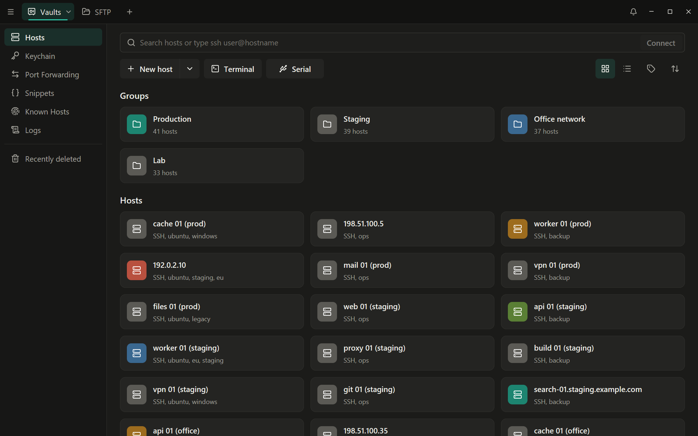
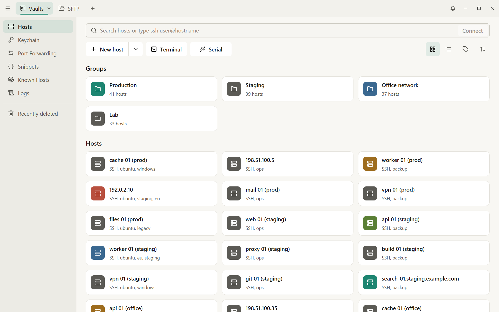
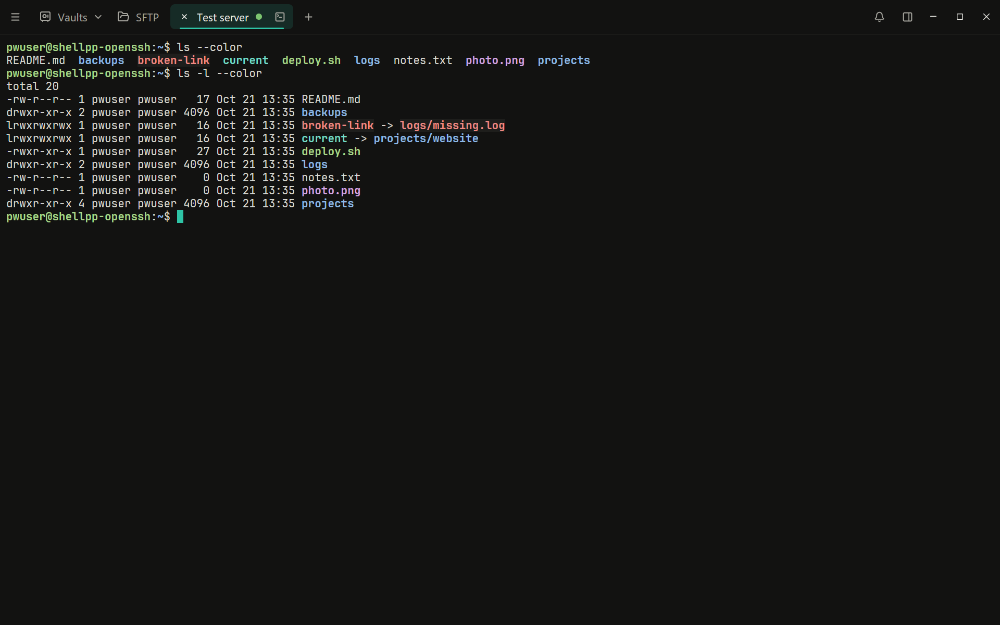
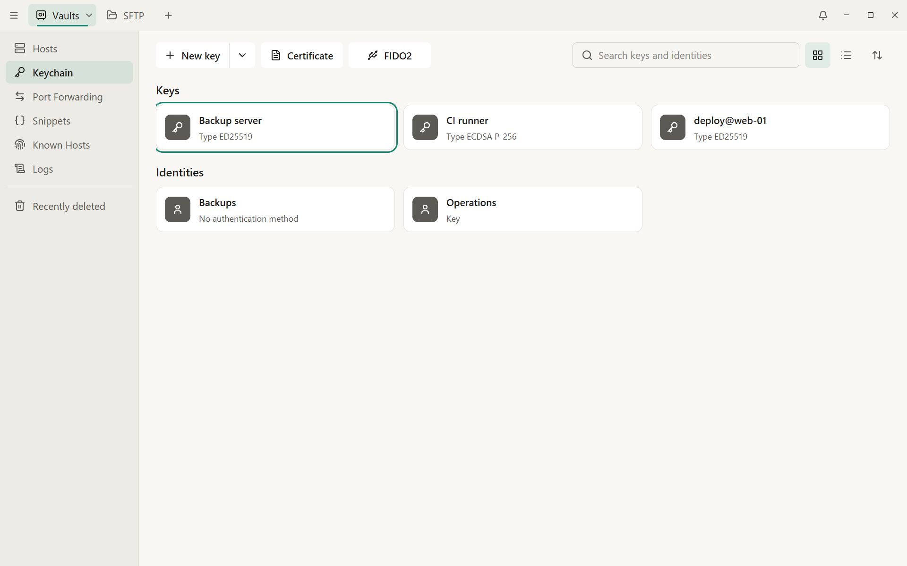

# Shell++

English | [Русский](README.ru.md)

Shell++ is a self-hosted, local-first SSH client for Windows and Linux. It covers hosts and groups, a keychain for SSH keys and identities, a terminal with tabs and split panes, snippets, SFTP, and port forwarding. Sync between devices is optional and end-to-end encrypted, and it runs through a server you host yourself. An Android app is in progress.

| | |
|---|---|
|  |  |
|  |  |

The screenshots show demo data: made-up hosts on documentation addresses and a test SSH server.

## Principles

1. **Local-first.** The app works fully offline, without an account or a server. Sync is optional.
2. **No license checks. No telemetry.** There are no license or subscription checks, trials, tiers, telemetry, phone-home calls or remote feature disabling.
3. **Your data always stays readable and exportable.** If your access to a shared vault is revoked, your account is deleted, you sign out or the server is unreachable, your local copy remains available and exportable. Revoking access only stops future sync. It never wipes or locks data you have already received.
4. **Open export formats.** You can export at any time to JSON (documented schema, plain or encrypted), `~/.ssh/config`, OpenSSH-format keys and `known_hosts`.
5. **Zero-knowledge sync.** The sync server stores only encrypted blobs and sync metadata. Encryption keys never leave the client in plaintext.

## Status

Shell++ 1.0.0-rc.1 is the release candidate of release 1.0, for Windows and Linux ([CHANGELOG.md](CHANGELOG.md)). The desktop app has:

- hosts and groups with tags, search and quick connect (`ssh user@host`), and Recently deleted;
- a keychain: SSH keys (generated or imported), identities, FIDO2 security keys on Windows, a built-in SSH agent, agent forwarding and Known Hosts;
- an SSH terminal with tabs, split panes, workspaces and broadcast input, a local terminal, Telnet and serial connections, highlighting rules, autocomplete from the host's history (off by default), connection logs and session recordings;
- SFTP with a local and a remote panel and a transfer queue;
- port forwarding (local, remote and dynamic), jump hosts and proxies;
- snippets and scripts on many hosts, and optional script generation through an OpenAI-compatible API or a local model you set up yourself (off by default; a description goes only to the address you set);
- import from `~/.ssh/config`, `known_hosts`, PuTTY sessions, CSV and its own JSON; export to JSON (plain or encrypted), `~/.ssh/config`, OpenSSH keys and `known_hosts`;
- sync of your personal vault between devices through your own server ([server/README.md](server/README.md)): end-to-end encrypted, with conflict copies, a recovery key and optional TOTP;
- an update check that only tells you about a new release and checks its signature.

Not in 1.0:

- team vaults, roles and sharing (after 1.0, [docs/ROADMAP.md](docs/ROADMAP.md));
- macOS: there is no Mac to check it on, so there are no macOS builds;
- Mosh (after the first version of the Android app);
- the archive of a previous account: signing in on a device whose vault belongs to another account is refused, and the app says what to do instead;
- FIDO2 security keys on Linux (see Known limitations);
- changing the account's email, and publishing the SSH ID again;
- SSH host certificates: `@cert-authority` lines of `known_hosts` are skipped;
- a theme choice in Settings: the interface follows the system's light or dark mode.

**Linux** builds and passes every test in containers; it has not yet run on a real desktop. If something does not work on yours, please [open an issue](https://github.com/proxyboy228/shellpp/issues).

**Android:** the app is in progress, with versions of its own and no release yet ([docs/mobile/](docs/mobile/README.md)).

**Data formats:** release candidates keep the formats of 1.0, so 1.0.0 opens what 1.0.0-rc.1 wrote. A version older than the data refuses to open it and changes nothing.

## Installing

Releases are on the [Releases](https://github.com/proxyboy228/shellpp/releases) page. Each one has `SHA256SUMS` and a minisign signature of every file; [docs/release.md](docs/release.md#checking-a-download) shows how to check a download with them.

### Windows

1. Download `shellpp-<version>-windows-x64.zip` and check it (above).
2. Unpack it anywhere and run `shellpp.exe`; nothing is installed.
3. The executable is not code-signed, so SmartScreen may warn the first time ("Windows protected your PC"): choose **More info**, then **Run anyway**. That is why the checksums and signatures matter.

There is no installer: the portable zip is the only package (`docs/decisions.md`, D83). Where the data lives on Windows (`docs/storage-format.md`, section 2):

- `%LOCALAPPDATA%\shellpp\`: the encrypted database `shellpp.db`, session recordings in `recordings\`, database backups before upgrades in `backups\`;
- `%LOCALAPPDATA%\shellpp\logs\`: diagnostic logs (no secrets, addresses, user names or terminal text);
- `%LOCALAPPDATA%\shellpp\tmp\`: files opened from SFTP while they are open;
- the Windows Credential Manager: the device key, only while "Remember on this device" is on, and the API keys of script generation, if you saved any (entries named `shellpp`).

To keep everything next to the program (a portable setup), start it with `SHELLPP_DATA_DIR` set to a folder, as `README-portable.txt` in the zip shows. Uninstalling is turning "Remember on this device" off (or deleting the `shellpp` entries in the Credential Manager), then deleting the program's folder and, for the default location, `%LOCALAPPDATA%\shellpp\`.

### Linux

`shellpp-<version>-linux-x64.tar.gz` holds the program `shellpp`, `shellpp.desktop`, the icon `shellpp.png`, `LICENSE`, `THIRD_PARTY_NOTICES.md` and `README-linux.txt`.

What it needs:

- x86-64 with glibc 2.35 or later: Ubuntu 22.04 or later, Debian 12 or later, or another distribution of that age;
- an X11 or Wayland session, a Vulkan driver (Mesa's is enough), and the libraries `libxkbcommon`, `libxkbcommon-x11`, `libxcb`, `libX11-xcb`, `libwayland-client`, `fontconfig` and `freetype`, which desktop distributions already have;
- for "Remember on this device" and saved API keys: a Secret Service provider (GNOME Keyring, KWallet, KeePassXC). Without one the app works, and asks for the master password at every start.

Install for your user:

```sh
tar -xzf shellpp-<version>-linux-x64.tar.gz
cd shellpp-<version>-linux-x64
install -Dm755 shellpp ~/.local/bin/shellpp
install -Dm644 shellpp.desktop ~/.local/share/applications/shellpp.desktop
install -Dm644 shellpp.png ~/.local/share/icons/hicolor/128x128/apps/shellpp.png
```

`~/.local/bin` has to be on your `PATH` for the menu entry to start it. The data lives in `${XDG_DATA_HOME:-~/.local/share}/shellpp/`, the logs in `${XDG_STATE_HOME:-~/.local/state}/shellpp/logs/`, temporary SFTP files in `${XDG_CACHE_HOME:-~/.cache}/shellpp/tmp/`. The device key ("Remember on this device") and saved API keys sit in the Secret Service under the service `shellpp`. To uninstall, turn "Remember on this device" off (or delete those entries), then delete the three installed files and those folders.

### The sync server

The server is optional: the app works without it. A release has it as a Docker image (`shellpp-server-<version>-docker-image.tar.gz`, `docker load -i` it) and as a static Linux binary (`shellpp-server-<version>-linux-x64.tar.gz`). [server/README.md](server/README.md) shows how to install it at home with Docker Compose ([server/deploy/](server/deploy/)), how to reach it from outside (your own domain with Caddy and Let's Encrypt, Cloudflare Tunnel, or only over a VPN), and how to back it up and restore it.

### Updates

Help > **Check for Updates** (and, if you turn it on, a daily check at launch) reads the latest release's manifest and shows a new version only when its minisign signature matches the key built into the app. It downloads and installs nothing: it opens the release page. A release candidate is not offered as an update to a stable version, and builds of a release candidate see no update until 1.0.0 is published ([docs/release.md](docs/release.md#how-the-app-checks-for-updates)).

## Building from source

Prerequisite: the Rust toolchain pinned in `rust-toolchain.toml` (Rust 1.99.1). Install it once with `rustup toolchain install 1.99.1`; inside the repository, `cargo` then uses it automatically. On Linux, also the development packages GPUI links (the list is in `tests/linux/Dockerfile`).

Normal development build, with your permanent profile:

```sh
cargo run -p shellpp-desktop
```

The permanent profile is the data directory from [docs/storage-format.md](docs/storage-format.md), section 2.1:

- Windows: `%LOCALAPPDATA%\shellpp\`
- Linux: `${XDG_DATA_HOME:-~/.local/share}/shellpp/`

Test data in a temporary folder (300 hosts, 5 groups, some hosts with tags and colors):

```sh
cargo run -p shellpp-desktop --features dev-tools -- --demo
```

- It creates a new folder `shellpp-demo-<random>` in the system temporary directory, on Windows `%TEMP%\shellpp-demo-<random>\`, and prints its path to the console.
- It unlocks the demo data automatically and deletes the folder when the app exits.
- It never touches the permanent profile.

To use another data folder, set the `SHELLPP_DATA_DIR` environment variable, for example in PowerShell:

```powershell
$env:SHELLPP_DATA_DIR = "D:\shellpp-data"; cargo run -p shellpp-desktop
```

The variable stays set until the PowerShell session ends; `Remove-Item Env:SHELLPP_DATA_DIR` returns to the permanent profile.

The Windows package is built by `scripts\package-windows.ps1`; how releases are built and signed is in [docs/release.md](docs/release.md).

## Known limitations

- **Windows:** the executable is not code-signed (D7), so SmartScreen may warn once. Flags (regional indicator emoji) are drawn as two letters: Windows has no flag glyphs (D210). In the local panel of SFTP, renaming a file to the same name in another case (`readme` to `README`) is refused as "already there" (D224).
- **Linux:** checked in containers, not yet on a real desktop. FIDO2 security keys do not sign on Linux in 1.0: the release is built without the USB HID support that nobody could check with a real key yet (D173). Without a Secret Service provider there is no "Remember on this device" (D5).
- **Terminal:** an emoji with the emoji presentation selector (VS16) takes two cells, so a program that counts it as one can put the cursor one column off; the cells after an emoji sequence stay blank (D92, D206). More in [docs/compatibility.md](docs/compatibility.md).
- **SFTP:** a file or folder name on the server that is not valid UTF-8 is shown with the replacement character `�` (U+FFFD) and cannot be opened, renamed or downloaded; a folder transfer leaves it out and lists it at the end. The SFTP library decodes names that way (D45, D50).
- **Port forwarding rules, scripts on many hosts and "Export to host"** connect without a tab: until their dialogs exist, they reach only hosts whose key is already in Known Hosts and log in with saved credentials, the agent or key files only (D61).
- **Dates** are shown in the ISO format (`2026-10-21 18:04`) in the local time zone; the system's date format is not used (D210).
- **Sync:** one personal vault per account; team vaults come after 1.0. The known limits of the server (sign-in limits counted in memory, the size of a push answer) are in [docs/ROADMAP.md](docs/ROADMAP.md), section 2.2, and [docs/security.md](docs/security.md), section 17.

The D-numbers are entries of [docs/decisions.md](docs/decisions.md).

## Documentation

- [docs/guide/](docs/guide/README.md): the user guide.
- [CHANGELOG.md](CHANGELOG.md): what each release holds.
- [docs/release.md](docs/release.md): how releases are built, signed and checked.
- [SPEC.md](SPEC.md): product specification, covering scope, principles, data model, security and sync.
- [docs/ui-behavior-spec.md](docs/ui-behavior-spec.md): how screens, controls and user flows behave.
- [docs/design-system.md](docs/design-system.md): visual language, design tokens and components.

The specifications were originally written in Russian. The Russian originals are in [docs/ru/](docs/ru/):
[SPEC.md](docs/ru/SPEC.md), [ui-behavior-spec.md](docs/ru/ui-behavior-spec.md), [design-system.md](docs/ru/design-system.md).

Design documents:

- [docs/decisions.md](docs/decisions.md): the decisions taken during development, numbered.
- [docs/architecture.md](docs/architecture.md): components, process model and dependency policy.
- [docs/data-model.md](docs/data-model.md): entities, fields and sync behavior.
- [docs/storage-format.md](docs/storage-format.md): on-disk format, encryption envelope and export formats.
- [docs/data-format.md](docs/data-format.md): the on-disk format version 1 as implemented now.
- [docs/sync-protocol.md](docs/sync-protocol.md): the end-to-end encrypted sync protocol.
- [docs/security.md](docs/security.md): threat model and security controls.
- [docs/ROADMAP.md](docs/ROADMAP.md): the state of the project and what comes next.

## Stack

- Desktop app: [GPUI Kit](https://crates.io/crates/gpui-kit), a native Rust UI without a webview.
- Terminal: alacritty_terminal with our own GPUI element.
- SSH and SFTP: russh (with two patches in `third_party/russh`) and russh-sftp; keys through ssh-key.
- Local storage: SQLite with record-level encryption (XChaCha20-Poly1305, keys from Argon2id), the device key in the OS keychain.
- Sync: HTTPS with rustls; the server in Rust (axum) with SQLite or PostgreSQL, shipped as a Docker image and a static binary.
- Android (in progress): Kotlin screens over the same Rust core through JNI.

## Clean-room statement

Shell++ is an independent implementation written from its own specifications. It is not affiliated with, endorsed by, or derived from any commercial product. It contains no code, assets, binaries, network protocols, storage formats or UI texts of any proprietary client.

Contributions must follow the same rules. See [Clean-room rules](CONTRIBUTING.md#clean-room-rules) in CONTRIBUTING.md.

## Contributing

Contributions are welcome. Read [CONTRIBUTING.md](CONTRIBUTING.md) before opening an issue or a pull request. All participants are expected to follow the [Code of Conduct](CODE_OF_CONDUCT.md).

## Security

Do not report security vulnerabilities in public issues. Report them privately as described in [SECURITY.md](SECURITY.md).

## License

Shell++ uses two licenses:

- The sync server in [`server/`](server/) is licensed under the
  [GNU Affero General Public License v3.0 only](server/LICENSE)
  (`AGPL-3.0-only`). Anyone who runs a modified server for others must
  publish their changes.
- Everything else, including the desktop app and the shared crates, is
  licensed under the [Apache License 2.0](LICENSE) (`Apache-2.0`).

Third-party components are listed in
[THIRD_PARTY_NOTICES.md](THIRD_PARTY_NOTICES.md) and, for the server, in
[server/THIRD_PARTY_NOTICES.md](server/THIRD_PARTY_NOTICES.md).
