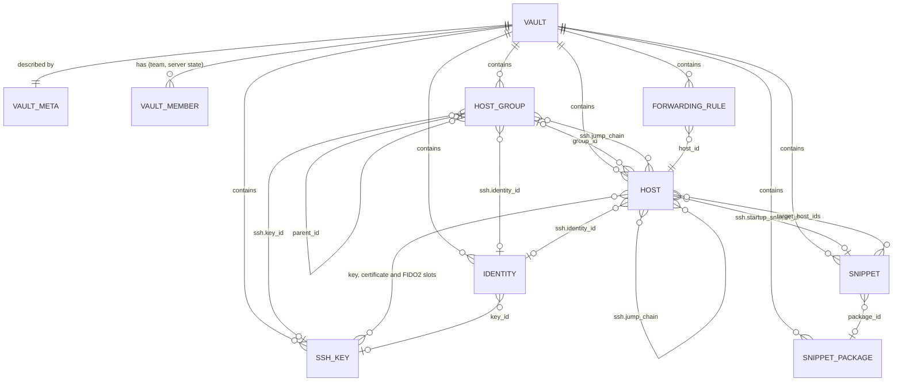

# Data model

This document defines every entity that Shell++ stores or shows: its fields, types, defaults and constraints, the references between records, group inheritance and how each entity syncs. The payload JSON Schema and the export JSON Schema are one schema (written in stage 3, D1), generated from the tables below.

Related documents:

- [architecture.md](architecture.md): components, identifiers, process and window model.
- [storage-format.md](storage-format.md): record envelope, payload wrapper, padding, local SQLite schema, recordings, temporary files, export formats, terminal theme JSON.
- [sync-protocol.md](sync-protocol.md): HLC, revisions, push and pull, conflict resolution algorithm, key epochs, role enforcement, invitations.
- [security.md](security.md): key hierarchy, fingerprints, recovery key format, history capture heuristics, threat model.
- [decisions.md](decisions.md): accepted decisions, cited as D1–D26.

Conventions:

- "UI x.y" is section x.y of [ui-behavior-spec.md](ui-behavior-spec.md), "SPEC" is [SPEC.md](../SPEC.md), and a bare "section x" is a section of this document.
- "(stage 0 decision)" marks a choice made while writing the stage 0 documents that is not in the specifications or the accepted decisions. A heading marked this way covers its whole section. In field tables, a default, limit or rule without a cited source is a stage 0 decision.
- "[decision] (D93)" marks what was added from the owner's answers to the sync design draft (D93, 2026-10-22). The answers are the owner's; the details that carry them out are ours and can be changed, as D93 lists. A heading marked this way covers its whole section.

## 1. Notation

### 1.1 Field types

| Notation | Meaning |
|---|---|
| `uuid` | UUID text, lowercase and hyphenated (RFC 9562). Record ids, vault ids and file ids are UUIDv7. |
| `ref(T)` | `record_id` of a record of type `T` in the same vault (section 3.4) |
| `host_link` | object `{"vault_id": uuid, "record_id": uuid}` that points at a `host` in any vault (section 3.4) |
| `string(n)` | single line: NFC-normalized, leading and trailing whitespace trimmed, 1 to n Unicode scalar values, no control characters |
| `text(n)` | multi-line: at most n UTF-8 bytes, LF line endings, no control characters except LF and TAB |
| `secret(n)` | stored exactly as entered (no trimming, no normalization), at most n UTF-8 bytes, no NUL |
| `int[a..b]` | integer in the closed range a to b |
| `bool` | `true` or `false` |
| `timestamp` | RFC 3339 UTC with milliseconds, for example `2026-10-18T22:31:05.123Z` |
| `b64u(n)` | n bytes as base64url without padding |
| `enum` | one of the listed lowercase strings |
| `list<T>[n]` | JSON array of at most n items |
| `T?` | optional: the member may be absent; absent and `null` mean the same |

The "Req" column: "yes" means the field must hold a valid value before the record is created (section 2.1); "no" means optional.

### 1.2 JSON rules

- Field names are snake_case. The only exception is the terminal theme object, which keeps the camelCase names of D25 (section 14.1).
- Writers omit members whose value is `null` and write every other member they know. Readers treat a missing member as its default.
- Writers keep `data` members they do not know when they rewrite a record; unknown types and newer payload versions are kept unchanged and never rewritten ([storage-format.md](storage-format.md), section 5.6).
- Equality of two `data` objects (used by conflict resolution) is deep JSON equality after dropping `null` members; member order carries no meaning.
- A record whose serialized payload exceeds 262 143 bytes cannot be saved ([storage-format.md](storage-format.md), section 5.3). The field limits below keep normal records far below this.

## 2. Records: lifecycle, classes and types

### 2.1 Lifecycle

- **Draft** (UI 1.3, D20): a new object is held in memory until all its required fields are valid; only then is the first record version written. Closing the panel discards a draft. An invalid value is not saved, and the last valid value stays in effect.
- **Autosave** (UI 1.3, UI 3.2): after creation, changes are written automatically, debounced by 500 ms. Each write is a new revision with a new HLC ([sync-protocol.md](sync-protocol.md)).
- **Remove with undo** (UI 2.4): removal writes the tombstone at once. Undo writes the last live `data` back under the same `record_id` with a fresh HLC (stage 0 decision). The undo lasts 5 seconds; after it the record stays 90 days in Recently deleted on each device (section 16.6). [decision] (D93)
- **Read-only vaults**: nothing is written to an archived vault (D14), and nothing is written to a team vault where the user is a viewer except the viewer's own published connection log copies (D15, section 13.3). Their objects open read-only; actions that only read (connect, copy to the personal vault, export) stay available.
- **Type restrictions**: a record whose type is not allowed in its vault kind (section 2.3) is ignored on read and never written. The server enforces only the class rules (section 2.2).
- **Singletons** (`vault_meta`, `user_keypair`, `ssh_id`, `recovery_key`): at most one live record per vault. If concurrent creation leaves several live ones, the one with the greatest (`hlc`, `device_id`) is effective, and the next client allowed to write it tombstones the others (stage 0 decision).
- **Locked app**: no record is written while locked; data produced meanwhile is written after unlock ([storage-format.md](storage-format.md), section 4.6).

### 2.2 Record classes

The class is the clear-text u8 in the envelope and the unit of the server's class filter (D10, D15).

| Code | Class | Sync toggle (UI 12.2) | Default | Allowed in team vaults |
|---|---|---|---|---|
| `0x01` | `vault` | none: always synced | on | yes, `vault_meta` only |
| `0x02` | `hosts` | Hosts and groups | on | yes |
| `0x03` | `keys` | Keys and identities | on | yes |
| `0x04` | `snippets` | Snippets | on | yes |
| `0x05` | `forwarding` | Forwarding rules | on | yes |
| `0x06` | `history` | Command history | off | no |
| `0x07` | `connection_log` | Connection log | off | yes, append-only |
| `0x08` | `known_hosts` | Known hosts | on | no |
| `0x09` | `appearance` | Custom terminal themes; Keyword highlighting rules (two toggles, section 17) | on | no |
| `0x0A` | `workspaces` | Workspaces | on | no |

Codes `0x00` and `0x0B`–`0xFF` are reserved. Role rules per class are in [sync-protocol.md](sync-protocol.md).

### 2.3 Record types

Type code = u16 `class << 8 | kind`, inside the ciphertext. Kind `0x00` and `0xF0`–`0xFE` are reserved; `0xFF` is the conflict copy of that class. Names and codes are frozen once released. The payload carries the name, and its class must equal the envelope class. "v" is the current payload version of the type ([storage-format.md](storage-format.md), section 5.6).

| Code | Type | v | Vault kinds | Section |
|---|---|---|---|---|
| `0x0101` | `vault_meta` | 1 | personal, team | 6.1 |
| `0x0102` | `user_keypair` | 1 | personal | 6.5 |
| `0x0103` | `ssh_id` | 1 | personal | 6.6 |
| `0x0104` | `recovery_key` | 1 | personal | 6.7 |
| `0x0105` | `member_pin` | 1 | personal | 6.3 |
| `0x0106` | `device_info` | 1 | personal | 6.4 |
| `0x0107` | `roster_entry` | 1 | personal | 6.8 |
| `0x0201` | `host` | 1 | personal, team | 7.2 |
| `0x0202` | `group` | 1 | personal, team | 7.1 |
| `0x0203` | `credential_binding` | 1 | personal | 7.7 |
| `0x0301` | `key` | 1 | personal, team | 9.1 |
| `0x0302` | `identity` | 1 | personal, team | 9.4 |
| `0x0401` | `snippet` | 1 | personal, team | 10.1 |
| `0x0402` | `snippet_package` | 1 | personal, team | 10.2 |
| `0x0501` | `forwarding_rule` | 1 | personal, team | 11 |
| `0x0601` | `history_entry` | 1 | personal | 13.1 |
| `0x0602` | `history_hint_state` | 1 | personal | 13.2 |
| `0x0701` | `connection_log_entry` | 1 | personal, team | 13.3 |
| `0x0801` | `known_host` | 1 | personal | 9.5 |
| `0x0901` | `terminal_theme` | 1 | personal | 14.1 |
| `0x0902` | `highlight_rule` | 1 | personal | 14.2 |
| `0x0A01` | `workspace` | 1 | personal | 12 |
| `0x0A02` | `last_session` | 1 | personal | 16.3 |
| `0xNNFF` | `conflict` | 1 | as the original | 15 |

## 3. Common fields and references

### 3.1 Envelope and payload

Every entity except VaultMember, SessionRecording and the local-only data of section 16 is a record, also in local mode. Its envelope (clear) and payload wrapper are defined in [storage-format.md](storage-format.md), sections 5.1 and 5.5:

| Where | Field | Meaning |
|---|---|---|
| envelope, clear | `vault_id`, `record_id` | UUIDv7. A record's identity is the pair (`vault_id`, `record_id`), and `record_id` is also unique across all vaults on a device: a pulled record that reuses the id of a record in another vault is rejected ([sync-protocol.md](sync-protocol.md), section 6.4) |
| envelope, clear | `class`, `revision`, `key_epoch`, tombstone flag | section 2.2; revision u64 starting at 1 |
| payload | `v`, `type` | section 2.3 |
| payload | `hlc`, `device_id` | clock and device of the last semantic change ([sync-protocol.md](sync-protocol.md)) |
| payload | `data` | the type's fields, defined in this document; absent in a tombstone |
| payload | `deleted` | `true` only in a tombstone |
| local only | `synced_revision`, `server_seq`, `tombstoned_at`, `base_envelope` | sync bookkeeping ([storage-format.md](storage-format.md), section 4.6) |

### 3.2 Derived values

These are computed when needed and never stored (stage 0 decision):

- **Created at**: the timestamp of the UUIDv7 `record_id`. A move or copy to another vault creates a new record, so its creation time is the time of the move (D13). Used by "sort by creation date" (UI 7.1) and "date added" (UI 10.1).
- **Modified at**: the milliseconds part of `hlc`. Used by "sort by modification date".
- Key algorithm, key size, SHA256 fingerprints, certificate details, snippet variables, counts on group cards, effective (inherited) values, identity authentication method, rule summaries and recent connections, as described per entity.

### 3.3 Common data members

| Field | Type | Req | Notes |
|---|---|---|---|
| `import_key` | string(512)? | no | Allowed in `group`, `host`, `key`, `identity`, `snippet`, `snippet_package`, `forwarding_rule`, `workspace`. The source key of an import (D21, section 18.4). Kept on edit; dropped by Duplicate. |

### 3.4 References

- **Same-vault references** (`ref(T)`): structural links such as a host's group, identity, keys, jump hosts and startup snippet. The target is a record of type `T` in the same vault. They are written as `record_id` text.
- **Host links** (`host_link`): used only by personal-only types to point at a host in any vault the device holds: `workspace`, `history_entry`, `history_hint_state` and `connection_log_entry` (the personal copy). `credential_binding` points at its target, a host or a group in a team vault, with a `record_link` (D13). A link only names the host; the connection uses that host's own settings (stage 0 decision).
- **Missing target**: the target is absent, tombstoned, of the wrong type, or in a vault the device does not hold. The UI shows "missing", never an error. Missing references are not removed automatically (principle 3); for inheritance see section 8.
- **No cascades**: removing a record does not remove or rewrite records that reference it, except for the rules in sections 7.1 (group removal), 13.4 (recordings) and 18 (moves and merges).
- `credential_binding` is the only cross-vault link that changes how a connection authenticates (D13).

### 3.5 Shared value types

| Type | Shape and rules |
|---|---|
| `tag` | string(64) without commas. Compared case-insensitively (Unicode simple case folding) for filtering and de-duplication; the first spelling seen is shown. A tag list holds at most 32 unique tags. |
| `tag_color` | enum: `graphite` (default), `jade`, `amber`, `coral`, `plum`, `moss`, `ocean`, `rose`. Shown with the token `--tag-<name>` ([design-system.md](design-system.md), 3.1). |
| `order_key` | manual order key (section 18.1) |
| `theme_ref` | `{"builtin": "<slug>"}` or `{"record_id": "<uuid>"}`, exactly one member. Built-in slugs are the file names in `apps/desktop/src/theme/terminal/` without `.json`: `graphite` (default dark) and `paper` (light), then the bundled open schemes of [design-system.md](design-system.md), 4.4: `dracula`, `nord`, `solarized-dark`, `solarized-light`, `gruvbox-dark`, `tokyo-night`, `catppuccin-mocha`, `catppuccin-latte`. A `record_id` names a `terminal_theme` in the personal vault. |
| `env_var` | `{"name": string, "value": secret(1024)}`; `name` matches `[A-Za-z_][A-Za-z0-9_]{0,255}` |
| `record_link` | `{"vault_id": uuid, "record_id": uuid}` naming any record; `host_link` is a `record_link` to a host |

## 4. Entity overview

"Personal sync" is the default of the per-device toggle for the personal vault. Team vaults always sync every type they may hold (D15).

| Entity | Stored as | Class | Vault kinds | Personal sync | UI |
|---|---|---|---|---|---|
| Vault | local `vaults` row + `vault_meta` | `vault` | both | always | 1.1, 2.2, 3.1, 12.3 |
| VaultMember | server state, memory | none | team | not stored | 2.2, 12.3 |
| Member pin | `member_pin` | `vault` | personal | always | 12.3 |
| Roster entry | `roster_entry` | `vault` | personal | always | 12.3 |
| Device info | `device_info` | `vault` | personal | always | 11.1 |
| UserKeypair | `user_keypair` | `vault` | personal | always | 12.3 (fingerprint) |
| SshId | `ssh_id` | `vault` | personal | always | 7.2, 12.3 |
| Recovery key | `recovery_key` | `vault` | personal | always | 13.1, 13.4 |
| Group | `group` | `hosts` | both | on | 2.2, 2.3, 3.4 |
| Host | `host` | `hosts` | both | on | 2.1–2.4, 3.1–3.3, 4.1, 6 |
| Credential binding | `credential_binding` | `hosts` | personal | on | 2.6, 3.1, 12.3 |
| Key | `key` | `keys` | both | on | 3.1, 7.1–7.3 |
| Certificate | inside `key` | `keys` | both | on | 7.1, 7.3 |
| FIDO2 key | `key` with an `sk-` algorithm | `keys` | both | on | 7.1 |
| Identity | `identity` | `keys` | both | on | 3.1, 7.1, 7.2, 7.4 |
| KnownHost | `known_host` | `known_hosts` | personal | on | 10.1, 10.2 |
| Snippet | `snippet` | `snippets` | both | on | 4.2, 9.1–9.4 |
| SnippetPackage | `snippet_package` | `snippets` | both | on | 9.1, 9.2 |
| ForwardingRule | `forwarding_rule` | `forwarding` | both | on | 8.1–8.4 |
| Workspace | `workspace` | `workspaces` | personal | on | 4.5, 6 |
| HistoryEntry | `history_entry` | `history` | personal | off | 4.2, 9.1, 12.4 |
| History hint state | `history_hint_state` | `history` | personal | off | 4.2 |
| ConnectionLogEntry | `connection_log_entry` | `connection_log` | personal; team copies | off | 6, 11.1, 11.2, 12.3, 12.6 |
| SessionRecording | file + reference in the log entry | none | none | never synced | 11.2, 12.6 |
| TerminalTheme | `terminal_theme` (imported themes only) | `appearance` | personal | on | 3.1, 4.2, 12.4 |
| HighlightRule | `highlight_rule` | `appearance` | personal | on | 12.4 |
| Conflict record | `conflict` | the original's | as the original | with its class | 2.3, 12.2, 13.6 |
| Settings | `local_settings` | none | none | never synced (D15) | 12.1–12.7, 13.4 |
| SyncSettings | `local_settings` | none | none | per device | 12.2, 12.3 |
| Last session | `last_session` (16.3) | `workspaces` | personal | never synced | 4.7, 6 |
| Notification | memory | none | none | never stored | 1.5, 5.4 |

## 5. Entity-relationship overview

Records inside one vault (personal or team). All arrows are same-vault references.



Records that exist only in the personal vault, and the links that may cross vaults. `ANY_HOST` is a host in the personal vault or in a team vault; `PERSONAL_HOST` is a host in the personal vault.

```mermaid
erDiagram
    PERSONAL_VAULT ||--|| RECOVERY_KEY : holds
    PERSONAL_VAULT ||--o| USER_KEYPAIR : "holds after registration"
    PERSONAL_VAULT ||--o| SSH_ID : "holds after registration"
    PERSONAL_VAULT ||--|{ DEVICE_INFO : "one per device"
    PERSONAL_VAULT ||--o{ MEMBER_PIN : holds
    PERSONAL_VAULT ||--o{ ROSTER_ENTRY : holds
    PERSONAL_VAULT ||--o{ CREDENTIAL_BINDING : holds
    PERSONAL_VAULT ||--o{ KNOWN_HOST : holds
    PERSONAL_VAULT ||--o{ TERMINAL_THEME : holds
    PERSONAL_VAULT ||--o{ HIGHLIGHT_RULE : holds
    PERSONAL_VAULT ||--o{ WORKSPACE : holds
    PERSONAL_VAULT ||--o{ HISTORY_ENTRY : holds
    PERSONAL_VAULT ||--o{ HISTORY_HINT_STATE : holds
    PERSONAL_VAULT ||--o{ CONNECTION_LOG_ENTRY : holds
    CREDENTIAL_BINDING }o--|| TEAM_HOST_OR_GROUP : "target"
    CREDENTIAL_BINDING }o--|| PERSONAL_CREDENTIAL : "identity, key or SSH ID"
    WORKSPACE }o--o{ ANY_HOST : "host links"
    HISTORY_ENTRY }o--o| ANY_HOST : "host link"
    HISTORY_HINT_STATE }o--|| ANY_HOST : "host link"
    CONNECTION_LOG_ENTRY }o--o| ANY_HOST : "host link"
    CONNECTION_LOG_ENTRY ||--o| SESSION_RECORDING : "recording_file_id"
    PERSONAL_HOST }o--o| TERMINAL_THEME : "terminal_theme"
    MEMBER_PIN }o--|| VAULT_MEMBER : "server_url and user_id"
    ROSTER_ENTRY }o--|| VAULT_MEMBER : "server_url, vault_id and user_id"
```



A `conflict` record references any record of its class by `original_record_id` (section 15). A connection log entry in a team vault links to a host of that vault.

## 6. Vaults and account records

### 6.1 Vault

A vault is the unit of storage, encryption and sharing (D13): exactly one active `personal` vault per install, and any number of `team` vaults. Its bookkeeping is a local `vaults` row ([storage-format.md](storage-format.md), section 4.3); its name and color are in its `vault_meta` record.

| Field | Where | Type | Req | Default | Notes |
|---|---|---|---|---|---|
| `vault_id` | `vaults`, envelope | uuid | yes | | UUIDv7, generated by the client |
| `kind` | `vaults` | enum `personal`, `team` | yes | | |
| `status` | `vaults` | enum `active`, `archived` | yes | `active` | `archived`: read-only local archive of a team vault after access was lost, the vault was deleted, the user logged out or deleted the account (D14). The personal vault is never archived: after log out or account deletion it stays `active` with `bound = false` (local-only). The one exception is the old personal vault of an earlier account, left behind when the device binds to another account (section 18.5). |
| `role` | `vaults` | enum `owner`, `editor`, `viewer`? | team only | | from the server; null for the personal vault |
| `current_epoch` | `vaults` | int ≥ 1 | yes | 1 | [sync-protocol.md](sync-protocol.md) |
| `bound` | `vaults` | bool | yes | `false` | syncing with the bound account |
| `account_user_id`, `server_url` | `vaults` | uuid?, string(2048)? | no | | the account and normalized server origin the vault was last bound to; set at binding, kept when the vault is archived or unbound, so an archived team vault of an earlier account still opens its HPKE wrap, whose `info` names that `user_id` ([storage-format.md](storage-format.md), sections 4.2 and 14.5). [decision] (D93; Choice 4 (a)) |
| `name` | `vault_meta` | string(64) | yes | `Personal` for the personal vault | shown in the switcher (UI 1.1) and the Vault fields |
| `color` | `vault_meta` | tag_color? | no | `graphite` | |

- `vault_meta` is written by the user in the personal vault and by owners in a team vault; the creator writes it when the vault is created.
- An archived vault offers Export and "Copy to personal vault" (D14). Nothing in it is deleted automatically (principle 3).

### 6.2 VaultMember

Server state of a team vault, read with the members endpoint ([sync-protocol.md](sync-protocol.md)) and kept in memory only, because the local database holds no plaintext emails other than the account's own (stage 0 decision). Avatars and the member list (UI 2.2, 12.3) show the last list fetched in this run and are hidden before the first successful fetch.

| Field | Type | Notes |
|---|---|---|
| `user_id` | uuid | server-generated |
| `email` | string(320) | normalized |
| `role` | enum `owner`, `editor`, `viewer` | a vault can have several owners (D14) |
| `added_by`, `added_at` | uuid, timestamp | |
| `x25519_public_key` | b64u(32) | |
| `ssh_id_public_key` | string(512) | |
| fingerprint | derived | format in [security.md](security.md) |
| pin state | derived | `unpinned`, `pinned`, `verified` or `changed`, from `member_pin` (section 6.3) |
| roster state | derived | `accepted`, `seen`, `removed` or none, from `roster_entry` (section 6.8) |

### 6.3 Member pin (`member_pin`)

TOFU pin of another user's X25519 public key (D14). One per (`server_url`, `user_id`).

| Field | Type | Req | Default | Notes |
|---|---|---|---|---|
| `server_url` | string(2048) | yes | | normalized https origin of the server |
| `user_id` | uuid | yes | | |
| `x25519_public_key` | b64u(32) | yes | | |
| `email` | string(320) | yes | | email at pin time |
| `verified` | bool | no | `false` | set after a fingerprint comparison out of band: an owner's invitation confirmation, a confirmation in the recipient dialog, an explicit accept in an epoch warning that asked for the comparison, or a manual mark in Team (UI 12.3) |
| `origin` | enum `invitation_accept`, `seen` | no | `seen` | how the key was first pinned (stage 0 decision): `invitation_accept` when this account accepted an invitation whose dialog showed the inviter's fingerprint, `seen` for every other first sight (a member list, `GET /v1/users/{id}/keys`, the owner's invitation list), on any device and for any vault |

- Duplicate live pins for one pair must carry the same key; `verified` is true if any of them is, and `origin` is `invitation_accept` if any of them says so. Different keys are treated as a key change: wrapping and opening are blocked and a warning is shown ([sync-protocol.md](sync-protocol.md)).
- Accepting a changed key (Team, UI 12.3) rewrites the pin with the new key, `verified = false` and `origin = seen`.
- Only a pin with `verified = true` makes an `accepted` roster user a rotation recipient (section 6.8). Only a pin with `verified = true` or `origin = invitation_accept` lets a device that holds no earlier key of a vault open its first wrap from that user without a fingerprint comparison ([sync-protocol.md](sync-protocol.md), section 7.7). (stage 0 decision)
- Excluded from the plain export ([storage-format.md](storage-format.md), section 13.2).

### 6.4 Device info (`device_info`)

One record per device that uses the personal vault. Written at first run and at sign-in; never deleted when a device is revoked, so log entries keep their device name.

| Field | Type | Req | Default | Notes |
|---|---|---|---|---|
| `device_id` | uuid | yes | | equals `meta.device_id` of that device |
| `name` | string(64) | yes | the OS computer name, else `<Platform> device` | shown under the user in the log (UI 11.1) |
| `platform` | enum `windows`, `macos`, `linux`, `ios`, `android` | yes | | |
| `app_version` | string(32) | yes | | semver; rewritten on the first unlock after an update |

### 6.5 UserKeypair (`user_keypair`)

Singleton, created at registration (D13); absent on a device that was never bound to an account. After log out it stays as a record of that account and is never carried into another account (section 18.5). Excluded from the plain export.

| Field | Type | Req | Notes |
|---|---|---|---|
| `private_key` | b64u(32) | yes | X25519 secret |
| `public_key` | b64u(32) | yes | must equal the account's published key |

Rotation is not in the MVP.

### 6.6 SshId (`ssh_id`)

Singleton, created at registration (D13): the user's own Ed25519 key for team hosts and any host.

| Field | Type | Req | Notes |
|---|---|---|---|
| `private_key` | secret(4096) | yes | OpenSSH private key, unencrypted (the vault protects it) |
| `public_key` | string(512) | yes | `ssh-ed25519 <base64> shellpp:<email>`; the comment is not changed by an email change |

- Shown in Keychain as a read-only key card (UI 7.2) and in SSH ID (UI 12.3).
- Regenerating writes a new key pair as a new revision of the same record, then publishes the public key ([sync-protocol.md](sync-protocol.md)).
- After concurrent regenerations, the device that wrote the winning version publishes its public key again when the server's differs ([sync-protocol.md](sync-protocol.md), section 5.6). [decision] (D93)
- May be referenced wherever a key is accepted in the personal vault: `ssh.key_id` of hosts and groups, `identity.key_id`, and `credential_binding` (stage 0 decision).

### 6.7 Recovery key (`recovery_key`)

Singleton, created at first run, also without an account (D11). Registration on a device whose personal vault was bound to an earlier account creates a new one in the new personal vault (section 18.5). Shown after password re-entry (UI 13.4). Excluded from the plain export.

| Field | Type | Req | Notes |
|---|---|---|---|
| `recovery_key` | b64u(32) | yes | the 32-byte key; displayed in the format of [security.md](security.md) |
| `issued_at` | timestamp | yes | |

Reissue (UI 13.4) replaces both fields in the same record; with an account, the new revision is committed in the same server transaction as the new recovery verifier ([sync-protocol.md](sync-protocol.md), section 5.3).

- Every device builds its local `recovery` key wrap from this record and rebuilds it whenever a new revision is applied ([storage-format.md](storage-format.md), section 6.2).

### 6.8 Roster entry (`roster_entry`)

(stage 0 decision; rules in [security.md](security.md), section 5.7, and [sync-protocol.md](sync-protocol.md), section 7.1)

The client's own record of who belongs to a team vault, kept so that the server's member list alone can never add a recipient of a vault key. One per (`server_url`, `vault_id`, `user_id`); the account itself has no entry. The user's key is in its `member_pin`, not here.

| Field | Type | Req | Default | Notes |
|---|---|---|---|---|
| `server_url` | string(2048) | yes | | normalized https origin of the server |
| `vault_id` | uuid | yes | | a team vault |
| `user_id` | uuid | yes | | another user of that vault |
| `status` | enum `accepted`, `seen`, `removed` | yes | | below |
| `role` | enum `owner`, `editor`, `viewer`? | no | | the last role seen in a member list or set by this account |
| `epoch` | int ≥ 1? | no | | only for `accepted`: the vault epoch this account last wrapped to that user. Set at invitation confirmation, and for every recipient of a rotation this account makes, in the same local transaction that stores that epoch |
| `epoch_commit` | b64u(16)? | no | | only for `accepted`: the first 16 bytes of HKDF(`vault_key[v, epoch]`, `"shellpp/v1/roster-epoch"` ‖ `vault_id` ‖ `be32(epoch)`) ([security.md](security.md), section 5.5). Written wherever `epoch` is written (invitation confirmation, a confirmation in the recipient dialog, rule 5 of the rotation recipient rules in [sync-protocol.md](sync-protocol.md), section 7.7). It ties `accepted` to the key of that epoch, because the same epoch number can name different keys on two forks of an active server's view (stage 0 decision) |
| `checklist_hidden` | bool | no | `false` | only for `removed`: the "Secrets to change" list of this removal is hidden ([security.md](security.md), section 15) |

| Status | Set by | Effect |
|---|---|---|
| `seen` | a member list names a user without an entry, or an explicit accept of a `removed` sender in an epoch warning | the role is cached; the user is not a recipient of automatic rotations |
| `accepted` | an invitation confirmation made on one of this account's devices, or an explicit accept after a fingerprint comparison in the recipient dialog | the user may be a recipient of automatic rotations while `epoch` equals the vault's current epoch, `epoch_commit` matches the key this device holds for that epoch and the user's `member_pin` has `verified = true`. With an unverified pin the user needs a new confirmation in the recipient dialog; with an older `epoch` or a non-matching `epoch_commit` it is "not confirmed for the current epoch" ([sync-protocol.md](sync-protocol.md), section 7.7) |
| `removed` | this account removed the user, or a fetched member list no longer names a user whose entry is `seen` or `accepted` | the user's wraps are refused for this vault and it is never an automatic recipient; only an explicit accept changes the status (to `accepted` in the recipient dialog, to `seen` in an epoch warning), even when the server lists the user again |

- `role` is updated from member lists while the status is not `removed`.
- Duplicate live entries for one triple: the effective status is `removed` if any entry says so, else `accepted` if any entry says so, else `seen`; the role comes from the entry with the greatest (`hlc`, `device_id`), and `epoch` and `epoch_commit` come from the entry that says `accepted` with the highest `epoch`, preferring, among entries with that epoch, one whose `epoch_commit` matches the key this device holds. The next client that writes the entry (with the status it decided, an explicit accept included) keeps one record and tombstones the others.
- Two versions of one entry in a sync conflict: under rule 5 of [sync-protocol.md](sync-protocol.md), section 6.7, the version that says `removed` wins over one that does not, whatever the stamps (stage 0 decision).
- The time of the change to `removed` (from the entry's HLC) is the removal time used by the "Secrets to change" list.
- Kept when the vault is archived. Excluded from the plain export ([storage-format.md](storage-format.md), section 13.2).

## 7. Hosts and groups

### 7.1 Group (`group`)

Nested folder of hosts and groups with inheritable SSH settings (SPEC "Hosts", D20). UI 2.2, 2.3, 3.4.

| Field | Type | Req | Default | Notes |
|---|---|---|---|---|
| `name` | string(256) | yes | | the only required field (UI 3.4) |
| `parent_id` | ref(group)? | no | top level | section 7.1 rules |
| `color` | tag_color? | no | `graphite` | UI 3.4 |
| `notes` | text(32768)? | no | | not shown in the group panel; kept for import and export (stage 0 decision) |
| `order_key` | order_key? | no | end of the list | among groups with the same parent (section 18.1) |
| `ssh` | object | no | `{}` | inheritable block, below |
| `import_key` | string(512)? | no | | section 18.4 |

`ssh` block of a group (D20, UI 3.4):

| Field | Type | Default | Notes |
|---|---|---|---|
| `port` | int[1..65535]? | inherit | |
| `username` | string(256)? | inherit | |
| `identity_id` | ref(identity)? | inherit | |
| `key_id` | ref(key) or ref(ssh_id)? | inherit | |
| `jump_chain` | list<ref(host)>[8]? | inherit | `[]` means "no jump hosts" and stops inheritance |

Rules:

- A group cannot be moved into itself or its subtree. Nesting depth is at most 32.
- Sync can still produce a cycle (two devices move groups into each other) or a missing parent. While resolving the tree, a group whose parent is missing, and the group with the greatest (`hlc`, `device_id`) in a cycle, are treated as top-level. No record is rewritten automatically. Every device computes the same tree from the same records.
- Removing a non-empty group (UI 3.4): its child groups and hosts get the removed group's `parent_id` (each one write, appended at the end of the new parent's order), then the group is tombstoned, in one transaction.
- Group card count (UI 2.3): live hosts in the whole subtree.

### 7.2 Host (`host`)

UI 2.1–2.4, 3.1–3.3, 4.1, 6; fields from SPEC "Hosts" and D20.

| Field | Type | Req | Default | Notes |
|---|---|---|---|---|
| `address` | string(255) | yes | | the only required field (UI 3.2); rules below |
| `label` | string(256)? | no | | title falls back to the address (UI 2.3) |
| `group_id` | ref(group)? | no | top level | Parent Group (UI 3.1) |
| `tags` | list<tag>[32] | no | `[]` | |
| `notes` | text(32768)? | no | | D20 |
| `color` | tag_color? | no | `graphite` | D20 |
| `order_key` | order_key? | no | end of the list | among hosts with the same group (section 18.1) |
| `backspace` | enum `default`, `del`, `ctrl_h` | no | `default` | UI 3.1: Default, `^?` (DEL), `^H` |
| `charset` | string(64) | no | `utf-8` | a WHATWG Encoding label, stored in lowercase; applies to every protocol of the host (stage 0 decision) |
| `terminal_theme` | theme_ref? | no | the global default | rules below |
| `record_history` | enum `default`, `on`, `off` | no | `default` | "As in settings" (D20) |
| `record_output` | enum `default`, `on`, `off` | no | `default` | "As in settings" (D16, D20) |
| `primary_protocol` | enum `ssh`, `telnet` | no | `ssh` | used by Quick Connect, Enter and double click (UI 2.4); `telnet` requires `telnet` (stage 0 decision) |
| `ssh` | object | no | `{}` | section 7.3 |
| `telnet` | object? | no | not added | section 7.4 |
| `os` | object? | no | not detected | section 7.6 |
| `import_key` | string(512)? | no | | section 18.4 |

Rules:

- `address`: an IPv4 literal, an IPv6 literal without brackets (brackets typed by the user are removed; a zone index such as `%eth0` is allowed), or a host name. It must not contain whitespace, `@`, `/`, `\`, `[` or `]`, and a `:` only inside an IPv6 literal. Host names are compared case-insensitively. A single word without a dot is a valid saved address; the quick-connect rule of UI 2.1 applies only to the search bar.
- `terminal_theme`: a `record_id` reference is allowed only for hosts in the personal vault, because imported themes live only there (D15). A team-vault host can name only a built-in theme. A theme chosen in the Appearance tab (UI 4.2) for a host the user cannot write applies to the session only.
- A host with `primary_protocol = telnet` is a Telnet host (for example an imported PuTTY Telnet session). Its `ssh` block is still stored, and Connect ▸ still offers SSH.
- Duplicate (UI 2.4): a new record in the same vault with the same `data` except: `label` = (label, or address if empty) + `" Copy"`, `order_key` right after the original, no `import_key`.
- Copy Link (UI 2.4): `shellpp://host/<record_id>`. It stops working when the host moves to another vault (UI 2.6).

Example payload:

```json
{
  "v": 1,
  "type": "host",
  "hlc": "0199f6a1b2c30001",
  "device_id": "0199f6a1-b2c3-7d4e-8f00-112233445566",
  "data": {
    "address": "db1.example.com",
    "label": "DB primary",
    "group_id": "0199f6a1-0000-7000-8000-000000000001",
    "tags": ["prod", "db"],
    "color": "ocean",
    "order_key": "V",
    "ssh": {
      "port": 2222,
      "identity_id": "0199f6a1-0000-7000-8000-000000000002",
      "jump_chain": ["0199f6a1-0000-7000-8000-000000000003"],
      "env": [{"name": "LANG", "value": "en_US.UTF-8"}]
    },
    "os": {"family": "linux", "distro": "debian", "version": "12", "source": "script", "detected_at": "2026-10-18T22:31:05.123Z"}
  }
}
```

### 7.3 Host SSH settings (`host.ssh`)

UI 3.1 "SSH" block and "Show more". "Inherit" fields follow section 8.

| Field | Type | Default | Notes |
|---|---|---|---|
| `port` | int[1..65535]? | inherit, then 22 | |
| `username` | string(256)? | inherit | |
| `password` | secret(4096)? | none | not inherited |
| `identity_id` | ref(identity)? | inherit | "+ → identity" |
| `key_id` | ref(key) or ref(ssh_id)? | inherit | "+ → key" |
| `certificate_key_id` | ref(key)? | none | "+ → certificate": a key whose `certificate` is set; host only |
| `fido2_key_id` | ref(key)? | none | "+ → FIDO2 key": a key with an `sk-` algorithm; host only |
| `jump_chain` | list<ref(host)>[8]? | inherit | Host Chaining; `[]` means direct |
| `proxy` | object? | none | section 7.5 |
| `agent_forwarding` | bool | `false` | UI 3.1; forwards the built-in agent (the Keychain's keys, D60) |
| `agent_forward_system` | bool | `false` | also the system agent's keys (D60) [decision] |
| `agent_confirm` | bool | `false` | every forwarded signature waits for the user's yes (D60) [decision] |
| `allow_legacy_algorithms` | bool | `false` | also offer the SHA-1 and CBC algorithms, after the modern ones (D80) [decision] |
| `startup_snippet_id` | ref(snippet)? | none | runs in the interactive session right after login; variables are asked as for any run |
| `env` | list<env_var>[64] | `[]` | names unique (case-sensitive); sent as SSH `env` requests, which the server accepts only for names it allows |
| `keepalive_s` | int[0..3600]? | the global value | D20; `0` = off |
| `mosh` | bool | `false` | shown and saved; Mosh connections come in their own stage (D29) |

Rules:

- Each credential slot holds at most one value; a type that is already linked disappears from the "+" menu (UI 3.1). A slot whose target has the wrong kind (for example `certificate_key_id` on a key without a certificate) counts as missing.
- `jump_chain`: hosts in the same vault, not the host itself, no duplicates, connected in list order. Each hop uses its own effective port and credentials, but its own `jump_chain` and `proxy` are ignored. The target's `proxy` applies to the connection to the first hop (stage 0 decision).
- Agent forwarding and the startup snippet of a team-vault host are set by the vault's editors; [security.md](security.md) covers the risk.
- Prompt "Save" checkbox (UI 4.8; stage 0 decision for the target): a password saved for a personal-vault host goes to `ssh.password`. For a host in a team vault, it is saved as a new identity in the personal vault plus a `credential_binding` to the host, so the secret is not shared with the team. A saved passphrase goes to the key's `passphrase`; when the user cannot write the key (viewer, archive), the passphrase checkbox is hidden.

### 7.4 Telnet and Mosh

- `telnet` (UI 3.1 "Add Telnet"; stage 9, D3): `{"port": int[1..65535]}`, default port 23, not inherited. Login is interactive; credentials are not used. Removing Telnet sets the member to null. The host-level `charset` and `backspace` apply.
- Mosh (D3): only the `ssh.mosh` flag exists until its stage; the stage adds its own fields.

### 7.5 Proxy (`host.ssh.proxy`)

| Field | Type | Req | Notes |
|---|---|---|---|
| `type` | enum `http`, `socks5` | yes | HTTP uses CONNECT; SOCKS5 resolves the target name at the proxy |
| `address` | string(255) | yes | same rules as a host address |
| `port` | int[1..65535] | yes | |
| `username` | string(256)? | no | SOCKS5 username/password authentication (RFC 1929) or HTTP Basic |
| `password` | secret(4096)? | no | |

### 7.6 OS detection result (`host.os`)

Written on the first successful connection when OS detection is on (UI 12.4, D3). UI 2.3 shows a neutral icon while it is absent.

| Field | Type | Req | Notes |
|---|---|---|---|
| `family` | enum `linux`, `windows`, `macos`, `bsd`, `other` | yes | |
| `distro` | string(32)? | no | lowercase `ID` from `/etc/os-release` (for example `ubuntu`), or `freebsd`, `openbsd`, `netbsd` |
| `version` | string(32)? | no | for example `VERSION_ID` |
| `source` | enum `banner`, `script` | yes | `banner`: the server reported the OS in its version string; `script`: the detection script ran |
| `detected_at` | timestamp | yes | |

- The client writes `os` only when it is absent or the detected `family` or `distro` differs, which keeps conflicts rare. When the user cannot write the host (viewer, archive), the result is kept in memory for this run.
- The icon is chosen from `family` and `distro` by the frontend.

### 7.7 Credential binding (`credential_binding`)

A member's own credentials for a host or group in a team vault (D13, UI 2.6, 3.1, 12.3). Stored in the personal vault, invisible to other members.

| Field | Type | Req | Notes |
|---|---|---|---|
| `target` | record_link | yes | a host or group in a team vault |
| `target_type` | enum `host`, `group` | yes | group targets let one binding cover a subtree (stage 0 decision) |
| `credential_type` | enum `identity`, `key`, `ssh_id` | yes | |
| `credential_id` | uuid | yes | an `identity`, `key` or the `ssh_id` record of the personal vault |
| `username` | string(256)? | no | overrides the username (section 8.4) |

- At most one effective binding per target: among live bindings with the same `target`, the greatest (`hlc`, `device_id`) wins.
- Kept when the team vault is archived. Tombstoned when the user unbinds, or by the client that moves the target out of its team vault (section 18.2).

## 8. Inheritance and effective values

### 8.1 Inherited fields

Only these fields inherit from groups (SPEC "Hosts", D20): `port`, `username`, `identity_id`, `key_id`, `jump_chain`. Nothing else is inherited (color, notes, tags, proxy, environment, agent forwarding, keepalive, theme, history and output overrides).

### 8.2 Lookup chain

Level 0 is `host.ssh`. Level 1 is the `ssh` block of the host's group, level 2 that of its parent, and so on up to the top level. The chain also ends at a missing group, at a group treated as top-level by the cycle rule (section 7.1), and after 32 groups.

### 8.3 Resolution

```text
first(f)   = the value of f at the lowest level where f is not null; null if none
idf(L)     = the identity referenced by identity_id at level L (null if none)

identity   = first(identity_id)
username   = first(L.username ?? idf(L).username)         over levels L = 0, 1, …
key        = first(L.key_id ?? idf(L).key_id)              over levels L = 0, 1, …
password   = host.ssh.password ?? identity.password        (groups have no password)
port       = first(port) ?? 22
jump_chain = first(jump_chain) ?? []                       ([] at a level stops the lookup)
certificate_key = host.ssh.certificate_key_id              (host only)
fido2_key       = host.ssh.fido2_key_id                    (host only)
```

- A level's own value wins over its identity's value, and any value at a lower level wins over every higher level. So a host's identity beats a username set on its group.
- A reference to a missing record counts as set: the lookup stops there and the value is "missing" (shown in the form, treated as unset at connect time, so the user is prompted per UI 4.8). There is no silent fallback to a parent's credentials (stage 0 decision).
- A missing jump host makes the connection fail before it starts, with the missing hop named.
- Inherited values are shown as the placeholder "from group X", where X is the group at the level that supplied the value (UI 3.1, 3.4).

### 8.4 Team vaults and credential bindings

For a host in a team vault, the client looks for a live `credential_binding` whose target is the host, then the host's group, then each ancestor (section 8.2). If one is found (D13):

- the binding supplies the credentials: an identity gives its username, password and key; a key gives that key; `ssh_id` gives the SSH ID key;
- `username = binding.username ?? identity.username ?? first(L.username)` (explicit `username` fields only);
- the levels' `identity_id`, `key_id`, `password`, `certificate_key_id` and `fido2_key_id` are ignored;
- `port` and `jump_chain` resolve as in section 8.3.

Without a binding, the team host's own and inherited credentials are used as stored in the team vault.

### 8.5 Other effective values

| Value | Effective value |
|---|---|
| Keepalive | `host.ssh.keepalive_s` ?? setting `terminal.keepalive_s` (section 16.1) |
| Charset | `host.charset` ?? `utf-8` |
| Terminal theme | `host.terminal_theme` ?? setting `terminal.default_theme` ?? `graphite`; a missing record falls back the same way |
| Record history | `host.record_history` unless `default`, else setting `terminal.record_history` |
| Record output | `host.record_output` unless `default`, else setting `logs.record_output` |
| Telnet port | `host.telnet.port` ?? 23 |

### 8.6 Authentication attempt order

(stage 0 decision; the SSH layer in [architecture.md](architecture.md) may refine it)

1. Public key with the certificate key (`certificate_key`), then the FIDO2 key, then the effective `key`.
2. Password, when an effective (saved) password exists (D36: before the agent, so that a host with a saved password never spends its attempts on unrelated keys).
3. Keys offered by the system agent, when one is available (stage 2, D3), then the user's key files `~/.ssh/id_*` (D30).
4. Password from a prompt, when none is saved.
5. keyboard-interactive.

At most 4 public keys are offered in all (D36): servers close the connection after `MaxAuthTries` failures (6 by default in OpenSSH).

Anything still missing (username, password, passphrase) is prompted as in UI 4.8.

## 9. Keychain

### 9.1 Key (`key`)

UI 3.1, 7.1–7.3.

| Field | Type | Req | Default | Notes |
|---|---|---|---|---|
| `label` | string(256) | yes | | UI 7.3 |
| `source` | enum `stored`, `agent` | no | `stored` | `agent`: no private key here; signing goes to the system agent (the FIDO2 fallback of D5) |
| `private_key` | secret(32768)? | yes if `stored` | | OpenSSH format; rules below |
| `public_key` | string(16384)? | yes if `agent` | derived from the private key | one line `<algorithm> <base64> [comment]` |
| `passphrase` | secret(1024)? | no | | present = "save in the encrypted storage"; absent on an encrypted key = "enter on every connection" (UI 7.3) |
| `certificate` | string(16384)? | no | | section 9.2 |
| `fido2` | object? | for `sk-` keys | | section 9.3 |
| `import_key` | string(512)? | no | | section 18.4 |

Derived, never stored: algorithm (shown as the key type, UI 7.2), key size, whether the private key is encrypted, the SHA256 fingerprint (`SHA256:` followed by the unpadded base64 of SHA-256 of the public key blob, as OpenSSH prints it), and parse errors (type "unknown" with the reason, UI 7.2).

Rules:

- `private_key` is stored in the OpenSSH format. PEM (PKCS#1, PKCS#8, SEC1) and PuTTY `.ppk` v2 and v3 are converted on import (D5); an encrypted source key is re-encrypted with the same passphrase in the standard OpenSSH key encryption (stage 0 decision).
- `public_key` must match the private key; an empty field is filled from the private key on save (UI 7.3).
- `passphrase` is allowed only when the private key is encrypted, and must open it.
- Supported algorithms: `ssh-ed25519`, `ecdsa-sha2-nistp256`, `ecdsa-sha2-nistp384`, `ecdsa-sha2-nistp521`, `ssh-rsa` (signatures `rsa-sha2-256` and `rsa-sha2-512`), `sk-ssh-ed25519@openssh.com`, `sk-ecdsa-sha2-nistp256@openssh.com`. Anything else is kept and shown as "unknown".
- Generate key (UI 7.1): Ed25519 by default; ECDSA P-256, P-384 or P-521; RSA 3072 or 4096 bits (3072 by default). RSA 2048 is not offered (D32); imported RSA keys of 2048 bits and more are accepted.
- The private key leaves the record only through an explicit action: show or copy (UI 7.3), export to file, plain export.
- Users of a key (derived): hosts and groups (`key_id`, `certificate_key_id`, `fido2_key_id`), identities, credential bindings.

### 9.2 Certificate (inside `key`)

An SSH user certificate is stored on the key it certifies (UI 7.1 "Certificate", UI 7.3 block 5).

- `certificate`: one OpenSSH certificate line, `<algorithm>-cert-v01@openssh.com <base64> [comment]`.
- Valid only if it is a user certificate (not a host certificate) and its certified public key equals the key's public key. Otherwise the value is invalid and not saved (UI 1.3).
- Derived, never stored: key id, serial, principals, valid after, valid before, CA fingerprint, and the status "not yet valid", "valid" or "expired". Expired certificates are kept and marked.
- The Certificate action (UI 7.1) adds the certificate to the key in the target vault whose public key it certifies. If there is none, it creates a new key record with the certificate; the private key is then required unless `source` is `agent` (stage 0 decision).
- Used through `host.ssh.certificate_key_id`, or through any key reference that points at a key with a certificate (an identity's "linked key or certificate", UI 7.4).

### 9.3 FIDO2 key (a `key` with an `sk-` algorithm)

UI 7.1 "FIDO2"; the exact flow is set by the FIDO2 spike before stage 3 (D5).

- `private_key` is the OpenSSH security-key private key: application, flags and key handle, no secret scalar. It is still handled as a secret.
- With `source = agent`, only `public_key` is stored and the system agent signs (D5 fallback).
- `fido2`: `{"resident": bool}`, default `false`: whether the key was created as a discoverable credential on the authenticator. Application and flags are derived from the key (stage 0 decision; the shape may grow after the spike).
- Used through `host.ssh.fido2_key_id`, or through any key reference.

### 9.4 Identity (`identity`)

Username plus password and/or key, reused across hosts (SPEC "Hosts", UI 7.4).

| Field | Type | Req | Notes |
|---|---|---|---|
| `label` | string(256) | yes | required field (stage 0 decision) |
| `username` | string(256)? | no | |
| `password` | secret(4096)? | no | |
| `key_id` | ref(key) or ref(ssh_id)? | no | "linked key or certificate" (UI 7.4) |
| `import_key` | string(512)? | no | |

- Derived: authentication method "password", "key", "both" or "no authentication method" (UI 7.2); the list of hosts that use it (UI 7.4), including hosts that inherit it from a group.
- Merge hint (UI 3.1): hosts in the same vault with the same effective username and the same password, or the same effective username and the same key, are counted. Accepting creates an identity (`label` = the username; the password and the key copied when every one of these hosts has the same) and, on each of these hosts, sets `ssh.identity_id` and clears `ssh.username`, and `ssh.password` and `ssh.key_id` only when the identity now holds them: a value the hosts do not share stays on its host, where it wins over the identity's (section 8.3), so no host loses a way to sign in (stage 0 decision, amended in D40).

### 9.5 Known host (`known_host`)

The app's own known hosts store; connections check only this store (UI 10.1, D21).

| Field | Type | Req | Default | Notes |
|---|---|---|---|---|
| `host` | string(1024) | yes | | a host name or IP address (lowercase), an OpenSSH pattern with `*` or `?`, or a hashed entry `\|1\|<salt>\|<hash>` stored exactly as imported |
| `port` | int[1..65535]? | no | 22 | null for hashed entries, whose port is inside the hash |
| `key_type` | string(64) | yes | | key algorithm name, for example `ssh-ed25519` |
| `public_key` | string(16384) | yes | | base64 key blob, as in a known_hosts line |
| `marker` | enum `revoked`? | no | | `@revoked` entries (D21) |
| `source` | enum `tofu`, `replaced`, `import` | yes | | |
| `comment` | string(256)? | no | | comment of an imported line |

Rules:

- One record per pattern and key. A plain imported line with several comma-separated patterns becomes one record per pattern. Negated (`!`) patterns are skipped and counted together with `@cert-authority` lines (D21). An import reads at most 256 patterns per line and gives at most 200,000 records holding at most 64 MiB of text per file; lines past these limits count as invalid (D31, UI 10.1).
- Matching on connect: a plain entry matches the host name or address (case-insensitive) and port; a pattern entry uses OpenSSH wildcard matching; a hashed entry matches when HMAC-SHA1(salt, name) equals the hash, where name is `host` for port 22 and `[host]:port` otherwise (the OpenSSH hashing), compared in constant time.
- A `revoked` record blocks any connection that presents its key, whatever the host pattern (UI 10.2).
- "Accept and save" creates a record with `source = tofu`. "Connect once" stores nothing. "Replace saved key" updates the matching record in place (`key_type`, `public_key`, `source = replaced`).
- Display address (UI 10.1): `host` for port 22, `[host]:port` otherwise; hashed entries show "Hashed host" and the key type (the owner's wording, stage 2b).
- Derived: SHA256 fingerprint, date added (section 3.2), saved hosts with this address (UI 10.1).

## 10. Snippets

### 10.1 Snippet (`snippet`)

UI 4.2 (Snippets tab), 9.1–9.4; tags from D23.

| Field | Type | Req | Default | Notes |
|---|---|---|---|---|
| `script` | text(65536) | yes | | the only required field (UI 9.2); not blank |
| `label` | string(256)? | no | | "Action description"; the card falls back to the first line of the script |
| `package_id` | ref(snippet_package)? | no | no package | |
| `tags` | list<tag>[32] | no | `[]` | |
| `target_host_ids` | list<ref(host)>[256] | no | `[]` | "Targets for execution" (UI 9.3); hosts of the same vault, unique |
| `order_key` | order_key? | no | end of the list | among snippets with the same package |
| `import_key` | string(512)? | no | | |

- Variables (derived): every `{{ name }}` in the script, with optional spaces inside the braces and `name` matching `[A-Za-z_][A-Za-z0-9_]{0,63}`. The same name is asked once per run. There is no escape syntax in the MVP. Values typed at run time are never stored: they are not written to the snippet, and a command line that contains a snippet the app inserted or ran is never recorded in history ([security.md](security.md), section 10.1) (stage 0 decision).
- Run (UI 9.3) needs a script and at least one target.

### 10.2 Snippet package (`snippet_package`)

UI 9.1, 9.2.

| Field | Type | Req | Default | Notes |
|---|---|---|---|---|
| `name` | string(256) | yes | | |
| `order_key` | order_key? | no | end of the list | |
| `import_key` | string(512)? | no | | |

- Packages are flat: no nesting (stage 0 decision).
- Removing a package moves its snippets out of it (`package_id` cleared) and tombstones the package, like group removal (stage 0 decision).

## 11. Forwarding rules (`forwarding_rule`)

UI 8.1–8.4.

| Field | Type | Req | Default | Notes |
|---|---|---|---|---|
| `type` | enum `local`, `remote`, `dynamic` | yes | | |
| `host_id` | ref(host) | yes | | the SSH host the rule goes through |
| `label` | string(256)? | no | | the card falls back to the summary |
| `bind_address` | string(255) | no | `127.0.0.1` | SPEC "Security", UI 8.4 |
| `bind_port` | int[1..65535] | yes | `1080` suggested for `dynamic` (UI 8.3) | |
| `dest_address` | string(255)? | yes for `local`, `remote` | `127.0.0.1` suggested for `remote` | absent for `dynamic` |
| `dest_port` | int[1..65535]? | yes for `local`, `remote` | | absent for `dynamic` |
| `autostart_on_connect` | bool | no | `false` | UI 8.4 |
| `autostart_on_launch` | bool | no | `false` | UI 8.4 |
| `import_key` | string(512)? | no | | |

| Type | Listens on | Connects to |
|---|---|---|
| `local` | `bind_address:bind_port` on this computer | `dest_address:dest_port` as seen from the SSH host |
| `remote` | `bind_address:bind_port` on the SSH host | `dest_address:dest_port` as seen from this computer |
| `dynamic` | SOCKS5 on `bind_address:bind_port` on this computer | wherever each SOCKS request asks, through the SSH host |

- `bind_address` is an IP literal or `localhost`. A wildcard address (`0.0.0.0`, `::`) needs an explicit choice and shows a warning; for `remote` the warning mentions `GatewayPorts` (UI 8.3, 8.4).
- Summary (derived, UI 8.2): `<bind_address>:<bind_port> → <dest_address>:<dest_port> via <host title>`; for `dynamic`, `SOCKS <bind_address>:<bind_port> via <host title>`.
- Status (running, stopped, error with its message) is runtime state in memory.
- Autostart waits for unlock (UI 8.4, 13.3). In team vaults both autostart flags are ignored, so a shared rule never opens ports on a member's computer without that member's action (stage 0 decision).
- No `order_key`: the screen sorts by label, creation or modification (D23 gives Manual only to Hosts).

## 12. Workspaces (`workspace`)

A saved set of tabs and splits with linked hosts (UI 4.5, 6; Ctrl+K search, D23). Personal vault only; host links may point into team vaults (section 3.4).

| Field | Type | Req | Notes |
|---|---|---|---|
| `name` | string(256) | yes | |
| `tabs` | list<tab>[32] | yes | at least one tab |
| `host_names` | list<{`host`: host_link, `name`: string(256)}>[512] | no | the name of each linked host: written by the core on every save (a host that is gone keeps its earlier name) and when a linked host is removed (the name it has then); names the hosts that are missing on the new tab page (UI 4.5). Advisory: a bad entry is dropped on save and import, never the workspace, and an entry's unknown members are kept. An import keeps the file's; an export writes the entries of the hosts it carries only. A name lives as long as its link (D63). [decision] (D94) |

| Object | Shape | Rules |
|---|---|---|
| tab | `{"title": string(256)?, "root": pane}` | `title` is a custom tab name (UI 4.4 Rename); absent = the host title |
| pane, leaf | `{"session": session}` | |
| pane, split | `{"direction": enum, "sizes": [number], "children": [pane]}` | `direction`: `row` = side by side (split vertically, UI 4.7) or `column` = stacked (split horizontally); 2 to 4 children; `sizes` positive, one per child, summing to 1 ± 0.001; at most 16 leaves per tab and depth 4 |
| session | `{"kind": enum, "host": host_link?}` | `kind`: `ssh`, `sftp`, `telnet` or `local`; `host` required except for `local`; `local` opens the default local shell of the device that restores it. Serial sessions are not saved (port names are device-specific). |

```json
{
  "name": "Prod",
  "tabs": [
    {"root": {"session": {"kind": "ssh", "host": {"vault_id": "0199f6a1-0000-7000-8000-0000000000a1", "record_id": "0199f6a1-0000-7000-8000-0000000000b1"}}}},
    {"title": "db", "root": {"direction": "row", "sizes": [0.5, 0.5], "children": [
      {"session": {"kind": "ssh", "host": {"vault_id": "0199f6a1-0000-7000-8000-0000000000a1", "record_id": "0199f6a1-0000-7000-8000-0000000000b2"}}},
      {"session": {"kind": "local"}}
    ]}}
  ]
}
```

- Opening a workspace restores tabs and layout and connects (UI 4.5). A pane whose host is missing shows a "missing host" state instead of connecting.
- "Add to Workspace ▸" appends a new tab with one `ssh` session for each selected host.

## 13. History, connection log and recordings

### 13.1 History entry (`history_entry`)

One command (D16; capture rules and secret detector in [security.md](security.md); storage notes in [storage-format.md](storage-format.md), section 7). UI 4.2 History tab, 9.1 Shell History, 12.4 Import shell history.

| Field | Type | Req | Default | Notes |
|---|---|---|---|---|
| `host` | host_link? | no | | absent for a local terminal session |
| `command` | text(16384) | yes | | one logical line of at most 4096 characters ([security.md](security.md), section 10.1), no LF, control and escape sequences removed (UI 4.2) |
| `executed_at` | timestamp | yes | | time of Enter; for imported lines, the time from the history file when it has one, else the import time |
| `origin` | enum `typed`, `imported` | no | `typed` | |

- Written only if the effective "Record history" is on (section 8.5) and the capture rules and the secret detector allow it. Rejected commands are never written.
- A command equal to the previous entry of the same session is not written again (stage 0 decision).
- Deleting an entry or clearing a host's history writes tombstones. There is no automatic expiry in the MVP ([storage-format.md](storage-format.md), section 7).
- Derived: the newest-first list, search, filter by host (UI 9.1), and the three most frequent commands of a host (count of live entries per (`host`, `command`)), minus entries that look like secrets (UI 4.2).

### 13.2 History hint state (`history_hint_state`)

| Field | Type | Req | Notes |
|---|---|---|---|
| `host` | host_link | yes | |
| `dismissed` | bool | yes | `true`: the "save as snippets" hint is not shown again for this host (UI 4.2) |

At most one per host link; if several are live, the hint is dismissed when any of them says so.

### 13.3 Connection log entry (`connection_log_entry`)

One established session (UI 11.1, 11.2; D15, D19). Connection attempts that fail before the session is established are not logged (stage 0 decision).

| Field | Type | Req | Default | Notes |
|---|---|---|---|---|
| `started_at` | timestamp | yes | | |
| `ended_at` | timestamp? | no | | absent while active ("now", UI 11.1) |
| `end_reason` | enum `closed`, `exit_status`, `dropped`, `unknown`? | no | | `closed`: normal end or closed by the user; `exit_status`: non-zero exit (UI 4.6); `dropped`: transport error; `unknown`: the app stopped during the session, set at the next start |
| `exit_status` | int? | no | | |
| `protocol` | enum `ssh`, `sftp`, `telnet`, `mosh` | yes | | |
| `host` | host_link? | no | | absent for a quick connect without a saved host |
| `host_label` | string(256)? | no | | snapshot at start |
| `address` | string(255) | yes | | snapshot at start |
| `port` | int[1..65535] | yes | | |
| `username` | string(256)? | no | | the remote user |
| `os` | object? | no | | snapshot of `host.os` (section 7.6) |
| `user_id` | uuid? | no | | the connecting account; absent in local mode |
| `user_email` | string(320)? | no | | snapshot |
| `device_id` | uuid | yes | | the connecting device; needed because an owner's edit changes the payload `device_id` |
| `saved` | bool | no | `false` | bookmark; saved entries are not removed by auto-cleanup (UI 11.1) |
| `recording_file_id` | uuid? | no | | personal entry only (section 13.4) |
| `published_copy` | record_link? | no | | personal entry only: the team copy, so that its end time can be updated |

Rules:

- The personal entry is always written to the personal vault (D15), at session start and again at its end. Snapshots keep the log readable when the host is later renamed, moved or removed.
- Team copy (D15, UI 11.1, 12.3): for a host in a team vault, when this device has "Publish my connection log" on for that vault (section 16.2), a second record is created in the team vault with the same fields except `recording_file_id` and `published_copy`; its `host` links to the team host. Any member may create it; only its creator or an owner may update or tombstone it ([sync-protocol.md](sync-protocol.md)). On team copies, Saved can be toggled only by its creator and by owners.
- Entries left without `ended_at` by a crash get `end_reason = unknown` at the next unlock on their device; until then other devices show them as active.
- Retention (UI 12.6, D19): entries whose end (or start, for active ones) is older than `logs.retention_days` and that are not saved are tombstoned by the device that created them. Each client hides other devices' expired entries. "Clear the log" tombstones the personal entries and this device's own team copies. Tombstones written by retention do not go to Recently deleted on the device that writes them: they are expiry, not a deletion. Other devices cannot tell them from a deletion and keep them, as for moves (section 16.6). [decision] (D93)
- Account deletion keeps the user's team copies in their team vaults, and the deletion dialog says so (UI 12.2). [decision] (D93; Choice 12 (c))
- Recent connections (UI 6, derived): the personal entries newest first, one row per host link (or per address and port for quick connects), at most 10. The row's "vault / group" path comes from the linked host (stage 0 decision).
- User column (UI 11.1): avatar and account from `user_id` and `user_email`, device name from `device_info`; before stage 8 the column shows the device.

### 13.4 Session recording

A local file `recordings/<file_id>.shpprec`, never synced (D16). File format, key and lifecycle are in [storage-format.md](storage-format.md), section 8.

| Field | Where | Notes |
|---|---|---|
| `file_id` | file name, header, `connection_log_entry.recording_file_id` | UUIDv7; its time is the recording start |
| personal `vault_id`, `key_epoch` | file header | select the key |
| size, duration, completeness | derived from the file | "incomplete recording" when the final chunk is missing |

- Started when the effective "Record output" is on (section 8.5); the log entry is written first.
- Deleted when its log entry is tombstoned, on the device that holds the file.
- A synced entry whose file is on another device shows "recording not available on this device" (UI 11.2).

## 14. Appearance

### 14.1 Terminal theme (`terminal_theme`)

An imported theme (UI 12.4 "Import theme…", D25). Built-in themes are app files, not records.

| Field | Type | Req | Notes |
|---|---|---|---|
| `theme` | object | yes | a theme in the D25 format (camelCase names, `version` = 1, the 16 ANSI colors in an `ansi` object), defined in [design-system.md](design-system.md), section 7.2 and summarized in [storage-format.md](storage-format.md), section 13.7 |
| `origin` | enum `itermcolors`, `windows_terminal`, `json` | yes | the imported file format |

- `theme.name` is unique among built-in and imported themes, compared case-insensitively. An import whose name is taken gets the suffix ` (2)`, ` (3)` and so on, shortening the name so that it stays within 64 characters.
- Referenced by `host.terminal_theme` (personal-vault hosts only) and by the setting `terminal.default_theme`. When the record is missing, the reference falls back as in section 8.5.

### 14.2 Highlight rule (`highlight_rule`)

A custom rule or a category color override (UI 12.4 "Keyword highlighting", D25).

| Field | Type | Req | Default | Notes |
|---|---|---|---|---|
| `kind` | enum `custom`, `category` | yes | | |
| `category` | enum `error`, `warning`, `ok`, `info`, `debug`, `ip_mac` | for `category` | | |
| `pattern` | string(512) | for `custom` | | ECMAScript regular expression with the `u` flag; must compile and must not match the empty string |
| `case_insensitive` | bool | no | `false` | adds the `i` flag |
| `color_dark` | string(9) | yes | | `#RRGGBB`, used on dark terminal backgrounds |
| `color_light` | string(9)? | no | `color_dark` | `#RRGGBB`, used on light terminal backgrounds |
| `enabled` | bool | no | `true` | |

- The color column is chosen by the brightness of the terminal theme's background, not by the UI theme (D25).
- Built-in category patterns belong to the app. A `category` record only overrides colors and `enabled`; one per category, and the greatest (`hlc`, `device_id`) wins among duplicates.
- Evaluation order: custom rules by `record_id` (creation order), then categories. Where matches overlap, the earlier rule wins. The global on/off switch is a setting (section 16.1).

## 15. Conflict records (`conflict`)

The losing version of a sync conflict, kept as a separate record in the same vault and class as the original (D12). Type code `0xNNFF`, where `NN` is the original's class. Created only by the client that detects the conflict; the algorithm is in [sync-protocol.md](sync-protocol.md).

| Field | Type | Req | Notes |
|---|---|---|---|
| `original_record_id` | uuid | yes | |
| `original_type` | string | yes | type name of the original |
| `original_revision` | int ≥ 1 | yes | revision of the losing version |
| `losing_hlc` | string(16) | yes | HLC text of the losing version |
| `losing_device_id` | uuid | yes | |
| `losing_deleted` | bool | yes | the losing version was a deletion |
| `losing_data` | object? | unless `losing_deleted` | the losing `data`, unchanged |

- Shown as a badge on the original's card in every list and as "Conflicts: N" in UI 12.2 (UI 13.6). N counts live conflict records in the vaults and classes this device syncs.
- A conflict record is never edited; it is only tombstoned. "Keep this" tombstones it. "Keep other" writes `losing_data` as a new revision of the original with a fresh HLC (or tombstones the original when `losing_deleted`), then tombstones the conflict (UI 13.6).
- An original that no longer exists locally is shown as "missing"; "Keep other" then recreates it under `original_record_id`.
- Conflict records sync with their class and follow its toggle. They are included in the plain export.
- Every type keeps conflict copies; a type without a card of its own is compared in a generic view of its fields, secrets masked (UI 13.6). A few types decide the winner by a rule of their own instead of the stamps alone: `roster_entry`, `known_host` and `member_pin` ([sync-protocol.md](sync-protocol.md), section 6.7). [decision] (D93; Choice 7 (a) and (c))

## 16. Local-only data

### 16.1 Settings

App settings are per device and never synced (D15). Each is one `local_settings` row whose value is JSON ([storage-format.md](storage-format.md), section 4.3), and none may hold secrets, host data or command text. Keys are dotted snake_case; a missing row means the default.

| Key | Type | Default | UI | Source |
|---|---|---|---|---|
| `appearance.ui_theme` | enum `auto`, `light`, `dark` | `auto` | 12.1 | |
| `appearance.ui_zoom` | number 0.8–2.0: the steps 0.8, 0.9, 1.0, 1.1, 1.25, 1.5, 1.75, 2.0 (another value snaps to the nearest) | 1.0 | 1.4 View | D96 |
| `security.auto_lock_minutes` | 1, 5, 15, 30, 60 or null (never); the app offers null, 5, 15, 30 and 60 | null | 13.4 | D9, D29 |
| `security.system_agent_while_locked` | bool: forwarded agents keep offering the system agent's keys while the app is locked | `false` | 13.4 | D194 |
| `terminal.autocomplete` | enum `off`, `history` | `off` | 4.2, 12.4 | beta: suggestions from the host's history (D142) |
| `terminal.autoreconnect` | bool | `true` | 12.4 | D18 |
| `terminal.record_history` | bool | `true` | 12.4 | UI 12.4 |
| `terminal.import_shell_history` | bool | `false` | 12.4 | SPEC "Security" |
| `terminal.copy_on_select` | bool | `false` | 12.4 | |
| `terminal.bell_sound` | bool | `false` | 12.4 | UI 12.4 |
| `terminal.bold_is_bright` | bool | `true` | 12.4 | |
| `terminal.min_contrast` | enum `off`, `palette`, `always` | `palette` | 12.4 | owner's stage 2b step 0.4: "Adjust indistinguishable colors"; `palette` moves text in palette colors (16 ANSI, the 256-color table, the default colors) to 4.5:1 against its background, `always` also truecolor text, `off` nothing |
| `terminal.cursor_style` | enum `block`, `bar`, `underline` | `block` | 12.4 | UI 12.4 |
| `terminal.cursor_blink` | bool | `false` | 12.4 | UI 12.4 |
| `terminal.term` | enum `xterm`, `xterm-256color`, `vt100`, `linux` | `xterm-256color` | 12.4 | UI 12.4 |
| `terminal.font_family` | string | `JetBrains Mono` | 4.2, 12.4 | design-system §5 |
| `terminal.font_size` | int 6–72 | 14 | 4.2, 12.4 | UI 12.4 |
| `terminal.line_height` | number 1.0–2.0, stored with two decimals | 1.2 | 4.2, 12.4 | design-system §5 |
| `terminal.confirm_multiline_paste` | bool | `true` | 4.3 | SPEC "Terminal" |
| `terminal.default_theme` | theme_ref | `{"builtin": "graphite"}` | 12.4 | design-system §4.1 |
| `terminal.highlighting_enabled` | bool | `true` | 12.4 | UI 12.4 |
| `terminal.os_detection_enabled` | bool | `true` | 12.4 | UI 12.4 |
| `terminal.os_detection_script` | string or null | null (the built-in script) | 12.4 | app configuration, not user command history |
| `terminal.local_shell` | string or null | null (PowerShell 7 on Windows when it is installed, else Windows PowerShell; the login shell elsewhere) | 2.2, 12.4 | owner's stage 2b step 0.5 |
| `terminal.keepalive_s` | int 0–3600 | 30 | 12.4 | UI 12.4 |
| `snippets.generation` | enum `off`, `on` | `off` | 9.5, 12.4 | script generation (beta, D144); never imported |
| `snippets.generation_url` | string(2048)? | null (the OpenAI API) | 9.5, 12.4 | `https://`, or `http://` to this computer; never imported (D144) |
| `snippets.generation_model` | string(256)? | null | 9.5, 12.4 | the provider's model name; the API key is in the OS credential store, never a setting (D144) |
| `sftp.show_hidden` | bool | `false` | 12.6 | D19 |
| `sftp.confirm_delete` | bool | `true` | 12.6 | D19 |
| `sftp.name_conflict` | enum `ask`, `replace`, `skip`, `rename` | `ask` | 12.6 | D19 |
| `sftp.parallel_transfers` | int 1–10 | 3 | 12.6 | D19 |
| `sftp.open_program` | string or null | null (system association) | 12.6 | D19 |
| `logs.retention_days` | int 1–3650 | 90 | 12.6 | D19 |
| `logs.record_output` | bool | `false` | 12.6 | D16 |
| `shortcuts.preset` | enum `pc`, `mac` | `mac` on macOS, else `pc` | 12.5 | D17 |
| `shortcuts.overrides` | object: action id → shortcut string or null (unassigned) | `{}` | 12.5 | |
| `updates.auto_check` | bool | `false` | 12.7 | D7 |
| `updates.manifest_url` | string or null | null (the default URL, [architecture.md](architecture.md)) | 12.7 | D7 |
| `updates.last_check` | int, seconds since the epoch | 0 | 12.7 | D97; the time of the last update check, failed or not: the check at launch waits a day. Of this device: never exported or imported |
| `serial.port` | string(256 bytes) or null | null (no Connect yet) | 2.2 Serial | D95; a port name of this device: the `serial.*` settings are never exported or imported |
| `serial.baud` | int 50–4000000 | 9600 | 2.2 Serial | D95 |
| `serial.data_bits` | enum `5`, `6`, `7`, `8` | `8` | 2.2 Serial | D95 |
| `serial.parity` | enum `none`, `odd`, `even` | `none` | 2.2 Serial | D95 |
| `serial.stop_bits` | enum `1`, `2` | `1` | 2.2 Serial | D95 |
| `serial.flow` | enum `none`, `software`, `hardware` | `none` | 2.2 Serial | D95 |
| `view.<screen>.layout` | enum `grid`, `list` | `grid` | 2.2, 7.1, 8.1, 9.1, 10.1 | |
| `view.<screen>.sort` | enum `manual`, `name`, `created`, `modified` | `manual` on Hosts, else `name` | 2.2, 7.1 | D23 |
| `view.details_panel_width` | int 320–560 | 380 | 1.3 | design-system §6 |
| `view.hosts.column_width.name` | int 64–2000 (px) | 220 | 2.3 (list layout) | owner's stage 2a step 0.4 |
| `view.hosts.column_width.address` | int 64–2000 (px) | 200 | 2.3 (list layout) | owner's stage 2a step 0.4 |
| `view.hosts.column_width.user` | int 64–2000 (px) | 120 | 2.3 (list layout) | owner's stage 2a step 0.4 |
| `hints.dismissed` | list of hint ids | `[]` | 9.3 | |

- `<screen>` is `hosts`, `keychain`, `forwarding`, `snippets` or `known_hosts`.
- "Remember on this device" (UI 13.4) is not a setting: its state is the `device` key wrap plus the keychain item ([storage-format.md](storage-format.md), section 6.3).
- A future LLM provider key (UI 9.5) is a secret and will never be a setting.

### 16.2 Sync settings

Per device (D15, UI 12.2, 12.3). The bound account itself is the `server_account` row and the per-vault cursors are `sync_state` ([storage-format.md](storage-format.md), section 4.3).

| Key | Type | Default | Notes |
|---|---|---|---|
| `sync.toggles` | object: toggle → bool | see section 17 | applies to the personal vault only |
| `sync.publish_log` | list<uuid> | `[]` | team vaults for which "Publish my connection log" is on (UI 12.3) |

### 16.3 Last session

Record type `last_session` (`0x0A02`, class `workspaces`, personal vault): the windows, tabs and splits open at the last exit, for Restore (UI 6, 4.7). It holds quick-connect addresses and usernames, so it is an encrypted record and not a `local_settings` value (plaintext, [storage-format.md](storage-format.md), section 4.3). At most one per vault. It is device-local: sync never pushes it and ignores pulled copies, whatever the Workspaces toggle (section 17), and removing it needs no tombstone. [decision, stage 2b]

| Field | Type | Req | Notes |
|---|---|---|---|
| `saved_at` | timestamp | yes | set by the core |
| `windows` | list<window>[16] | yes | the first window first; windows without tabs are not kept |

| Object | Shape | Rules |
|---|---|---|
| window | `{"tabs": [tab]}` | 1 to 32 tabs, left to right |
| tab | `{"title": string(256)?, "root": pane}` | `title`: the title set with Rename (UI 4.4); absent = the host's title |
| pane | as in section 12 | at most 16 leaves and split depth 4 per tab; at most 512 leaves in all |
| session | `{"kind": "ssh", "host": host_link}`, `{"kind": "ssh", "address": string(255), "port": int?, "username": string(255)?}` or `{"kind": "local", "shell": string(128)?}` | a saved host, a quick connect (UI 2.1) or a local terminal (`shell`: a detected shell's id, absent = the default shell of the device) |

- Written when the app exits, when its last window closes and before it locks (the record needs the keys; a quit while locked keeps what the lock wrote). Tabs without a session (the new tab page, SFTP, serial) and panes still choosing a host are not saved; nothing open removes the record. Never secrets or terminal content.
- Read once at the first unlock of a run: Restore offers that set (the saves of the run do not change it) and can run once per run. Restore is disabled when there is no record or it has no tabs. A record that does not pass these rules counts as none.

### 16.4 Notification

Memory only, in the Rust core, shared by all windows (D23, UI 1.5).

| Field | Type | Notes |
|---|---|---|
| `id` | u64 | increasing within the run |
| `level` | enum `info`, `success`, `warning`, `error` | |
| `message_key` | string | i18n catalog key, for example `sftp.upload.done` |
| `params` | object: string → string | values for the message; never secrets |
| `source` | object | `{"kind": enum, "ref": string?}`; `kind`: `sftp`, `session`, `forwarding`, `sync`, `update` or `app`; `ref` names the tab or record concerned |
| `created_at` | timestamp | |
| `read` | bool | opening the list marks all as read (UI 1.5) |

A toast shows for 5 seconds. At most 200 notifications are kept; the oldest are dropped. All are lost at exit.

### 16.5 Other runtime state

Kept in memory only and never written: drafts (UI 1.3), open tabs and sessions, split layout and broadcast state (UI 4.7; only their structure and targets are saved for Restore, section 16.3), forwarding rule status, the transfer queue (UI 5.6), "Connect once" host keys (UI 10.2), the decrypted record index, VaultMember lists (section 6.2) and OS detection results for read-only hosts (section 7.6).

### 16.6 Recently deleted

[decision] (D93; Choice 8 (b), for every vault, the personal one included)

Local only and never synced. Every deleted record of the types below, deleted on this device or by a tombstone that sync applies, is kept on this device with its last live version for 90 days, so a deletion made elsewhere (another device, a member of a team vault, a forged tombstone) can be undone or exported here. Storage: the local table `recently_deleted` ([storage-format.md](storage-format.md), section 4.2), which keeps a byte copy of the record's last live envelope, so the record stays encrypted under the key epoch it had.

| Field | Clear | Notes |
|---|---|---|
| `vault_id`, `record_id` | yes | one entry per record; a later deletion of the same record replaces it |
| `class` | yes | |
| `deleted_at` | yes | local time the tombstone was written or applied |
| `origin` | yes | `local` (deleted on this device) or `sync` (a tombstone from the server) |
| envelope | no | the last live envelope; the type, the name and every field come from it |

Kept: `group`, `host`, `credential_binding`, `key`, `identity`, `snippet`, `snippet_package`, `forwarding_rule`, `known_host`, `workspace`, `terminal_theme`, `highlight_rule` and `connection_log_entry`, in every vault the device holds, personal and team, also in local mode.

Not kept:

- `history_entry` and `history_hint_state`: deleting a command from history is the remedy for a secret the detector let through ([security.md](security.md), section 10, RR10, RR24), so that deletion stays final; history is never shared and is not synced by default;
- connection log entries this device tombstoned by retention (section 13.3): expiry, not a deletion. Other devices cannot tell them from a deletion and keep them;
- the source records of a move made on this device (section 18.2): the record lives on in the target vault. Other devices cannot tell a move from a deletion and keep it;
- conflict copies (resolved in UI 13.6) and the bookkeeping types `vault_meta`, `user_keypair`, `ssh_id`, `recovery_key`, `member_pin`, `roster_entry`, `device_info` and `last_session`, whose tombstones only tidy duplicates;
- a record that was never live on this device.

Rules:

- The tombstone and the entry are written in one local transaction. A record that is live again (Undo, Restore, "Keep other", a later revision from sync) leaves the list.
- Restore writes the kept `data` back as a new revision of the same record with a fresh HLC, as Undo does, and it syncs like any edit. Where the user cannot write the record (a viewer, an archived vault, a vault no longer held, or a team connection log entry the user neither created nor owns the vault of, [sync-protocol.md](sync-protocol.md), section 7.5), Restore copies the record into the personal vault with a new id, as Copy does (section 18.2, references unlinked). References from a restored record to records that are gone show as missing (section 3.4); restoring those too brings the links back.
- Export writes the chosen entries as a native JSON export, plain or encrypted, with the warnings of Export Data (UI 1.4).
- Delete forever removes the chosen entries on this device; "Empty trash" removes all of them. Other devices keep theirs.
- Entries older than 90 days are removed when the app starts and every 24 hours after.
- Sign-in on a device with local data re-encrypts the entries of the old personal vault together with its records, under the new record ids (section 18.5). "Delete local copy" at log out sets them aside with everything else in the database ([decision] (D190)).
- Export Data does not include them.

### 16.7 Brought back

[decision] (D93; Choice 2 (c))

Local list of the records that a full or class-limited resync pushed back because the server's snapshot lacked them ([sync-protocol.md](sync-protocol.md), section 6.9, step 5), shown in Account & Sync (UI 12.2). Table `resync_returned` ([storage-format.md](storage-format.md), section 4.2): `vault_id`, `record_id`, `returned_at`, all in the clear. An entry leaves the list on "Delete again" (an ordinary deletion), on "Keep", when the record is deleted anyway, and after 90 days. Types the user cannot delete in the interface are pushed back and only counted. A server restore's push-back is not listed.

### 16.8 Duplicate pairs

[decision] (D93; Choice 6 (c))

Local list of the pairs of section 18.3: raised when a pull inserts a record whose natural key (section 18.6) equals that of another live record of the same type in the same vault. Table `duplicate_pairs` ([storage-format.md](storage-format.md), section 4.2): `vault_id`, `record_id`, `other_record_id`, `found_at` and `kept` ("Keep both" chosen), all in the clear. A pair leaves the list when either record is no longer live; a kept pair is not shown again on this device.

## 17. Sync classes and toggles

(D15, UI 12.2; [sync-protocol.md](sync-protocol.md) defines the class filter, cursors and resync)

| Toggle (`sync.toggles` key) | UI 12.2 label | Types | Default |
|---|---|---|---|
| `hosts` | Hosts and groups | `host`, `group`, `credential_binding`, their conflicts | on |
| `keys` | Keys and identities | `key`, `identity`, their conflicts | on |
| `snippets` | Snippets | `snippet`, `snippet_package`, their conflicts | on |
| `forwarding` | Forwarding rules | `forwarding_rule`, its conflicts | on |
| `known_hosts` | Known hosts | `known_host`, its conflicts | on |
| `workspaces` | Workspaces | `workspace`, its conflicts | on |
| `terminal_themes` | Custom terminal themes | `terminal_theme` | on |
| `highlight_rules` | Keyword highlighting rules | `highlight_rule` | on |
| `history` | Command history | `history_entry`, `history_hint_state`, their conflicts | off |
| `connection_log` | Connection log | `connection_log_entry` (personal entries), its conflicts | off |
| none | none | class `vault` | always |

- Toggles are per device and apply to push and pull. Turning one off stops syncing and deletes nothing, locally or on the server (D15).
- `last_session` (section 16.3) is device-local: it is never pushed and pulled copies are ignored, whatever the Workspaces toggle.
- They apply only to the personal vault. Team vaults always sync every class they may hold, including connection log copies (D15).
- A toggle that covers a whole class works through the class filter. The two `appearance` toggles share class `0x09`: the class is pulled while either is on; records of a type whose toggle is off are not pushed and their pulled versions are not applied; turning that toggle on again schedules a class-limited resync of `appearance` (stage 0 decision; UI 12.2 has two toggles for one class). Conflicts of class `appearance` follow the toggle of their `original_type`.
- Local changes in a disabled class or type stay pending and are not counted as unsynced in the UI.
- In local mode (no bound account) toggles have no effect.

## 18. Order, moves, copies, merges and import

### 18.1 Manual order keys

(D23; format is a stage 0 decision)

- Used by `group`, `host`, `snippet` and `snippet_package` in the Manual sort mode (UI 2.2, 2.3). Containers: groups with the same `parent_id`; hosts with the same `group_id`; snippets with the same `package_id`; all packages of a vault.
- A key is a string of 1 to 64 characters from `0-9A-Za-z` that does not end in `0`. Keys compare by byte (ASCII order); equal keys are ordered by `record_id`. Read as a base-62 fraction (`0.d1d2…`), a key between two others is their midpoint, shortened to the fewest digits that stay strictly between them. A new item goes after the last one.
- Items without a key sort after keyed items, by `record_id`.
- When a new key would exceed 64 characters, the client rewrites the keys of that container with evenly spaced short keys (one write per item).
- Dropping a host on a group card (UI 2.3) changes `group_id` and appends the host at the end.

### 18.2 Move and copy to another vault

(D13, UI 2.6)

- Copy creates new records in the target vault (new `record_id`, fresh HLC). Move is Copy plus tombstones of the source records ([sync-protocol.md](sync-protocol.md)). Both need write access to the target; Move also needs it on the source. A viewer or an archive can only Copy, and only to the personal vault (D14 for archives; stage 0 decision for viewers).
- Linked objects of a host are its identity, keys (all three slots), startup snippet and jump hosts; of a snippet, its target hosts; of a forwarding rule, its host. One choice applies to all of them:
  - **Unlink** (default): references to them are cleared in the copy (`null`, or removed from lists);
  - **Copy together**: they are copied too, each once even when linked several times, and references are rewritten to the new ids.
- Moving a group moves its whole subtree; references between moved records are rewritten. A moved or copied host or group gets the target group chosen in the dialog (or the top level) and is appended at the end; a snippet's `package_id` is cleared unless its package is copied together.
- `import_key` is kept by Move and Copy (it is matched per target vault, section 18.4).
- On Move, the moving client rewrites host links to the moved hosts in `workspace`, `history_entry` and `history_hint_state` records, and tombstones `credential_binding` records whose target it moved out of a team vault. Connection log entries keep their old link and rely on their snapshots (stage 0 decision).
- The source records of a move made on this device do not go to Recently deleted (section 16.6). [decision] (D93)

### 18.3 Merging duplicates in a vault

- Identical keys (UI 7.2, same fingerprint): the record with the smallest `record_id` is kept and takes `certificate`, `passphrase` and `fido2` from the others where it lacks them. Every reference to the others (host and group key slots, `identity.key_id`, `credential_binding.credential_id`) is rewritten to it, then the others are tombstoned (stage 0 decision).
- Identities: section 9.4.
- Duplicates from two devices ([decision] (D93); Choice 6 (c)): the same object created on two devices before they sync (the same `~/.ssh/config` imported on both) becomes two records with different ids. When a pull inserts a record whose natural key (section 18.6) equals that of a live record of the same type in the same vault, the pair is listed (section 16.8) and the screen of that type shows a hint with Merge (UI 13.7). Types: `group`, `host`, `identity`, `key`, `snippet_package`, `snippet`, `forwarding_rule`, `known_host`, `workspace`, `terminal_theme` and `highlight_rule`; not history and log entries, which each device writes for itself. The hint shows only to a user who may write the vault, never in an archive.
  - Merge: the user picks the record to keep (by default the older one, the smaller `record_id`); for keys the rule above applies as it is (the smallest `record_id`, with `certificate`, `passphrase` and `fido2` taken where it lacks them). The kept record's `data` stays as it is: fields are not merged (SPEC excludes field merge). Every reference to the other record is rewritten to the kept one in the same local transaction: same-vault references (a host's group, identity, key slots, jump hosts and startup snippet, a group's parent, a snippet's package, a forwarding rule's host, a snippet's targets), host links and `credential_binding` targets in this device's personal vault, and `theme_ref` values (hosts, groups and the `terminal.default_theme` setting). The children of a merged group move to the kept one. Then the other record is tombstoned and goes to Recently deleted. References in other users' personal vaults cannot be rewritten and show as missing (section 3.4), as after a removal.
  - "Keep both" leaves both records and does not show the pair again on this device.

### 18.4 Import idempotency

(D21, UI 2.5; [storage-format.md](storage-format.md), section 13.8 lists what each export produces)

| Source | `import_key` | Matching when there is no key |
|---|---|---|
| `~/.ssh/config` | `ssh_config:<first alias of the Host line>` on the host | none |
| PuTTY sessions | `putty:<session name>` on the host | none |
| Native JSON (plain or encrypted) | `json:<exported record_id>` on a conflict copy; a record added under its exported id keeps the export's own `import_key` and is matched by `record_id` | none |
| CSV | none | (address, port, username) |
| known_hosts | none | (`host`, `port`, `key_type`, `public_key`, `marker`) |
| Key files (`IdentityFile`, Keychain import) | none | SHA256 fingerprint of the public key |

- Matching is done against live records of the target vault. A record matches when its `import_key` equals the incoming key, or, for native JSON, when its `record_id` equals the exported `record_id` anywhere on the device. Records without a key are matched by the natural key of their type (section 18.6). Hosts compare the effective port and username after inheritance (section 8) and the address case-insensitively.
- A match is shown as "already exists" and skipped. Existing records are never overwritten, even when they changed after the previous import (D21). Duplicates inside one source file are reduced to the first occurrence.
- Native JSON (D34, [export-format.md](export-format.md), section 4): records are merged by `record_id`. A new id is added under that id; the same id with the same content is "already exists"; the same id with other content is a conflict, and the imported version is added as a copy with a new id and " (imported)" on its label or name, while the local record stays. Groups, hosts, keys, identities, known hosts, snippets, snippet packages and forwarding rules are imported (D63: a forwarding rule never starts on launch, and one that listens beyond loopback not on connect either, except in a full restore), and the command history, the history hint states and the connection log unless the user turns them off (D51; history through the secret detector); device records are skipped. A key this version cannot read is kept as "unknown" (section 9.1, D50).
- References inside an import (a host's group, an `IdentityFile` key, ProxyJump hosts, a JSON record's references) point to the matched existing record when the target is skipped, and to the new record otherwise.
- CSV `group` is a group path with ` / ` between levels; missing groups are created and existing groups are matched by (parent, name) (stage 0 decision).
- CSV columns are mapped in the import dialog (D141): besides the SPEC's six, `notes` and `password` (stored as `ssh.password`); `tags` are separated by `,` or `;`. A row's effective port and username for matching come from the row and from the chain of its group, or of the deepest existing group on its path when the rest of the path is new.

### 18.5 Merge at sign-in on a device with local data

(D15, UI 13.5; storage steps in [storage-format.md](storage-format.md), section 6.6)

- Every live local record of the personal vault is re-encrypted into the account's personal vault with a new `record_id` and the same `data`, unless it matches an account record by its natural key (section 18.6). A matching local record is dropped and references to it are rewritten to the account record. An existing account record is never overwritten. A local record is dropped only when its `data`, with the references already rewritten to account records, equals the account record's; one that only shares the natural key is kept with a new id and raised as a duplicate pair (section 18.3). [decision] (D102) References are compared after they are rewritten, as the largest set of drops that holds: every local record with an account record of its natural key starts as dropped (references to it then point to that record), and one whose rewritten `data` equals none of the account records of its key is kept, until nothing changes. So neither the order in which the local records are read nor references in a cycle (a group whose jump host is in the group) leave an extra pair, and every drop holds for the final references. [decision] (D173, item 1.6)
- Not merged: the local `vault_meta`, `recovery_key` and `device_info` (the account's records replace them, and this device writes a new `device_info`). A device that was never bound to an account has no `user_keypair`, `ssh_id`, `member_pin`, `roster_entry` or `credential_binding`; on a device that was bound before, these records belong to the earlier account and are not merged either (below).
- Local conflict records are copied with `original_record_id` rewritten.
- A merge that stops before its last transaction (a lost connection, a crash) leaves the account vault it began: its rows and the records it pulled. A new attempt reuses them; giving up the sign-in (Cancel in the wizard, or the next unlock) deletes that vault with its rows. The local personal vault is never touched: only the last transaction of the merge switches to the account vault. [decision] (D173, item 1.18)
- Rebind (stage 0 decision): when the account's `personal_vault_id` equals the local personal vault's id (the device signs in again to the account it was last bound to, for example after a log out that kept the local copy), sign-in is a rebind, not a merge. The client keeps the rows and record ids, binds the vault again and runs the full resync of [sync-protocol.md](sync-protocol.md), section 6.9.
- Earlier account (stage 0 decision): registration, or sign-in to another account, on a device whose personal vault was bound before first moves the local data to a new personal `vault_id` with new record ids, as the merge does: at sign-in the new vault is the account's personal vault, at registration a new personal vault with a new vault key, a new `recovery_key` record and a new `kdf_salt`, so the new server never receives an auth key or a recovery auth key that the earlier one accepts ([sync-protocol.md](sync-protocol.md), section 4.3). The earlier account's `user_keypair`, `ssh_id`, `member_pin`, `roster_entry` and `credential_binding` records are not carried over: they stay in the old personal vault, which the device keeps as a read-only archive of the earlier account (principle 3; storage in [storage-format.md](storage-format.md), sections 6.2 and 6.6).

### 18.6 Natural keys

(stage 0 decision)

A key is computed in the vault that holds the record: a parent (the group of a group, the package of a snippet, the host of a forwarding rule) is part of the key by its own natural key, never by its record id, and a host's effective port and username are resolved there as section 8.3 has them (its own value, its identity's, then its groups'). So the keys of two vaults, the local one and the account's at sign-in, compare although their record ids differ. [decision] (D173, item 1.16)

| Type | Natural key |
|---|---|
| `group` | (natural key of the parent, `name`) |
| `host` | `import_key` if set, else (address, effective port, effective username) |
| `identity` | (`label`, `username`) |
| `key` | SHA256 fingerprint |
| `snippet_package` | `name`, case-insensitive |
| `snippet` | (package name, `label`, `script`) |
| `forwarding_rule` | (`type`, natural key of the host, `bind_address`, `bind_port`, `dest_address`, `dest_port`) |
| `known_host` | (`host`, `port`, `key_type`, `public_key`, `marker`) |
| `terminal_theme` | `theme` object equal; the same name with other colors is imported with a suffix (section 14.1) |
| `highlight_rule` | `custom`: (`pattern`, `case_insensitive`); `category`: `category` |
| `workspace` | `name` |
| `history_entry` | (`host`, `command`, `executed_at`) |
| `history_hint_state` | `host` |
| `connection_log_entry` | (`device_id`, `started_at`) |
