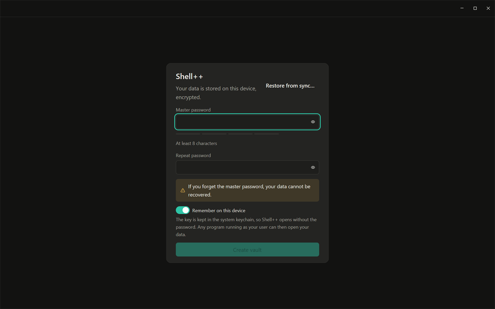
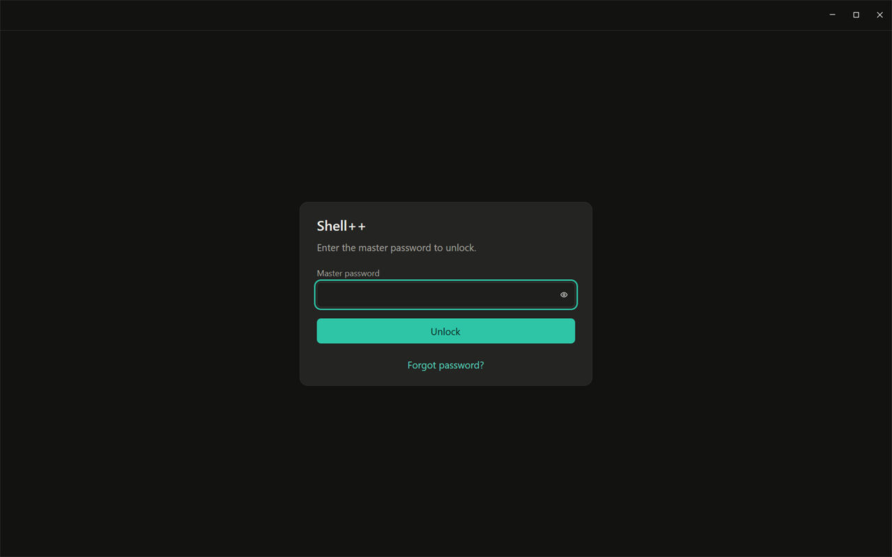

# First run and the master password

English | [Русский](ru/01-first-run.md)

Shell++ keeps your hosts, keys, passwords and snippets in a vault on your
device, encrypted with a key derived from your **master password**. Nothing
leaves the device unless you connect a sync server of your own.

## Creating the vault

The first time you start Shell++, it asks for a master password.

1. Enter the master password and repeat it. It needs at least 8
   characters; the strength bar under the field is advice, not a rule. A
   long passphrase of several words is both strong and easy to remember.
2. Read the warning: "If you forget the master password, your data cannot
   be recovered." The password is not stored anywhere, and a sync server
   never sees it.
3. Decide on **Remember on this device** (on by default). With it on, the
   vault's key is kept in the system keychain (on Windows, the Credential
   Manager), and Shell++ opens without asking for the password. Any program
   that runs as your user could then open your data too. Turn it off on a
   shared or less trusted computer.
4. Click **Create vault** (or press Enter). The Hosts screen opens.

If you already use Shell++ with a sync server on another device, click
**Restore from sync…** at the top instead: see
[Sync](06-sync.md#a-second-device).

## Unlocking

When Shell++ is locked, or starts without **Remember on this device**, it
asks for the master password. After five wrong passwords in a row it makes
you wait, 5 seconds at first and up to 5 minutes, also after a restart.

## Locking

- Lock by hand: app menu > **Lock**, or Ctrl+Shift+L.
- **Auto-lock**: Settings > **Security** > **Auto-lock** locks Shell++
  after 5 minutes to 1 hour without keyboard or mouse input in its windows.
  It is **Never** by default.

While locked, all windows show the unlock screen. Open sessions keep
running in the background and come back as they were after you unlock.
Unlocking after a lock always asks for the password, even with **Remember
on this device** on.

## Changing the master password

Settings (Ctrl+,) > **Security** > **Change master password…**: enter the
current password and the new one twice. **My old password may be
compromised** is ticked by default: the vault then also gets a new key and
a new recovery key, so the old password and the old recovery key stop
opening your data on a sync server and in its backups. With a sync account
the new recovery key is shown before anything changes: save it, tick **I
saved the recovery key** and click **Change password**. Without an account
the new recovery key stays inside the vault, unseen, until you connect a
sync server. Untick the option to change only the password.

## If you forgot the master password

Click **Forgot password?** on the unlock screen. The password is not stored
anywhere, so it cannot be shown or reset. You have these options:

- If **Remember on this device** is on, restart Shell++: it opens without
  the password. Changing the password needs the current one, so save your
  data instead: app menu > **Export Data…** (encrypted with a new
  password), then lock (Ctrl+Shift+L), **Forgot password?** > **Start with
  a new vault**, create the vault with a new master password and import
  the file with **Import Data…**
  ([Export and migration](07-export-and-migration.md)).
- **Restore from sync** (only on a device connected to a sync server): a new
  master password with your account's recovery key. See
  [Sync](06-sync.md#forgot-password-restore-from-sync).
- **Start with a new vault**: Shell++ starts empty. The old data file is
  not deleted: it is renamed (`shellpp.db.<date>.old`) and kept next to the
  new one, but only the forgotten password opens it.

## Where the data lives

On Windows, the vault is `%LOCALAPPDATA%\shellpp\shellpp.db`. Next to it
are `backups\` (copies of the database made before upgrades and before a
sync account is merged in, the three newest kept), `recordings\` (session
recordings, if you turn them on) and `logs\` (diagnostic logs without
secrets, addresses or terminal text). To keep everything next to the
program, for example on a USB drive, start it with the `SHELLPP_DATA_DIR`
environment variable set to a folder (see `README-portable.txt` in the zip).
