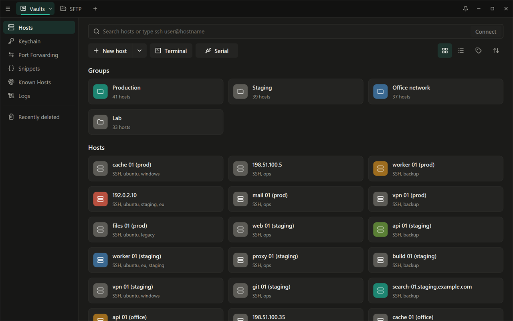
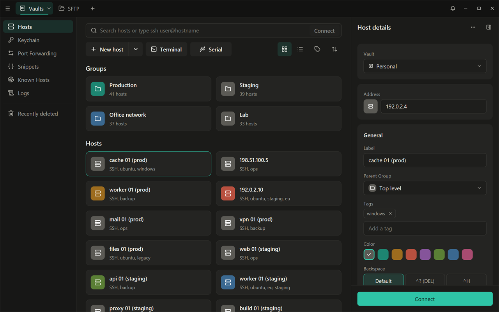
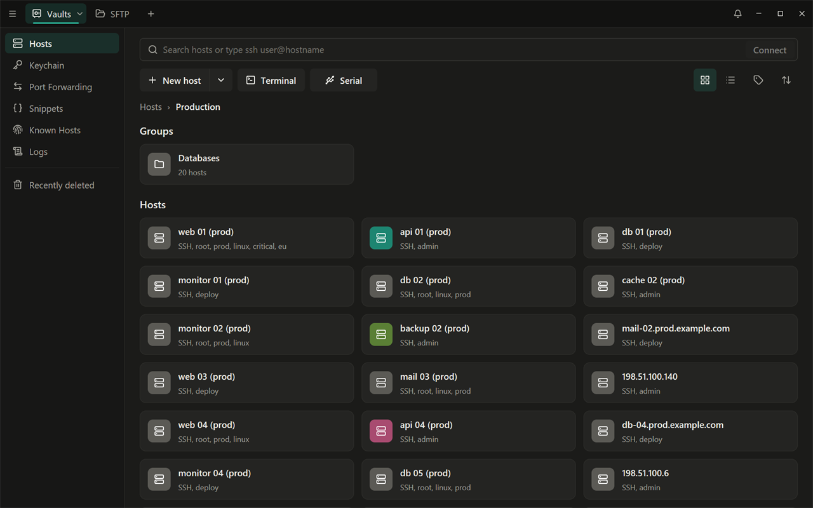
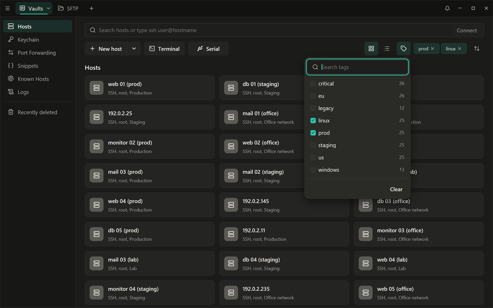
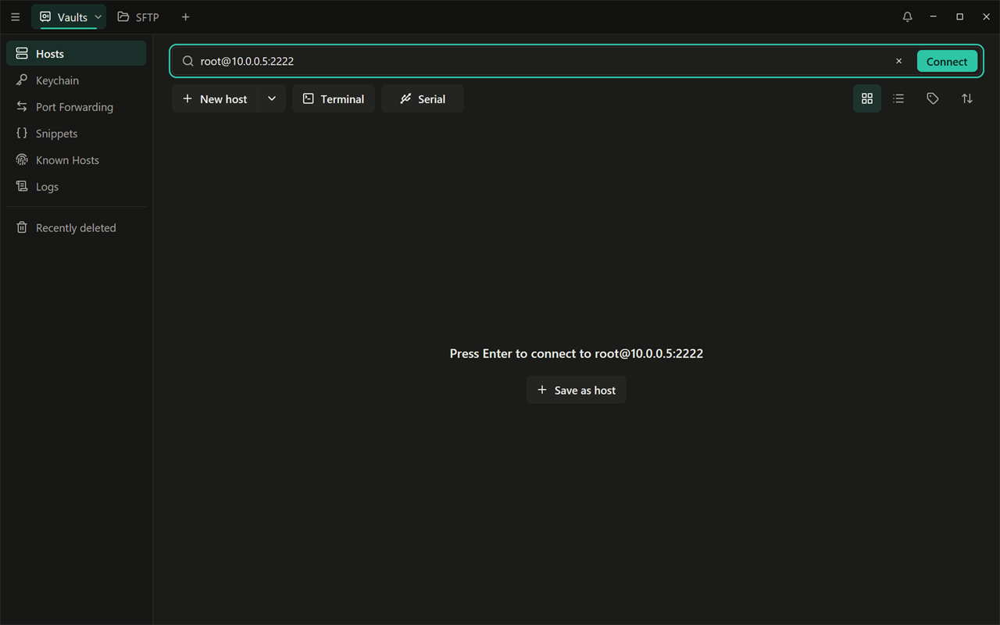
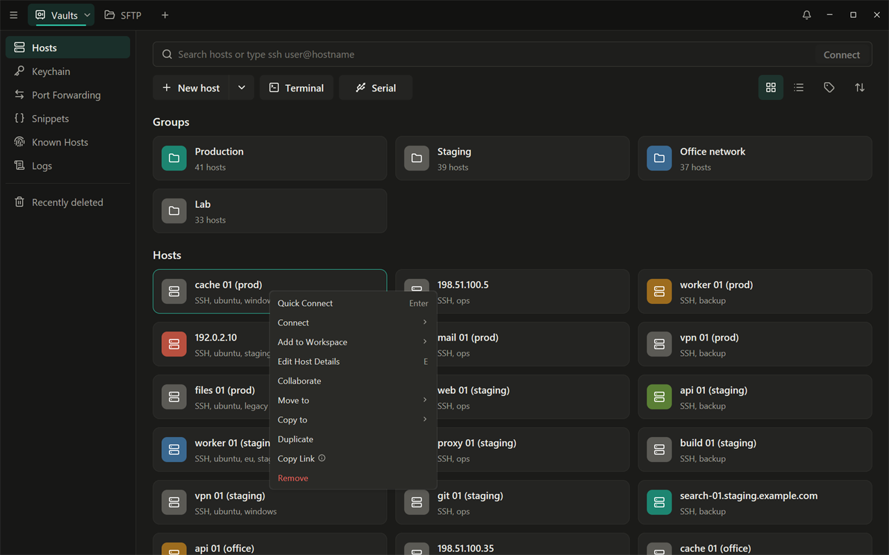
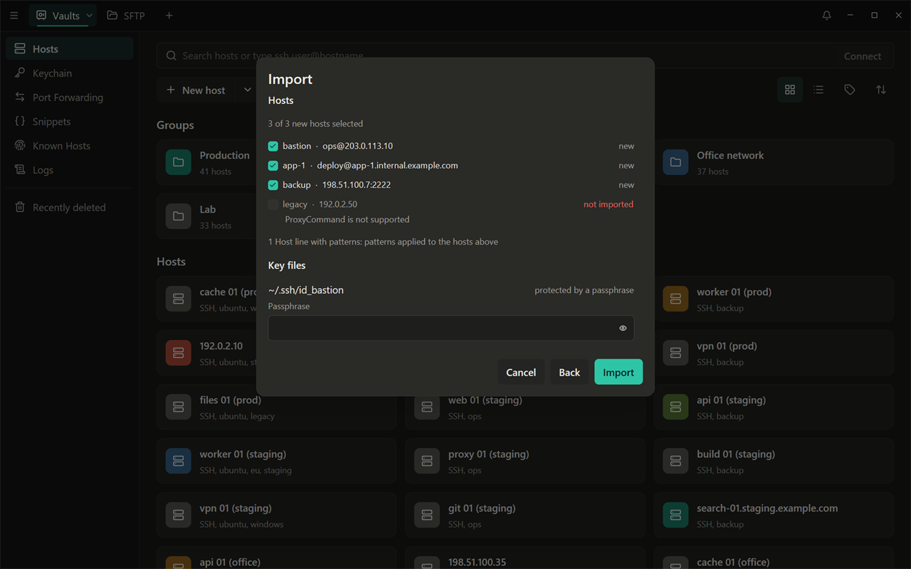
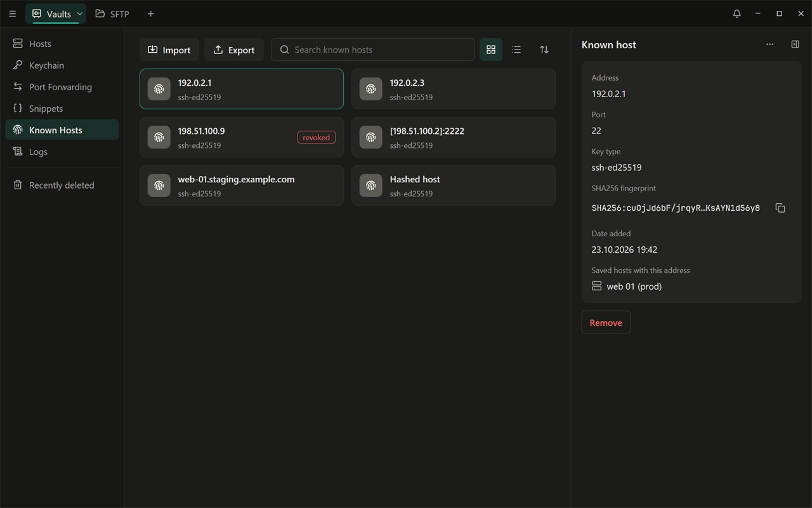

# Hosts, groups and tags

English | [Русский](ru/02-hosts.md)

The **Hosts** screen (the **Vaults** tab, Ctrl+1) lists the servers you
connect to, organized in groups. Click a host to open its panel on the
right; double-click it to connect.

## Adding a host

1. Click **New host** in the action bar. The host panel opens.
2. Enter the **Address**: an IP address or a host name.
3. Optionally fill in the rest:
   - **Label**: the name on the card (the address when empty);
   - **Parent Group**, **Tags**, **Color** and **Notes**;
   - **SSH**: **Port** (22 by default), **Username** and **Password**;
   - **+** (Add identity, key or certificate): a key from the Keychain (or
     a new one pasted here), a shared identity, or a certificate. See
     [Keys](03-keys.md).
4. There is no Save button: every change is saved as you type (the forms
   under **+** save with their own **Create**, **Import** or **Attach**
   button). A field with a mistake turns red with the reason and is not
   saved. A new host is kept once its address is valid.

**Show more** in the SSH block holds the advanced settings: Agent
Forwarding ([Keys](03-keys.md#agent-forwarding)), a startup snippet that
runs when the session opens, **Host Chaining** (jump hosts, up to 8), a
proxy (HTTP or SOCKS5), environment variables, the remote charset,
keepalive, whether to record the command history and the output of this
host, the terminal theme, and **Allow legacy algorithms** for old servers
(SHA-1 and CBC; leave it off unless a server needs it).

**Add Telnet** (in the panel's **…** menu) adds a Telnet block for devices
without SSH.

## Groups

Groups work like folders, and can be nested.

- Create one: the arrow next to **New host** > **New Group**. New hosts and
  groups are created in the group you have open.
- Click a group card to open it; the path above the cards ("Hosts › A ›
  B") leads back, and Esc goes up one level.
- Move hosts into a group by dragging them onto the group's card or onto a
  part of the path, with **Move to** in the right-click menu, or with the
  host's **Parent Group** field.
- A group can set the **Port**, **Username** and **Host Chaining** for the
  hosts inside it. A host that leaves a field empty uses the value of the
  nearest group that sets it; the field then shows it as a hint, such as
  "2222 · from group Production".
- Removing a group that is not empty moves its subgroups and hosts one
  level up.

## Tags

Tags label hosts across groups, for example `prod` or `db`.

- In the host panel, type a tag in **Tags** and press Enter. Existing tags
  are suggested as you type.
- **Filter by tag** in the action bar shows only the hosts that carry
  every tag you tick. The ticked tags appear as chips next to the button;
  click a chip to remove it from the filter.

## Finding and connecting

- The search bar filters hosts by label, address, user name or tag, in the
  open group and its subgroups.
- If what you type is an address (`user@host:port`, `10.0.0.5`,
  `server.example.com`, or `ssh user@host -p 2222`; a single word without a
  dot counts only as a search, except `localhost`), Enter or **Connect** connects to it right away without saving a
  host; Shell++ then offers to save it. If no host matches, **Save as
  host** saves it at once.
- Ctrl+K searches hosts and open tabs from anywhere.

## Working with several hosts

- Ctrl+click and Shift+click select several cards; Enter connects all of
  them, one tab each.
- **Tiles** / **List** switches the layout; **Sort** orders by name, date
  or by hand (drag the cards while sorting by hand).
- The right-click menu of a host: **Quick Connect**, **Connect** (via SSH or
  Telnet; hold Alt to open in a new window), **Add to Workspace**, **Edit
  Host Details**, **Move to**, **Copy to**, **Duplicate**, **Copy Link**
  and **Remove**.

**Remove** asks first; a toast then offers **Undo** for a few seconds, and
removed hosts and groups stay in **Recently deleted** for 90 days
([Sync](06-sync.md#recently-deleted)).

## Importing from an OpenSSH config

If you already have hosts in `~/.ssh/config`:

1. Click the arrow next to **New host** > **Import** (on an empty Hosts
   screen: **Import OpenSSH config**).
2. Choose **OpenSSH config** and click **Next**. The file is
   `~/.ssh/config` unless you choose another one with **Choose file…**;
   click **Next** again.
3. Check the preview. It lists every host with its status (**new**,
   **already exists** or **not imported**, with the reason), the key files
   the hosts use, and the lines that could not be read. Untick hosts you do
   not want. If a key file has a passphrase, enter it (tick **Save the
   passphrases in the vault** to keep them).
4. Click **Import**. The summary shows what was added.

What is imported:

- each `Host` entry becomes a host: the alias is its label, `HostName` its
  address (the alias when missing), with `Port` and `User`;
- `Host` lines with patterns (such as `Host *`) are not hosts themselves:
  their settings are applied to the hosts they match. `Include` is
  followed;
- `IdentityFile` keys are imported into the Keychain, and the first one is
  set on the host;
- `ProxyJump` becomes Host Chaining when every jump host is in the same
  file (or was imported before); otherwise the host keeps the missing hop,
  its notes say so, and it does not connect until you fix the chain;
- `ForwardAgent` turns on Agent Forwarding together with **Also offer the
  system agent's keys**; `ServerAliveInterval` sets the keepalive, `SetEnv`
  the environment variables;
- `LocalForward`, `RemoteForward` and `DynamicForward` become port
  forwarding rules that start when you connect to the host, except a rule
  that listens beyond this computer (not on `127.0.0.1`): it is imported
  without that, and you turn it on yourself.

What is not:

- a host with `ProxyCommand` is not imported (the command is never run);
- other options (`SendEnv`, `CertificateFile` and so on) are listed in the
  host's notes;
- hosts imported before are recognized and never overwritten, so you can
  import the same file again after you add hosts to it.

## Known hosts

The **Known Hosts** screen (in the sidebar) lists the server keys you have
accepted. Shell++ checks every connection against this list; it does not
read the system `~/.ssh/known_hosts` while connecting.

- **Import** reads a `known_hosts` file, for example the one in `~/.ssh`,
  so servers you already trust are not asked about again. Hashed entries
  are kept and still checked; `@revoked` entries become revoked keys.
- **Export** saves the list as `shellpp-known_hosts`.
- Click an entry to see its fingerprint and the saved hosts with that
  address. **Remove** makes the next connection ask again.

