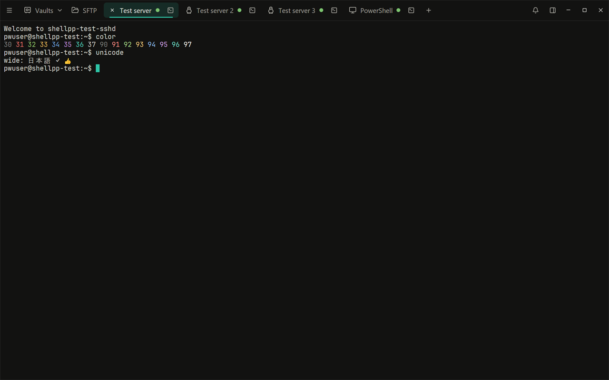
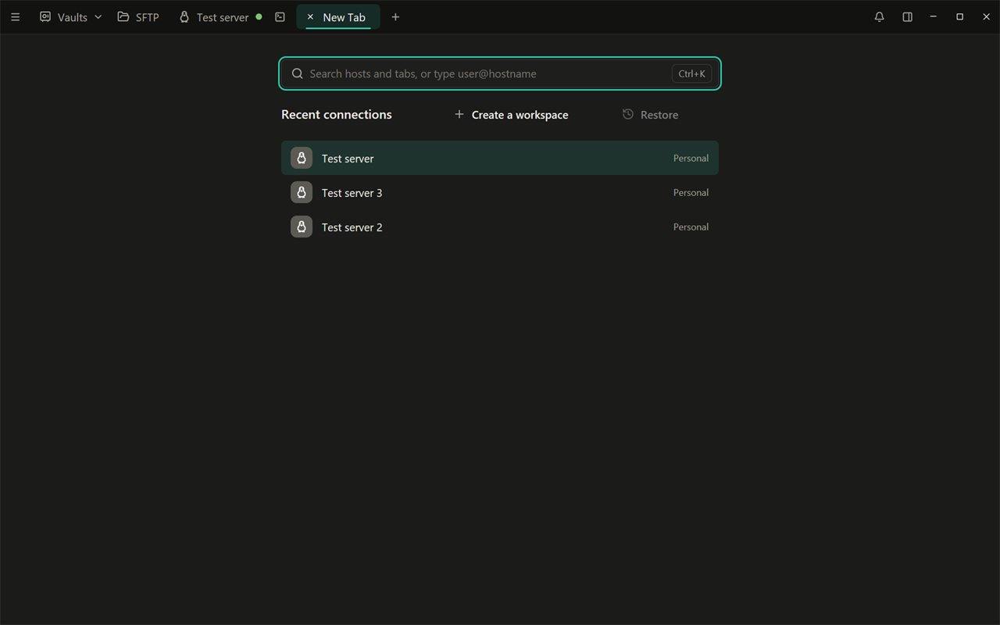
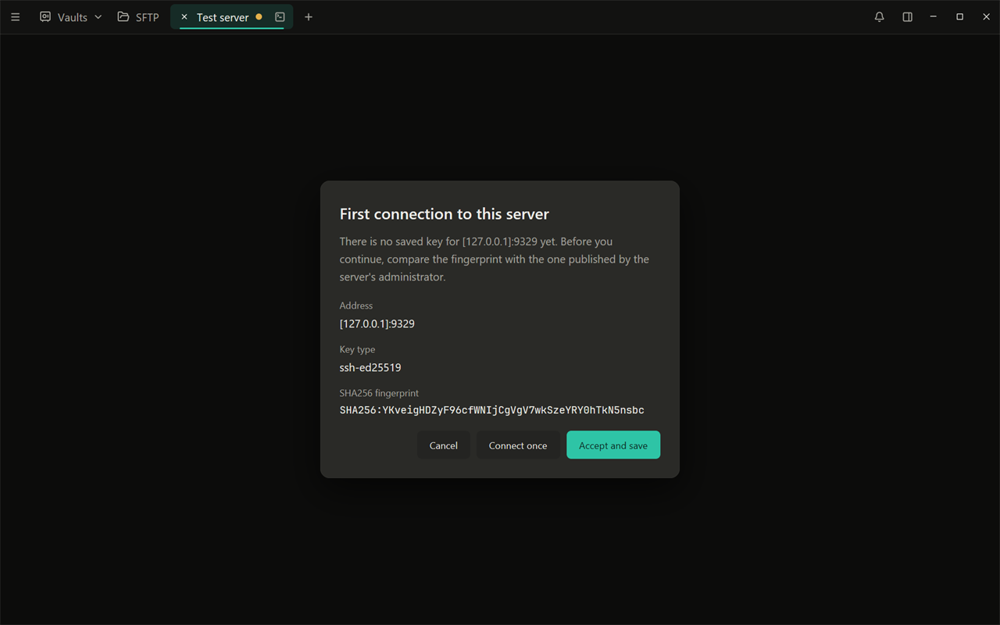
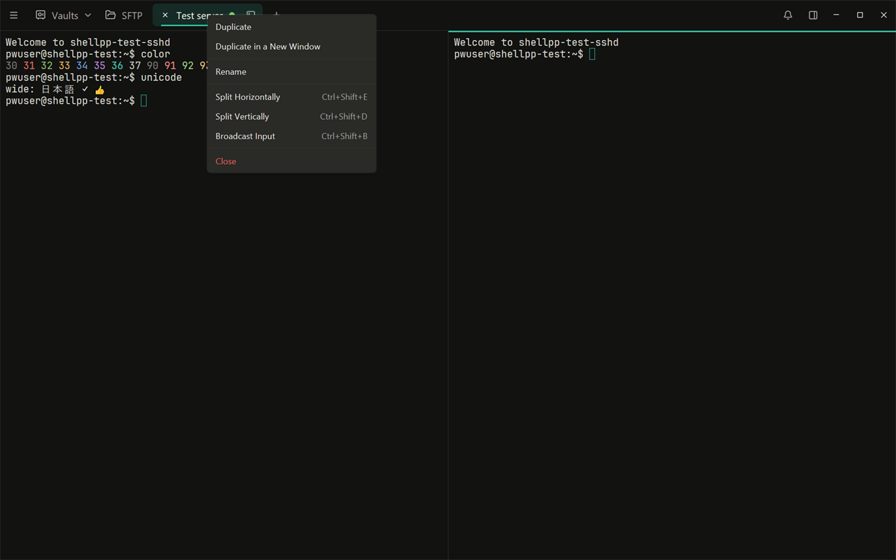
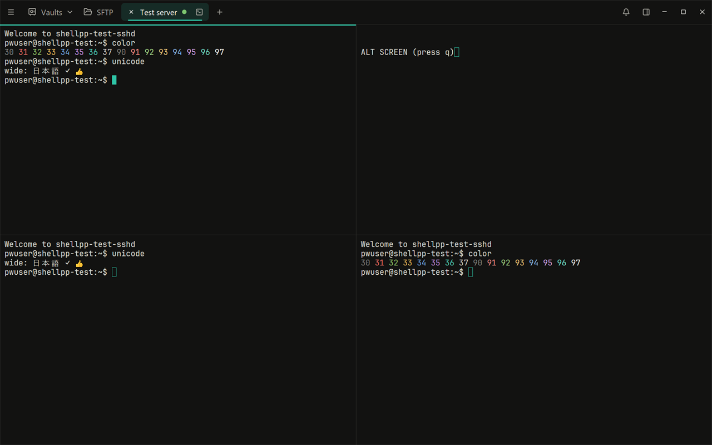
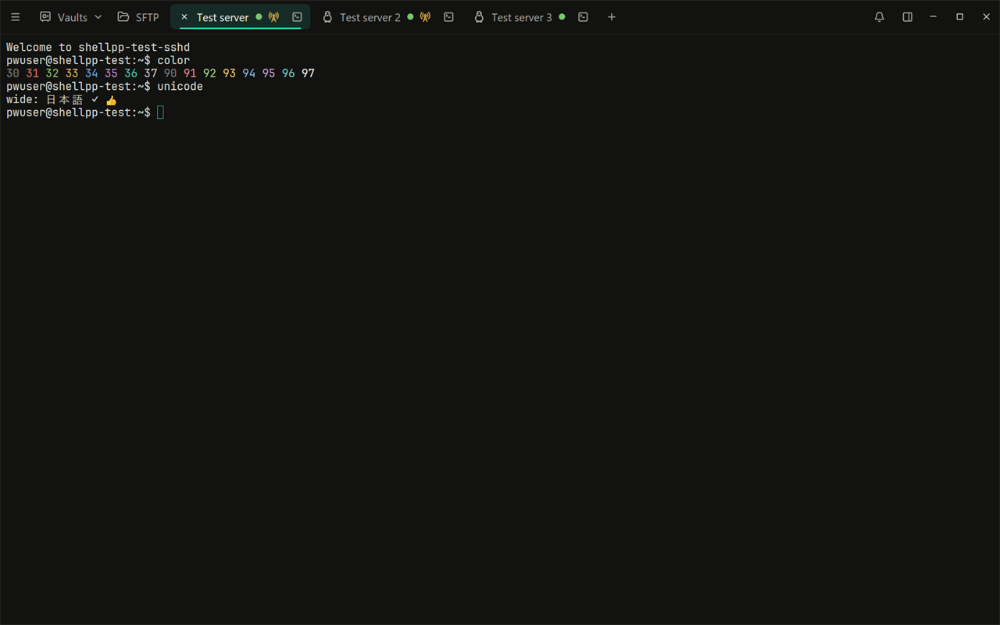
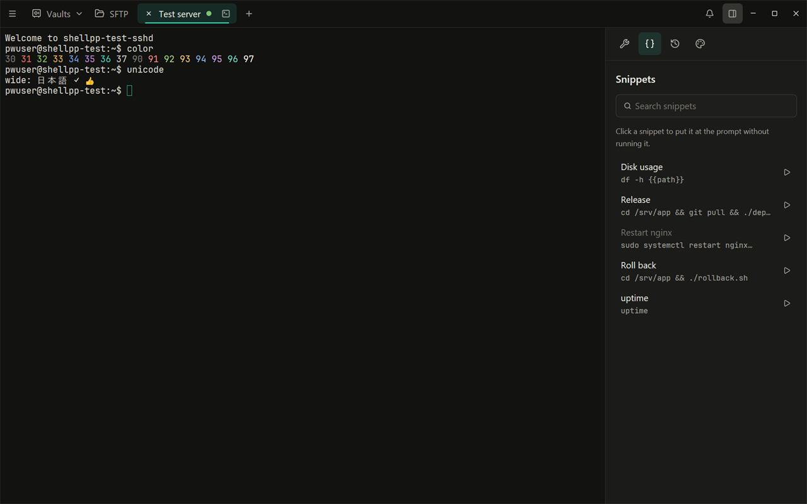

# The terminal: tabs, splits, workspaces and broadcast

English | [Русский](ru/04-terminal.md)

Every session opens in a tab of the top bar, next to **Vaults** and
**SFTP**. Keyboard shortcuts below are the Windows ones (the "PC" set). A
Mac uses the "Mac" set with Cmd, where some keys differ (for example Cmd+C
and Cmd+V in the terminal, Cmd+D to split); Settings > **Shortcuts** lists
them, and you can change any of them there.

## Opening a session

- **From the Hosts screen**: double-click a host card, or select cards and
  press Enter (one tab per host). The card's right-click menu has **Quick
  Connect** and **Connect** > **via SSH** / **via Telnet**. Hold Alt while
  you click to open the session in a new window.
- **From the host panel**: the **Connect** button at the bottom.
- **Quick connect**: type an address in the search bar of the Hosts screen
  and press Enter: `host`, `user@host`, `user@host:port`, `host:port`, or
  even `ssh user@host -p 2222` (a single word counts as an address only
  with a dot, as an IP address, or as `localhost`). After a successful quick connect, Shell++
  offers to save the host.
- **The New tab page**: **+** in the top bar, or Ctrl+T (Ctrl+Shift+T inside
  a terminal). Its search finds hosts, open tabs and workspaces, and below
  it are your **Recent connections**. Choosing a host opens it in that tab.
- **Search anywhere**: Ctrl+K (Ctrl+Shift+K inside a terminal) opens the
  same search over the current screen; a host opens in a new tab, an open
  tab is brought to the front.

**Restore** on the New tab page reopens the windows, tabs and splits of the
previous launch (once per launch).

### Local terminal, Telnet and serial

- **Local terminal**: the **Terminal** button on the Hosts screen, app menu
  > **New Local Terminal**, or Ctrl+L (outside a terminal). It opens your
  default shell: PowerShell 7 if it is installed, otherwise Windows
  PowerShell. This version has no setting to choose another shell.
- **Telnet**: add a Telnet block to a host (host panel > **Add Telnet**),
  then use **Connect** > **via Telnet**. Telnet is not encrypted, and you
  log in interactively.
- **Serial**: app menu > **New Serial Connection**, the **Serial** button
  on the Hosts screen, or Ctrl+Alt+S (outside a terminal). Choose the port (for example COM3),
  the baud rate and the line settings; they are remembered on this device.

### Connecting, host keys and passwords

While connecting, the tab shows the steps (resolving, connecting, checking
the host key, authenticating, opening the session) and a **Cancel** button.
If it fails, you see the reason with **Retry**.

The first time you connect to a server, Shell++ shows its host key
fingerprint:

- **Accept and save**: trust the key and remember it (Known Hosts);
- **Connect once**: trust it for this connection only;
- **Cancel**.

If the saved key of a server has changed, Shell++ stops with "The host key
has changed". This can mean the server was reinstalled, or that someone is
intercepting the connection: check with the server's administrator before
you choose **Replace saved key**. A revoked key never connects.

Password, passphrase and keyboard-interactive prompts appear over the tab
that asks. You can tick **Save the password in the encrypted storage** (for
saved hosts) or **Save the passphrase in the encrypted storage**; for key
files from `~/.ssh` you can choose **Remember until Shell++ locks or exits**
instead. Nothing is saved unless you tick it.

### When a connection drops

The output stays on screen, dimmed, with **Connection lost** and the
reason. With **Autoreconnect** on (the default, Settings > **Terminal**),
Shell++ tries again after 1, 2, 4, 8, 16 and 32 seconds, then every minute;
**Reconnect now** and **Cancel** are there meanwhile. A session that ends
with exit code 0 closes its tab; another exit code shows "Session ended
with code N" with **Reconnect**.

## Tabs

- **Switch**: click a tab; Ctrl+1 is Vaults, Ctrl+2 is SFTP, Ctrl+3 to
  Ctrl+9 are the session tabs; Alt+→ and Alt+← go to the next and previous
  tab.
- **Close**: the × on the tab, or Ctrl+Shift+W (on a split tab it closes
  the active pane).
- The dot on a tab shows its state: amber while connecting, green when
  connected, red when the connection dropped.

Right-click a tab for its menu:

- **Duplicate** opens another session to the same host (or the same shell)
  in a new tab; **Duplicate in a New Window** does it in a new window.
- **Rename** gives the tab a name of your own. Enter saves, Esc cancels; an
  empty name goes back to the host's name.
- **Split Horizontally** and **Split Vertically** (below).
- **Broadcast Input** (below).
- **Close** closes the tab with all its panes.

## Splits

Split a tab into panes to see several sessions at once:

- Ctrl+Shift+D: a new pane to the right;
- Ctrl+Shift+E: a new pane below;
- or the tab menu's **Split Vertically** / **Split Horizontally**.

The new pane asks which host to open. Its first row is the host of the pane
you split, then come your recent connections; type to search. Enter
connects, Esc closes the new pane again.

- Move between panes with a click or Ctrl+Alt+←/→/↑/↓. The active pane has
  an accent line along its top.
- Drag the line between two panes to resize them.
- Ctrl+Shift+W closes the active pane; the tab closes with its last pane.
- A tab holds up to 16 panes.

## Workspaces

A workspace is a saved set of tabs and splits that you open in one go.

- **Save the current window**: on the New tab page, click **Create a
  workspace** and give it a name. Tabs of saved hosts and local terminals
  are kept, with their splits and names. A tab with a quick-connect session
  is left out, and so are serial sessions.
- **Add hosts to a workspace**: on the Hosts screen, right-click hosts >
  **Add to Workspace** > a workspace (or **New Workspace**). Each host
  becomes a tab of its own.
- **Open**: the **Workspaces** block of the New tab page, or search for the
  workspace with Ctrl+K. Its tabs open in the current window and connect.
- **Rename or remove**: the pencil and × next to the workspace's button.
  Removing offers **Undo** for a few seconds; it never touches your hosts.

If hosts of a workspace no longer exist, the workspace shows "N hosts not
found", and opening it skips them.

## Broadcast input

Broadcast input sends what you type to several sessions at once, for
example to run the same command on a few servers.

- **Ctrl+Shift+B** turns it on for the panes of the current tab.
- The tab menu's **Broadcast Input** lets you tick several tabs: what you
  type in a connected pane of a ticked tab goes to the connected panes of
  all of them. It needs at least two connected panes.

While it is on, broadcasting tabs show an amber tower icon, and the panes
that receive your input have an amber border. Pasting several lines always
asks first and says how many other panes get them. Input is not mirrored
while a pane waits for a password. Ctrl+Shift+B again, or **Stop Broadcast
Input** in the tab menu, turns it off.

## The terminal sidebar

The **Terminal sidebar** button in the top bar (on session tabs) opens a
panel next to the terminal with four pages:

- **Tools**: search in the output and the scrollback (Ctrl+Shift+F opens
  it). Enter and Shift+Enter go to the next and previous match.
- **Snippets**: click a snippet to insert it without running it, or use
  its run button to insert it and press Enter. Variables such as
  `{{name}}` are asked first ([Snippets](05-sftp-forwarding-snippets.md#snippets)).
- **History**: the commands you ran on this host (saved hosts only). Click
  one to insert it. **Clear history** and the delete button on each row
  remove commands. Turn the history off in Settings > **Terminal** >
  **Record command history**.
- **Appearance**: the terminal themes and the **Font** page (family, text
  size, line spacing). A theme picked here applies to this session and is
  saved for the host.

## Copy, paste and the mouse

- Ctrl+Shift+C copies, Ctrl+Shift+V pastes, Ctrl+Shift+A selects all.
- Drag to select; double-click selects a word, triple-click a line.
- **Right-click pastes.** With **Copy on select** on (Settings >
  **Terminal**), a selection is copied as soon as you release the mouse.
- Pasting text with a line break asks first ("Paste several lines?", or
  "Paste and run?" for one line that ends with a line break) and shows
  what will be pasted, so a command is not run by accident.
- When a full-screen program such as `htop` or `mc` uses the mouse, hold
  Shift to select or paste.
- The scrollback keeps 10,000 lines. Shift+PageUp and Shift+PageDown scroll
  a page; Shift+Home and Shift+End jump to the top and bottom.

## Settings > Terminal

The main options: **Autoreconnect**, **Record command history**, **Copy on
select**, **Bell sound**, **Keyword highlighting** (errors, warnings,
addresses and your own regular expressions in color), the terminal type
(`xterm-256color` by default), the font, the default terminal theme and the
**Keepalive** interval (30 seconds by default; 0 turns it off).

**Zoom**: View > **Zoom In** / **Zoom Out** / **Actual Size** in the app
menu, or Ctrl+=, Ctrl+- and Ctrl+0 outside a terminal, scales the whole
interface from 80 % to 200 %. The terminal's own text size is set apart, in
the font settings.

## Keyboard shortcuts

Settings > **Shortcuts** lists every shortcut. Click an action's keys and
press new ones (with Ctrl, Alt or an F-key); × leaves an action without
keys; **Reset all** goes back to the defaults. While a terminal has the
focus, keys without Shift (such as Ctrl+L or Ctrl+K) go to the program in
the terminal.

| Action | Keys (Windows) |
|---|---|
| New tab | Ctrl+T, Ctrl+Shift+T |
| Search hosts and tabs | Ctrl+K, Ctrl+Shift+K |
| Close tab or pane | Ctrl+Shift+W |
| Next / previous tab | Alt+→ / Alt+← |
| Vaults, SFTP, tabs 3–9 | Ctrl+1, Ctrl+2, Ctrl+3–9 |
| New local terminal | Ctrl+L |
| New serial connection | Ctrl+Alt+S |
| Lock Shell++ | Ctrl+Shift+L |
| Settings | Ctrl+, |
| Zoom in / out / actual size | Ctrl+= / Ctrl+- / Ctrl+0 |
| Copy / paste / select all | Ctrl+Shift+C / Ctrl+Shift+V / Ctrl+Shift+A |
| Split right / down | Ctrl+Shift+D / Ctrl+Shift+E |
| Move to the pane left / right / above / below | Ctrl+Alt+← / → / ↑ / ↓ |
| Search in the terminal | Ctrl+Shift+F |
| Broadcast input on or off | Ctrl+Shift+B |
