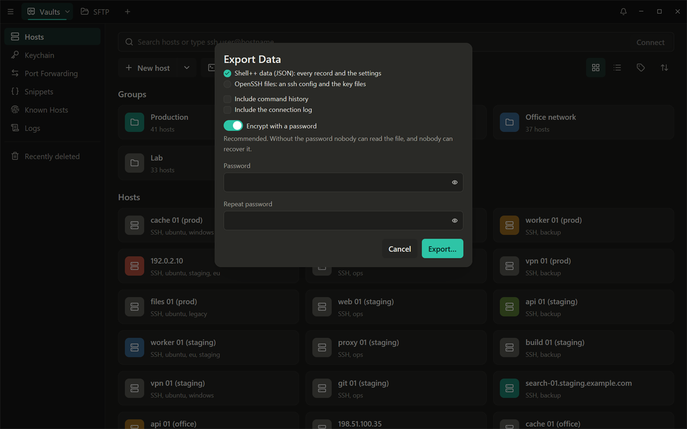
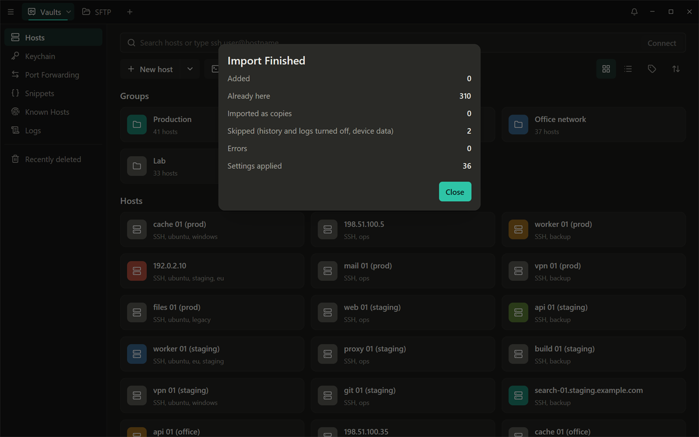

# Exporting your data and moving from another client

English | [Русский](ru/07-export-and-migration.md)

Your data always stays yours: you can export all of it at any time, with or
without a sync server, in open formats.

## Export Data

Open the app menu (the button with three bars, left in the top bar) >
**Export Data…**, or Settings (Ctrl+,) > **Account & Sync** > **Your data**
> **Export Data...**. Choose one of two formats.



### Shell++ data (JSON)

Every record of your vault (hosts, groups, keys, identities, snippets,
forwarding rules, known hosts, workspaces and so on) and the settings,
except the ones that belong to this device. This is the format to back up
your data or to move it to another Shell++.

- **Include command history** and **Include the connection log** are off by
  default.
- **Encrypt with a password** is on by default, and recommended: enter a
  password of at least 8 characters twice. Without the password nobody can
  read the file, and nobody can recover it either.
- With encryption off, the file holds your passwords and private keys in
  clear text. Shell++ says so and asks you to tick **I understand** first.

Click **Export…** and choose where to save the file
(`shellpp-export-<date>.json`, or `.encrypted.json` when encrypted). The
file is readable only by your user account.

### OpenSSH files

An ssh config and the key files, for use with `ssh` and other clients.

- Shell++ writes `shellpp-ssh-config` and, with **Include the key files**,
  one file per key: `shellpp_<name>`, `shellpp_<name>.pub` and
  `shellpp_<name>-cert.pub` for a certificate.
- **Protect the key files with a passphrase** (on by default) encrypts the
  keys that have no passphrase of their own. A key with its own passphrase
  keeps it. Turning protection off asks for **I understand**.
- The config holds each host's effective settings (with what it inherits
  from its groups), and `IdentityFile` lines point to
  `~/.ssh/shellpp_<name>`. Passwords and saved passphrases are never
  written.
- Choose a folder; if some files are already there, Shell++ asks before it
  replaces them.

To use the result, copy `shellpp-ssh-config` and the key files into
`~/.ssh`, and include the config at the top of your `~/.ssh/config` (before
the first `Host` line):

```
Include shellpp-ssh-config
```

Hosts that have only Telnet are left out of the config, and so are
proxies. Known hosts are exported separately: Known Hosts screen > **Export** saves
`shellpp-known_hosts` in the OpenSSH `known_hosts` format.

## Import Data

App menu > **Import Data…** reads a Shell++ export (`.json` or
`.encrypted.json`).



1. Choose the file. An encrypted file asks for the password chosen at
   export.
2. If the file holds command history or a connection log, choose whether
   to import them.
3. Click **Import**. The summary lists what was added, what was here
   already, what was imported as a copy, and what was skipped.

Importing never overwrites anything:

- records that are here already (the same record, a key with the same
  fingerprint, the same known host) are kept as they are;
- a record changed on both sides is added as a copy, with "(imported)" in
  its name when it has one;
- commands from the history that look like secrets are left out;
- forwarding rules from the file never start by themselves when Shell++
  starts, and rules that listen beyond this computer do not start when you
  connect either (except in a full restore, below).

**Apply the settings in the file** (on) applies the appearance and behaviour
settings. Settings that make Shell++ run programs or scripts, and the
security settings, stay as they are here: a file from someone else cannot
change them. **Full restore from my backup** applies them too. Use it only
for a backup you made yourself.

## Moving from another SSH client

Shell++ imports what most SSH clients can export or already use: the
OpenSSH config, `known_hosts` and key files.

1. **Hosts.** If the other client can export an OpenSSH config (or you
   already use `~/.ssh/config`), import it: Hosts screen > the arrow next to
   **New host** > **Import** > **OpenSSH config**. The keys its
   `IdentityFile` lines name are imported into the Keychain at the same
   time. See [Hosts](02-hosts.md#importing-from-an-openssh-config).
2. **Keys.** Import the other keys in the Keychain: OpenSSH, PEM and PuTTY
   `.ppk` files are read ([Keys](03-keys.md#importing-a-key-you-already-have)).
3. **Known hosts.** Hosts screen > the arrow next to **New host** >
   **Import** > **Known hosts**, or the Known Hosts screen > **Import**:
   choose the other client's `known_hosts` file, so Shell++ recognizes
   servers you already trust. Hashed entries are kept and still checked;
   `@revoked` entries become revoked keys; `@cert-authority` lines are
   skipped.
4. **Snippets** and **port forwarding rules** that are not in the ssh
   config have to be added by hand ([SFTP, port forwarding and
   snippets](05-sftp-forwarding-snippets.md)).

PuTTY sessions and CSV files are listed in the import dialog but are not
available in this version ("Arrives in a later version"). For PuTTY, export
your keys as `.ppk` files and import them in the Keychain.

## Leaving Shell++

Export your data as OpenSSH files (above) and include
`shellpp-ssh-config` from your `~/.ssh/config`; export the Known Hosts too.
On Windows, the app's data is in `%LOCALAPPDATA%\shellpp\`; deleting the
program folder and that folder removes Shell++ completely (the device key
in the Windows Credential Manager goes when you turn off **Remember on this
device** first).
