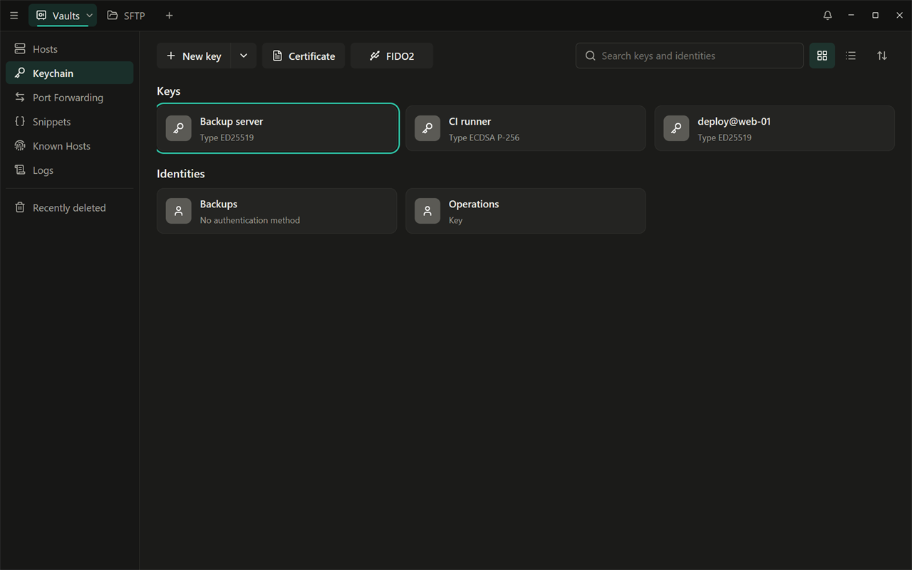
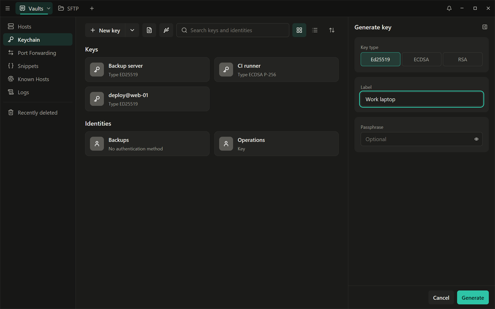
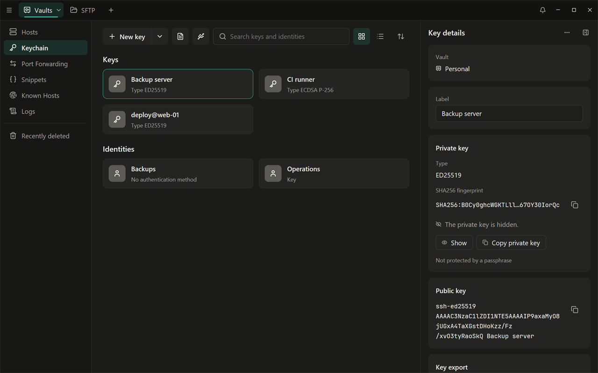
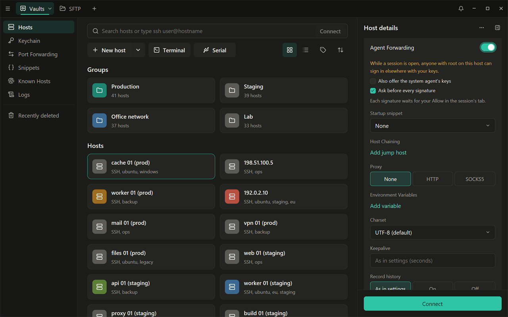

# Ключи, Keychain и экспорт на хост

[English](../03-keys.md) | Русский

**Keychain** (связка ключей, пункт боковой панели) хранит ваши закрытые
SSH-ключи и identity. Всё в нём хранится в зашифрованном виде в вашем
хранилище.

## Вход: какие ключи пробуются

При подключении к хосту Shell++ пробует по порядку:

1. ключ, заданный у хоста;
2. пароль, сохранённый у хоста;
3. ключи системного SSH-агента: `SSH_AUTH_SOCK`, агента Windows OpenSSH
   или Pageant — агент находится автоматически;
4. файлы ключей `~/.ssh/id_ed25519`, `id_ecdsa`, `id_rsa` и другие файлы
   `~/.ssh/id_*`. Парольная фраза запрашивается, только когда сервер
   примет ключ, и можно отметить **Remember until Shell++ locks or exits**
   (помнить до блокировки Shell++ или выхода из него);
5. запрос пароля;
6. запросы keyboard-interactive (например, одноразовый код).

Всего серверу предлагается не больше четырёх открытых ключей. Если сервер
отказывает из-за этого, задайте нужный ключ у хоста.

## Создание ключа

1. В Keychain откройте стрелку рядом с **New key** и выберите **Generate
   key**. В пустом Keychain нажмите **Generate**.
2. Выберите **Key type** (тип ключа): Ed25519 (по умолчанию и лучший
   вариант), ECDSA (кривая P-256, P-384 или P-521) или RSA (3072 или 4096
   бит).
3. Введите **Label** (метку), например «рабочий ноутбук». Она обязательна.
4. При желании введите **Passphrase** (парольную фразу) и повторите её.
   Если фраза задана, выберите, где она будет храниться:
   - **Save in the vault**: ключ открывается сам, когда хранилище
     разблокировано;
   - **Ask on every connection**: Shell++ спрашивает фразу каждый раз.
5. Нажмите **Generate**. RSA-ключ создаётся несколько секунд. Откроется
   панель нового ключа.

## Импорт существующего ключа

Нажмите **New key**. Форма импорта принимает ключ любым из способов:

- вставьте текст ключа в поле;
- **Choose file…**;
- перетащите файл на форму.

Shell++ читает ключ сразу при вставке и показывает его **Format**:

- OpenSSH (без шифрования или зашифрованный);
- PEM: PKCS#1, PKCS#8 (в том числе зашифрованный) и SEC1, включая
  устаревшее шифрование OpenSSL с AES-CBC;
- PuTTY `.ppk` версий 2 и 3, зашифрованный или нет.

Поддерживаются ключи Ed25519, ECDSA P-256/P-384/P-521 и RSA от 2048 бит.
Для ключа, защищённого парольной фразой, она запрашивается ("Protected by a
passphrase: enter it to import the key"), и предлагается тот же выбор
**Save in the vault** / **Ask on every connection**. Ключи PEM и PuTTY
преобразуются в формат OpenSSH и сохраняют свою парольную фразу.

**Label** необязательна: без неё используется комментарий ключа.

Что не принимается и почему:

- DSA, Ed448 и другие типы: "The key type … is not supported."
- RSA-ключи короче 2048 бит.
- Ключи, зашифрованные DES-EDE3.
- Открытые ключи (`.pub`), сертификаты и файлы RFC 4716: "This is a public
  key. Import the private key: the file of the same name without .pub."
  (это открытый ключ; импортируйте закрытый — файл с тем же именем без
  .pub).
- Файлы больше 64 КБ.

Ключ, который уже есть в Keychain (тот же отпечаток SHA256), второй раз не
добавляется: открывается его панель с сообщением "This key is already in
the Keychain".

### Импорт из `~/.ssh`

В пустом Keychain кнопка **Import from SSH folder** показывает закрытые
ключи из `~/.ssh` (файлы в поддерживаемом формате, не `*.pub`). Щёлкните
ключ, чтобы загрузить его в форму импорта. Когда в Keychain уже есть ключ,
добавляйте ключи из `~/.ssh` через **New key** > **Choose file…** или
импортируйте конфигурацию OpenSSH: её ключи из `IdentityFile`
импортируются вместе с хостами
([Хосты](02-hosts.md#импорт-из-конфигурации-openssh)).

## Панель ключа

Щёлкните ключ, чтобы открыть его панель ("Key details"):

- **Label**: сохраняется по мере ввода.
- **Private key**: тип ключа и отпечаток SHA256 (с кнопкой копирования).
  Текст ключа скрыт, пока вы не нажмёте **Show**. **Copy private key**
  копирует его в буфер обмена и очищает буфер через 30 секунд. Ключ снова
  скрывается, когда вы уходите с панели или приложение блокируется. Строка
  под ним говорит, есть ли у ключа парольная фраза и где она хранится.
- **Public key**: одна строка с кнопкой копирования. Вставьте её в
  `~/.ssh/authorized_keys` на сервере или воспользуйтесь экспортом на хост
  (ниже).
- **Certificate**: показывается, когда к ключу привязан сертификат.
- **Key export**: **Export to host…**.

В меню **…** есть **Copy public key** и **Remove**. Удаление ключа сначала
спрашивает подтверждение и перечисляет хосты, группы и identity, которые
его используют; после удаления они подключаются другими своими способами
входа. На несколько секунд появляется уведомление с **Undo**, а ключ 90
дней хранится в **Recently deleted**.
(**Duplicate** и **Export to file…** пока недоступны: чтобы сохранить
файлы ключей, используйте Export Data > OpenSSH files, см.
[Экспорт и переход](07-export-and-migration.md).)

## Экспорт на хост

Экспорт на хост (Export to host) добавляет открытый ключ в
`~/.ssh/authorized_keys` на выбранных серверах, как `ssh-copy-id`.

1. Откройте панель ключа и нажмите **Export to host…**.
2. Отметьте хосты. Поле поиска фильтрует по метке или адресу; **Select
   all** отмечает хосты, которые показывает поиск.
3. Нажмите **Export**.

Затем у каждого хоста появляется результат: **Added**, **Already there**,
**Connect once to save its host key first** (сначала подключитесь один раз,
чтобы сохранить ключ хоста), **No saved credentials signed in** (ни одни
сохранённые учётные данные не подошли) или ошибка подключения.

Как это работает:

- Вкладка не открывается. Shell++ входит тем, чем может воспользоваться,
  ничего у вас не спрашивая: сохранённым паролем или ключом хоста,
  системным агентом и файлами `~/.ssh/id_*`. Несохранённый пароль или
  ключ, парольная фраза которого запрашивается при каждом подключении,
  здесь использовать нельзя: вместо этого один раз подключитесь из
  вкладки.
- Shell++ обращается только к хостам, чей ключ хоста уже есть в Known
  Hosts, поэтому к новому хосту сначала подключитесь один раз (и примите
  его ключ), а потом экспортируйте на него.
- На сервере Shell++ создаёт `~/.ssh` (права 700) и `authorized_keys`
  (права 600), если их нет, и дописывает ключ, только если его там ещё нет
  (тот же ключ с другим комментарием считается уже добавленным).

## Сертификаты

**Certificate** на панели действий добавляет пользовательский сертификат
OpenSSH (файл `*-cert.pub`): вставьте его или выберите файл. Он
привязывается к ключу, который удостоверяет, и закрытый ключ этой пары уже
должен быть в Keychain. Затем панель ключа показывает ID ключа в
сертификате, principals, срок действия и отпечаток CA и предупреждает, если
срок истёк.

> Сертификаты хранятся, показываются и экспортируются, но эта версия пока
> не использует их для входа.

## Identities

Identity — это имя пользователя с паролем, которое могут использовать
несколько хостов. Создайте её из панели хоста: **+** (Add identity, key or
certificate) > **Identity** > **New identity**, указав название, имя
пользователя и пароль. Identity показываются в Keychain в разделе
**Identities**; эта версия показывает их там, но пока не позволяет
редактировать.

## Проброс агента

Проброс агента позволяет серверу использовать ваши ключи для следующего
перехода (например, `git` или `ssh` на другую машину), не копируя их туда.
По умолчанию он выключен и задаётся для каждого хоста отдельно: панель
хоста > **Show more** > **Agent Forwarding**.

- Пока проброс включён, любой, у кого есть root на этом хосте, может
  входить в другие системы с вашими ключами, пока ваша сессия открыта.
  Включайте его только для хостов, которым доверяете.
- Пробрасываются ключи Keychain, которые открываются без запроса (без
  парольной фразы или с сохранённой). **Also offer the system agent's
  keys** добавляет ключи агента.
- **Ask before every signature**: каждая подпись, которую запрашивает
  сервер, ждёт вашего **Allow** во вкладке сессии ("Sign with your key?").
  Если ответа нет две минуты, это считается **Deny**. Когда окно в фоне,
  системное уведомление называет хост.
- Сервер может только получить список ключей и попросить подпись:
  добавлять, удалять или читать ключи он не может. Пока Shell++
  заблокирован, ключи Keychain не предлагаются (ключи системного агента
  предлагаются, если вы их включили).
