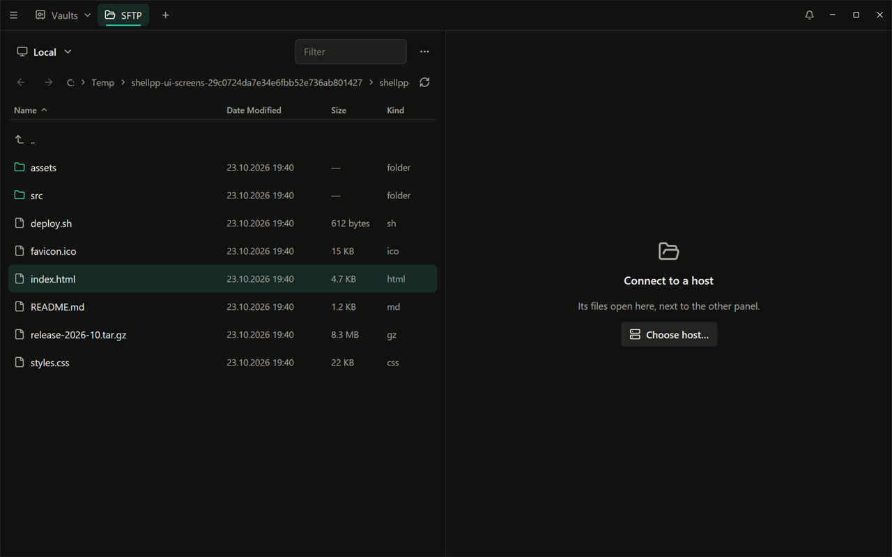
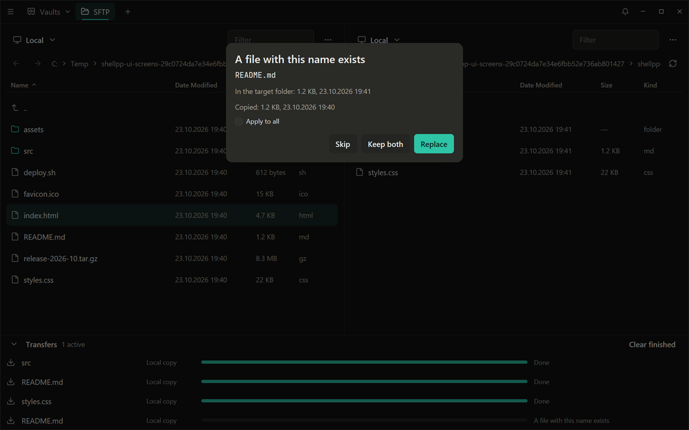
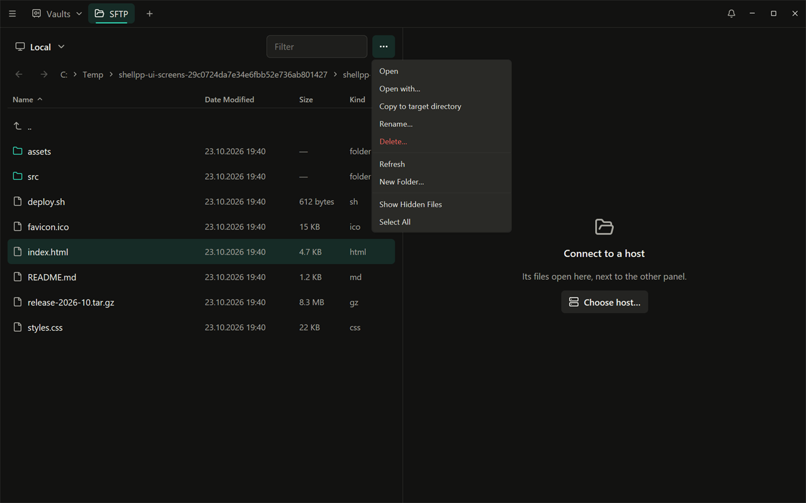
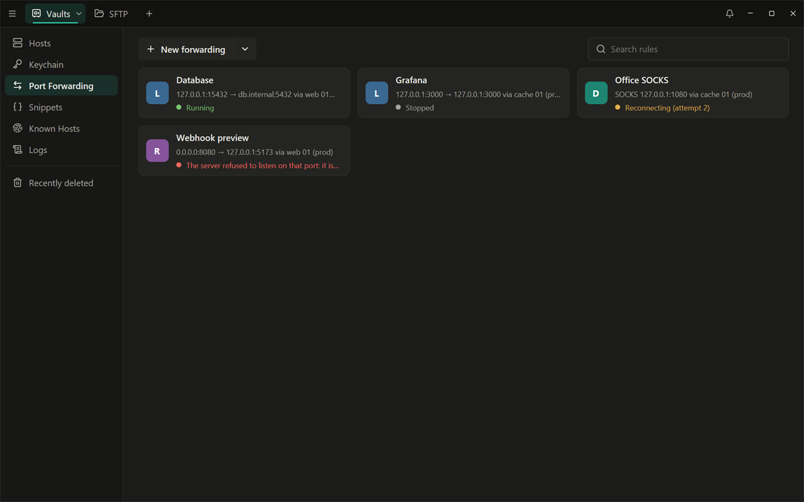
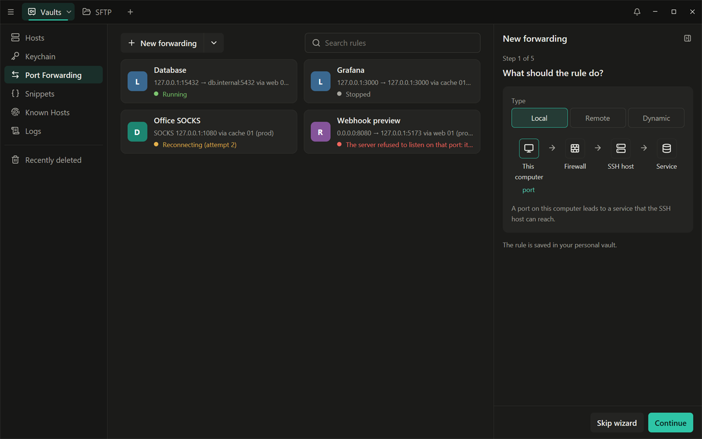
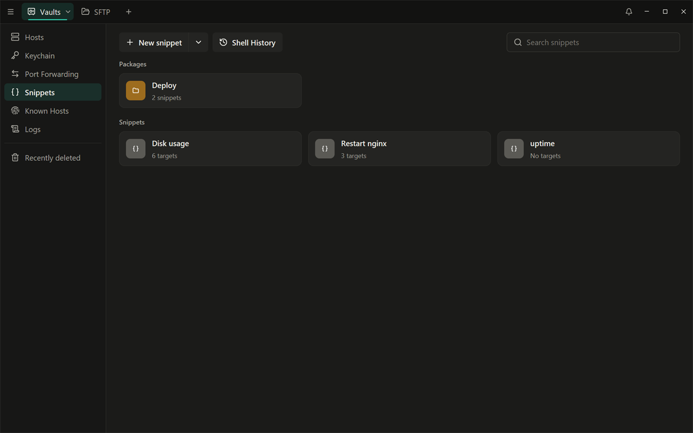
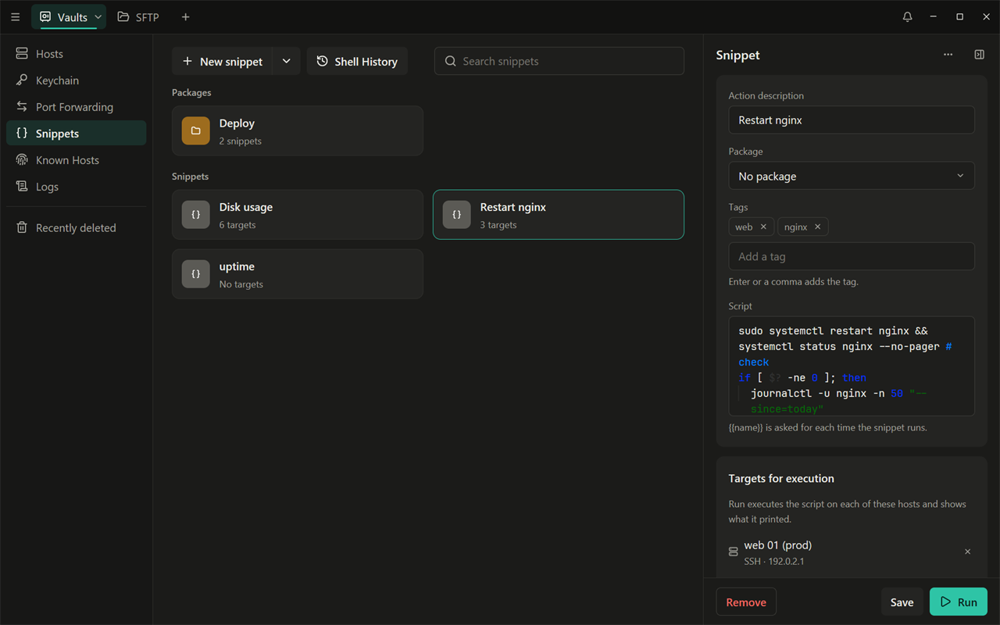
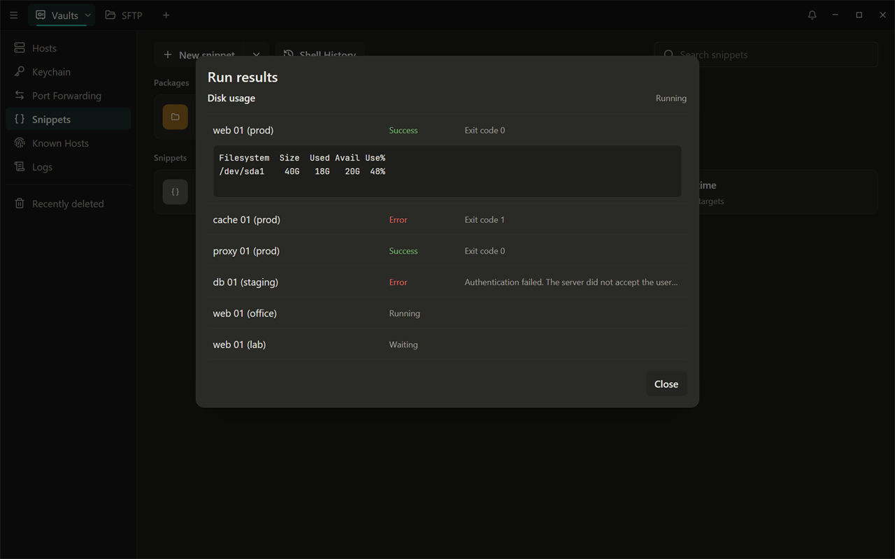

# SFTP, проброс портов и сниппеты

[English](../05-sftp-forwarding-snippets.md) | Русский

## SFTP

Вкладка **SFTP** (Ctrl+2) — файловый менеджер с двумя панелями. Левая
сначала показывает файлы вашего компьютера; откройте хост в любой из
панелей и копируйте файлы между ними.

### Подключение к хосту

1. В пустой панели нажмите **Choose host…** (а в панели с файлами — её
   кнопку источника > **Host…**).
2. Выберите сохранённый хост; поиск фильтрует по метке или адресу.
3. Панель подключается. Вопросы о пароле, парольной фразе и ключе хоста
   появляются прямо в панели.

Кнопка источника переключает панель обратно на **Local files**; **Close** в
меню **…** панели отключает её.

### Навигация

- Дважды щёлкните папку, чтобы открыть её; дважды щёлкните строку **..**
  (или нажмите Backspace в списке), чтобы подняться выше. Стрелки над
  списком переходят назад и вперёд по открытым папкам, а по каждой части
  пути можно щёлкнуть; в Windows первая часть показывает список дисков.
- **Filter** сужает список по имени. Щёлкните заголовок столбца, чтобы
  отсортировать.
- Ctrl+щелчок и Shift+щелчок выделяют несколько элементов; Ctrl+A
  выделяет всё.
- **Show Hidden Files** в меню **…**, или для всех панелей — в Settings >
  **SFTP**.

### Копирование файлов

Файлы всегда копируются в папку, которую показывает **другая** панель:

- перетащите их из одной панели в другую;
- щелчок правой кнопкой > **Copy to target directory**;
- или перетащите файлы из Проводника Windows на панель.

Папки копируются со всем содержимым. Между двумя хостами в этой версии
можно копировать только файлы.

Передачи появляются в очереди под панелями со скоростью и оставшимся
временем. Каждую можно приостановить, возобновить, повторить или
отменить; **Clear finished** убирает завершённые из списка. Передача
одного файла между этим компьютером и сервером продолжается с места
остановки; папка или копирование между двумя хостами начинаются заново. По
умолчанию одновременно идут три передачи (Settings > **SFTP** >
**Transfers at the same time**).

Если файл с таким именем уже есть, Shell++ спрашивает: **Skip**, **Keep
both** (копия получит имя `name (2).ext`) или **Replace**; отметьте
**Apply to all**, чтобы применить выбор к остальной части передачи. В
Settings > **SFTP** можно вместо этого настроить, чтобы файлы всегда
заменялись, пропускались или переименовывались. Проверяется только
копируемый элемент: копирование папки на папку с тем же именем с
**Replace** объединяет их, а файлы внутри с теми же именами заменяются без
вопросов. Пока Shell++ заблокирован, передачи продолжаются, а такой вопрос
ждёт разблокировки.

### Другие действия с файлами

В контекстном меню есть **Open**, **Open with…**, **Rename…**,
**Delete…**, **New Folder…** и **Edit Permissions…** (чтение, запись и
выполнение для владельца, группы и остальных или восьмеричное значение, в
том числе для всего содержимого папки; недоступно для локальных файлов в
Windows).

**Open** для файла на сервере скачивает копию в
`%LOCALAPPDATA%\shellpp\tmp\` и открывает её в программе для этого типа
файлов (или в той, что задана в Settings > **SFTP** > **Program for
Open**). Когда вы сохраняете там файл, Shell++ загружает его обратно; если
файл тем временем изменился на сервере, приложение спрашивает, какую
версию оставить. Копия не шифруется. Она удаляется, когда заканчивается её
SFTP-сессия (если ничего не ждёт загрузки), а вся папка `tmp` очищается
при запуске и выходе из Shell++ без вопросов: сохраните и закройте файл в
его программе, прежде чем выходить из Shell++. **Open** для исполняемого
файла (`.exe`, `.ps1`, `.sh` и так далее) сначала спрашивает
подтверждение, потому что такой файл запустится на вашем компьютере; то же
для ссылки на сервере, которая указывает на такой файл, как бы она сама ни
называлась.

> Имена файлов на сервере, которые не являются корректным UTF-8,
> показываются с `�`; такие файлы нельзя открыть, переименовать или
> скачать.

## Проброс портов

Экран **Port Forwarding** (в боковой панели) хранит правила проброса,
которые передают соединения через SSH-хост:

- **Local**: порт на этом компьютере ведёт к сервису за SSH-хостом,
  например к базе данных, которая слушает только на сервере (там
  `127.0.0.1:5432`, здесь — через `localhost:8080`);
- **Remote**: порт на SSH-хосте ведёт к сервису на этом компьютере или в
  вашей сети;
- **Dynamic** (SOCKS): SOCKS-прокси на этом компьютере отправляет любое
  соединение через SSH-хост.

### Создание правила

**New forwarding** запускает мастер:

1. тип, с картинкой, которая показывает, куда идёт соединение;
2. SSH-хост, через который оно идёт;
3. где открывается порт (адрес и порт): на этом компьютере, а для правила
   Remote — на SSH-хосте. `127.0.0.1` оставляет порт доступным только этой
   машине; другой адрес вызывает предупреждение;
4. куда идут его соединения (кроме SOCKS);
5. метка и сводка в одну строку, например
   `127.0.0.1:8080 → 127.0.0.1:5432 via web-1`. **Create** сохраняет
   правило; **Create and start** ещё и запускает его.

**Skip wizard** или стрелка рядом с **New forwarding** открывает вместо
мастера полную форму. В полной форме есть ещё **Start automatically**
(запускать автоматически): **When I connect to the host** (при подключении
к хосту) или **When the app starts** (при запуске приложения).

### Работа с правилами

- Дважды щёлкните карточку или выделите её и нажмите Enter, чтобы
  запустить или остановить правило. Карточка показывает **Running**,
  **Stopped**, попытку переподключения или причину сбоя (например, "Port
  8080 is busy. Choose another port.").
- Щёлкните карточку, чтобы изменить правило; сохранение работающего
  правила перезапускает его.
- В контекстном меню есть **Start**/**Stop**, **Edit**, **Duplicate** и
  **Remove** (с **Undo**).

> Правило подключается без вкладки, поэтому ни о чём не может вас
> спросить. Перед запуском правила один раз подключитесь к его хосту (и к
> его промежуточным хостам) во вкладке и выберите **Accept and save** для
> ключа хоста (**Connect once** недостаточно). Тогда правило входит с
> сохранённым паролем или ключом хоста, через SSH-агент или с вашими
> файлами ключей из `~/.ssh` (ключ с парольной фразой — только если вы
> разрешили Shell++ запомнить её в этом запуске). Ответить на запросы
> вроде одноразовых кодов нельзя.

## Сниппеты

Сниппеты — это команды и скрипты, которые всегда под рукой: на экране
**Snippets** (в боковой панели), в боковой панели терминала в сессии и на
нескольких хостах сразу.

### Создание сниппета

1. Нажмите **New snippet**.
2. Введите **Action description** (описание, например «Перезапустить
   nginx») и **Script**. При желании поместите сниппет в **Package** (папку
   сниппетов) и добавьте теги.
3. Используйте `{{name}}` для значения, которое меняется: Shell++
   спрашивает его при каждом запуске сниппета и не сохраняет. Одно и то же
   имя спрашивается один раз. Значение подставляется точно так, как
   введено, поэтому, если в нём могут быть пробелы, заключите его в скрипте
   в кавычки.
4. При желании добавьте **Targets for execution**: хосты, на которых
   выполняется сниппет.
5. Нажмите **Create**.

### Генерация скрипта по описанию (бета)

Shell++ умеет написать скрипт сниппета по описанию с помощью выбранного
вами сервиса с OpenAI-совместимым API: облачного (OpenAI и многие другие)
или локальной модели (Ollama, llama.cpp, LM Studio). По умолчанию
выключено.

1. Settings > **Terminal** > **Script generation (beta)**: включите,
   укажите **Address** — адрес API (пусто значит
   `https://api.openai.com/v1`; локальная модель — например
   `http://localhost:11434/v1`) — и **Model**. Для облачного сервиса
   введите **API key** и нажмите **Save key**: ключ хранится в системном
   хранилище учётных данных для узла этого адреса и отправляется только
   туда; локальной модели ключ не нужен.
2. В форме сниппета появится строка **Generate from a description
   (beta)**. Опишите, что должен делать скрипт, и нажмите **Generate**.
   Строка под ней называет узел, куда уйдёт описание.
3. Скрипт добавляется в поле **Script**. Он никогда не запускается и не
   сохраняется сам: прочитайте его, затем **Create** или **Save**.

Описание отправляется только при нажатии **Generate**, и только оно (без
хостов, паролей и ключей). Файл Import Data эти настройки никогда не
меняет.

### Сниппет в сессии

Откройте **Terminal sidebar** во вкладке сессии и в ней страницу
**Snippets**. Щёлкните сниппет, чтобы набрать его в командной строке без
выполнения, или нажмите его кнопку запуска, чтобы набрать его и нажать
Enter. Многострочный скрипт в оболочке, которая выполнила бы каждую строку
сразу, можно только выполнить, но не вставить.

### Запуск сниппета на нескольких хостах

**Run** (в панели сниппета, в меню его карточки или двойным щелчком по
карточке) выполняет скрипт на его целевых хостах и показывает результаты:
для каждого хоста — успех, ошибка или превышение времени, и код выхода;
щёлкните хост, чтобы увидеть, что вывел скрипт. Если хостов два или
больше, Shell++ перечисляет их и сначала спрашивает подтверждение; для
двух–четырёх хостов вместо этого **Run in split tab** открывает по панели
на хост и набирает скрипт в каждой.

Запуски на нескольких хостах подключаются без вкладки, как правила
проброса портов, и с теми же условиями (ключи хостов сохранены через
**Accept and save**, сохранённые учётные данные, агент или файлы ключей).
Одновременно выполняется до 8 хостов, каждый не дольше минуты.

### История команд

**Shell History** на экране Snippets показывает команды, которые вы
вводили в сессиях с сохранёнными хостами, новые сверху. Кнопка **Save as
snippet** у команды открывает новый сниппет с ней для этого хоста; нажмите
**Create**, чтобы сохранить его. Команды, похожие на секреты (токены,
пароли в командной строке), никогда не сохраняются. Историю можно
выключить в Settings > **Terminal** > **Record command history** или для
отдельного хоста в панели хоста.

## Журнал подключений

Экран **Logs** показывает ваши SSH- и SFTP-сессии с хостами (SFTP-сессии
показываются как SSH): когда, к какому хосту и под каким пользователем, и
чем закончилась каждая. Правила проброса портов и запуски сниппетов на
нескольких хостах здесь не показываются. Щёлкните запись, чтобы увидеть
подробности. Settings > **Logs** задаёт, сколько хранятся записи (по
умолчанию 90 дней; записи, которые вы отметили как сохранённые, остаются).

**Record session output** (Settings > **Logs**, по умолчанию выключено)
записывает вывод SSH-сессий в зашифрованном виде и только на этом
устройстве. Запись сессии открывается из её строки в журнале (**Open
recording**), с поиском и экспортом в текстовый файл.
