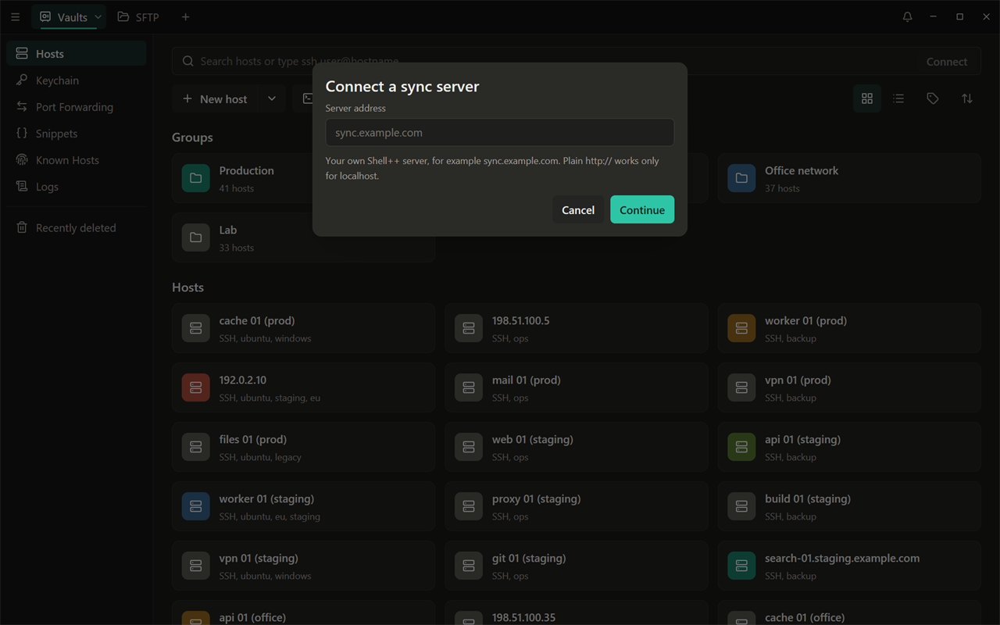
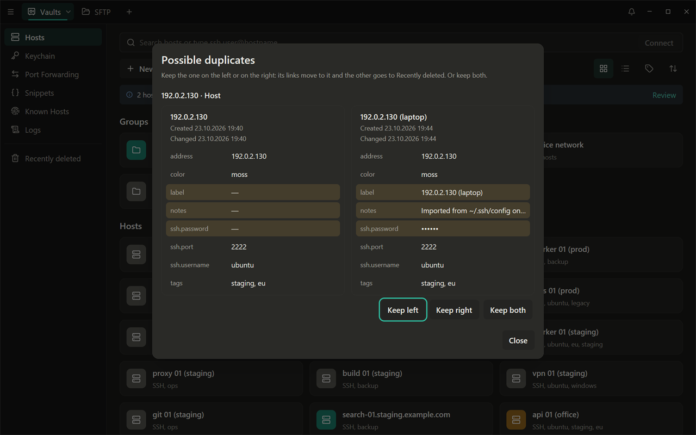
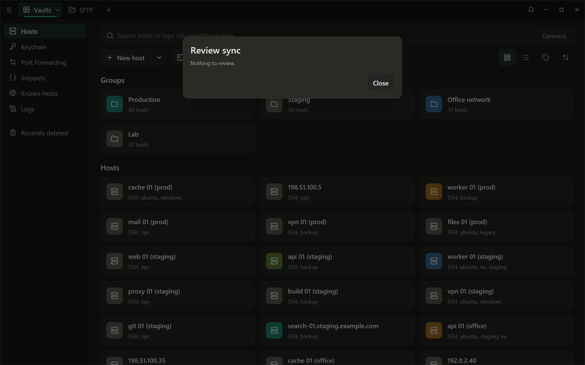
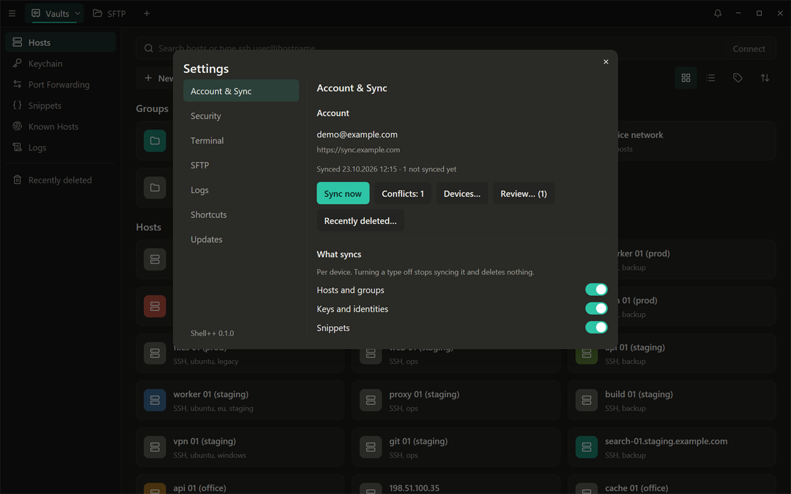
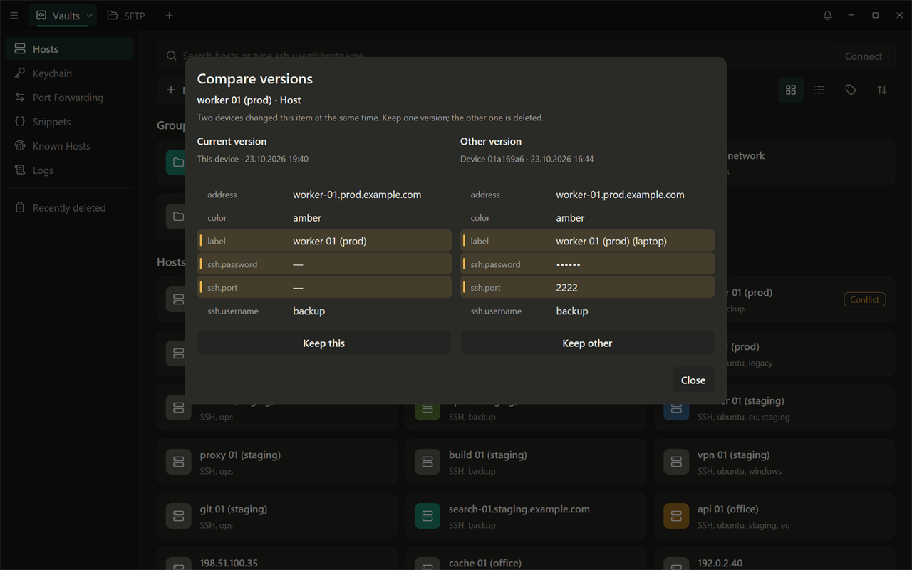
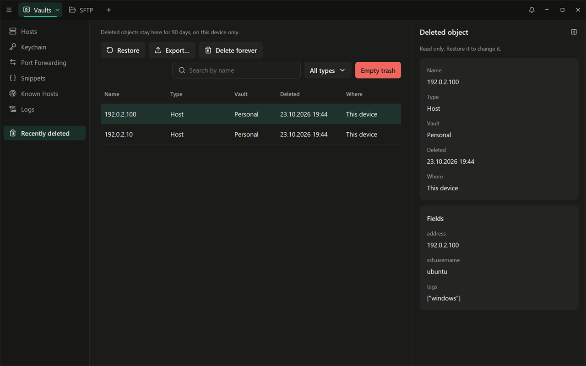

# Синхронизация между устройствами

[English](../06-sync.md) | Русский

Синхронизация необязательна: Shell++ полностью работает без неё. С ней на
всех ваших устройствах одинаковые хосты, ключи, сниппеты, правила проброса
и известные хосты, а работает она через сервер, который **вы запускаете
сами**.
Настройки приложения у каждого устройства свои (синхронизируются только
собственные темы терминала и правила подсветки). Всё шифруется на ваших
устройствах до отправки: сервер хранит только зашифрованные записи и
никогда не видит ваш мастер-пароль, ключ восстановления или содержимое
хранилища.

В этой главе:

1. [установка сервера](#установка-сервера) у себя дома;
2. [доступ к нему](#три-способа-доступа-к-серверу) с ваших устройств (три
   способа);
3. [подключение первого устройства](#подключение-первого-устройства) и
   [второго устройства](#второе-устройство);
4. [повседневная работа](#повседневная-синхронизация): что
   синхронизируется, проверка, Recently deleted, устройства;
5. [резервные копии и восстановление](#резервные-копии).

## Установка сервера

Нужна машина, которая всегда включена (домашний сервер, NAS с Docker,
небольшой VPS), с Docker и Docker Compose v2. Шаги ниже следуют
[`server/README.md`](../../../server/README.md), где есть полное описание.

### 1. Получите образ сервера

Из локальной копии репозитория (в её корневой папке):

```bash
docker build -f server/Dockerfile -t shellpp-server .
```

Когда релиз будет опубликован, его образ можно будет загрузить вместо
сборки: скачайте `shellpp-server-<version>-docker-image.tar.gz` из релиза,
проверьте его ([docs/release.md](../../release.md#checking-a-download)) и
выполните `docker load -i shellpp-server-<version>-docker-image.tar.gz`.
Появятся образы `shellpp-server:<version>` и `shellpp-server:latest`.

### 2. Настройте сервер

```bash
cd server/deploy
cp .env.example .env
```

Заполните `.env` (все команды ниже выполняются в `server/deploy`):

| Параметр | Что указать |
|---|---|
| `POSTGRES_PASSWORD` | длинный случайный пароль: `openssl rand -base64 32` |
| `SHELLPP_PUBLIC_URL` | адрес, который вы будете вводить на устройствах, например `https://sync.example.com` |
| секрет сервера | не в `.env`: файл `secrets/server_secret`, созданный командой `openssl rand -base64 48` (`server/README.md`, «Install»; Compose передаёт его серверу как секрет Docker). Сохраните копию вместе с ключом резервных копий: восстановленному серверу нужен тот же секрет, иначе двухэтапный вход придётся заново настраивать для каждой учётной записи |
| `BACKUP_AGE_RECIPIENT` | открытый ключ пары ключей `age`, созданной **на другой машине** командой `age-keygen -o shellpp-backup.key`; закрытый ключ никогда не попадает на сервер |
| `SHELLPP_REGISTRATION` | `invite` (по умолчанию: для новых учётных записей нужен код от вас) или `open` |
| `SHELLPP_TRUSTED_PROXIES` | оставьте значение из `.env.example` (`172.16.88.1/32`): с этим compose-файлом прокси на хосте приходит на сервер со шлюза сети compose, и только этот адрес может называть ограничениям частоты запросов адрес клиента (`server/README.md`, «Client addresses») |

Определитесь с адресом сервера (`SHELLPP_PUBLIC_URL`) до создания учётной
записи и вводите его одинаково на всех устройствах (то же имя и тот же
порт; регистр и косая черта в конце не важны): ключ входа учётной записи
выводится из адреса, который вводят устройства. Если потом перенести
сервер на другой адрес, войти уже не получится.

### 3. Запустите сервер

```bash
docker compose up -d
docker compose logs -f server
```

Compose-файл запускает PostgreSQL, применяет схему базы данных (сервис
`migrate`), запускает сервер только на `127.0.0.1:8080` и каждый день
делает зашифрованную резервную копию. Проверьте его командой
`curl http://127.0.0.1:8080/healthz` (`{"status":"ok"}`).

### 4. Создайте приглашение

```bash
docker compose run --rm server admin user invite --uses 1 --days 7
```

Код показывается один раз; вы введёте его при создании учётной записи.
Другие административные команды
(`docker compose run --rm server admin --help`):

| Команда | Что делает |
|---|---|
| `admin user list` | показывает список учётных записей |
| `admin user delete <email or id>` | удаляет учётную запись и её данные |
| `admin user reset-totp <who>` | для того, кто потерял приложение-аутентификатор |
| `admin user disable <who>` / `enable <who>` | выводит из учётной записи все её устройства / снова разрешает вход |
| `admin device revoke <device id>` | выводит из учётной записи одно устройство |
| `admin user quota <who> --records N --bytes N` | ограничения на объём данных (пока не заданы, их нет) |

## Три способа доступа к серверу

Сам сервер слушает только `127.0.0.1:8080`. Ваши устройства обращаются к
нему по HTTPS одним из этих способов (выберите один):

### 1. Свой домен с Caddy и Let's Encrypt

Самый простой вариант, если машина доступна из интернета: DNS-имя вроде
`sync.example.com` указывает на неё, а порты 80 и 443 открыты. Скопируйте
`Caddyfile.example` в `Caddyfile` (чтобы последующий `git pull` не
конфликтовал с вашей правкой), впишите в него своё имя и запустите Caddy
на той же машине:

```bash
cp Caddyfile.example Caddyfile
caddy run --config Caddyfile --adapter caddyfile
```

Caddy получает и продлевает сертификат Let's Encrypt. Приложение доверяет
ему, как любому сайту: подтверждать ничего не нужно.

### 2. Cloudflare Tunnel

Не нужны ни открытые порты, ни публичный IP. Создайте туннель и направьте
на него своё имя:

```bash
cloudflared tunnel create shellpp
cloudflared tunnel route dns shellpp sync.example.com
```

Скопируйте `cloudflared.example.yml` в `cloudflared.yml`, впишите в него
id туннеля и файл учётных данных и выполните
`cloudflared tunnel --config cloudflared.yml run`. TLS завершается на
Cloudflare: он видит зашифрованные записи и метаданные ваших устройств, но
никогда — ваши данные.

### 3. Только внутри VPN

Сервер доступен только внутри вашей сети WireGuard или Tailscale,
например как `sync.home.arpa`, с сертификатом от собственного CA Caddy
(`Caddyfile.internal.example`, `tls internal`). Приложение не знает этот
CA, поэтому при первом подключении показывает сертификат: сравните его
отпечаток SHA-256 с отпечатком на сервере

```bash
openssl s_client -connect sync.home.arpa:443 </dev/null | openssl x509 -noout -fingerprint -sha256
```

и нажмите **Trust this certificate**. После этого приложение доверяет
этому сертификату только для этого адреса.

Внутренние сертификаты Caddy действуют 12 часов и продлеваются до
истечения срока, а продлённый сертификат уже не совпадает с тем, которому
вы доверились: синхронизация останавливается с "Last error:
certificate_changed". В этой версии довериться новому сертификату можно
только так: **Sign out…**, затем снова **Connect sync server** (он покажет
новый сертификат), **Trust this certificate** и **Sign in**. Поэтому с VPN
всё настройте **до создания учётной записи** так, чтобы приложение
доверяло сертификату само, одним из способов:

- Tailscale: укажите в Caddyfile вместо `tls internal` имя машины в
  Tailscale (`<machine>.<tailnet>.ts.net`, с включёнными для tailnet
  HTTPS-сертификатами), и его же — в `SHELLPP_PUBLIC_URL`. Тогда Caddy
  получает для него от Tailscale общедоверенный сертификат;
- или добавьте корневой сертификат Caddy (`pki/authorities/local/root.crt`
  в папке данных Caddy) в доверенные корневые сертификаты операционной
  системы каждого устройства **до первого подключения устройства**: тогда
  приложение принимает сервер через системное хранилище сертификатов и
  ничего не спрашивает. (Устройство, которое уже доверилось отдельному
  сертификату, продолжает сравнивать с ним.) После этого все программы на
  этом устройстве доверяют сертификатам от этого CA.

## Подключение первого устройства

На устройстве, с данных которого должна начаться учётная запись:

1. Settings (Ctrl+,) > **Account & Sync** > **Connect sync server**.
2. Введите адрес сервера (достаточно `sync.example.com`: `https://`
   добавится) и нажмите **Continue**. Если сертификату ещё не доверяют,
   проверьте его, как описано выше.
3. Выберите **Create account**: ваш адрес электронной почты,
   **мастер-пароль этого устройства** (он станет паролем учётной записи) и
   код приглашения.
4. Shell++ показывает **Connected** и при первой синхронизации отправляет
   хранилище в зашифрованном виде.



## Второе устройство

**Новое устройство без данных**: на экране первого запуска нажмите
**Restore from sync…**, введите тот же адрес сервера и войдите с адресом
электронной почты и мастер-паролем **учётной записи** (и кодом
двухэтапного входа, если он включён). Устройство получит хранилище
учётной записи; с этого момента оно открывается паролем учётной записи.

**Устройство, на котором уже есть свои данные**: Settings > **Account &
Sync** > **Connect sync server** > **Sign in**. Сначала Shell++ делает
резервную копию локальной базы данных (`backups\` в папке данных), затем
сливает локальные данные с учётной записью; с этого момента устройство
открывается паролем учётной записи. Объекты, которые есть на обеих
сторонах с одинаковым содержимым, объединяются; объекты, которые только
похожи (например, тот же хост в другой группе), сохраняются рядом и
сохраняются рядом. Экраны, где они есть, говорят об этом («2 hosts may be
duplicates», с кнопкой **Review**), и они перечислены в **Review…** >
**Possible duplicates**: **Compare…** показывает оба объекта рядом,
отмечая различающиеся поля; **Keep left** или **Keep right** оставляет
один (ссылки переходят на него, другой уходит в Recently deleted), **Keep
both** оставляет оба и больше не спрашивает.



В этой версии устройство, подключённое к одной учётной записи, нельзя
подключить к другой.



## Повседневная синхронизация

Shell++ синхронизируется сразу после разблокировки, каждую минуту, пока он
разблокирован, и через пару секунд после каждого изменения. Settings >
**Account & Sync** показывает учётную запись, время последней
синхронизации устройства и то, что ещё ждёт отправки, а также кнопку
**Sync now**.



- **What syncs** (что синхронизировать) выбирается для каждого устройства.
  По умолчанию синхронизируются хосты и группы, ключи и identity,
  сниппеты, правила проброса, известные хосты, рабочие пространства, темы
  терминала и правила подсветки; история команд и журнал подключений —
  нет. Если выключить тип, его синхронизация прекращается, но ничего не
  удаляется.
- **Конфликты**: если два устройства изменили один и тот же объект, на
  месте остаётся более новое изменение, а другая версия сохраняется.
  Тогда Account & Sync показывает «Conflicts: N», а карточка объекта (хоста, ключа, сниппета и т. д.)
  — метку **Conflict**; обе открывают **Compare versions**: текущая и другая
  версии рядом, с устройством и временем каждой и отмеченными
  различающимися полями. **Keep this** или **Keep other** решает спор;
  **Close** откладывает решение.
- **Review…** (проверка; со счётчиком, когда есть что посмотреть)
  перечисляет конфликты, возможные дубликаты (см. выше) и объекты
  **Brought back**: давно удалённые на другом устройстве, но всё ещё
  имеющиеся здесь и теперь восстановленные на сервере (**Keep** или
  **Delete again**).
- **Recently deleted…** открывает экран Recently deleted (ниже).
- **Devices…** показывает устройства учётной записи. **Sign out** рядом с
  другим устройством спрашивает, не было ли оно потеряно или украдено.
  **Lost or stolen** также предлагает сменить мастер-пароль с отметкой
  **My old password may be compromised**, чтобы старый пароль перестал
  открывать ваши данные на сервере. На самом потерянном устройстве ничего
  не стирается: смените также пароли своих важных серверов.
- **Two-step sign-in…** (двухэтапный вход) добавляет одноразовый код
  (TOTP) к каждому новому входу: введите мастер-пароль, отсканируйте
  QR-код приложением-аутентификатором и введите его код. В этой версии
  выключить его из приложения нельзя; владелец сервера может его сбросить
  (`admin user reset-totp`).



## Недавно удалённые

Удалённые хосты, группы, ключи, сниппеты и другие объекты попадают на
экран **Recently deleted** (в боковой панели, под разделителем) — с
сервером синхронизации и без него. Они хранятся там 90 дней, только на
этом устройстве.



- **Search by name** и **Filter by type** сужают список; в таблице видны
  имя, тип, хранилище, время удаления и где оно произошло (на этом или на
  другом устройстве).
- Выделите объекты (щелчок, Ctrl+щелчок, Shift+щелчок, Ctrl+A), затем
  **Restore** (объект возвращается на место и синхронизируется),
  **Export…** (сохраняет их в файл через Export Data) или **Delete
  forever**. **Empty trash** удаляет всё. Оба действия сначала
  спрашивают. Те же действия есть в контекстном меню строки.
- Щелчок по одному объекту показывает его свойства, только для чтения, с
  замаскированными секретами.

## Выход и удаление учётной записи

- **Sign out…** прекращает синхронизацию на этом устройстве. Локальная
  копия остаётся и открывается тем же паролем. (В этой версии не
  включайте **Also delete the local copy on this device**: с ним
  устройство выходит из учётной записи, но копия не удаляется, а диалог
  пишет "Something went wrong".)
- **Delete account…** удаляет учётную запись и её данные на сервере (после
  ввода мастер-пароля и кода двухэтапного входа, если он включён). Каждое
  устройство сохраняет свою локальную копию; если нужен файл, сначала
  сделайте **Export data…**.

## Забыли пароль? Восстановление через синхронизацию

На устройстве, подключённом к серверу синхронизации, **Forgot password?**
на экране разблокировки предлагает **Restore from sync**: введите ключ
восстановления учётной записи (**Recovery key**), дважды новый
мастер-пароль и код двухэтапного входа, если он включён. Новый пароль
становится паролем учётной записи; другие устройства входят с ним заново.
Если сервер недоступен, **Recover only this device** задаёт новый пароль
только для локальной копии.

> **Ограничение этой версии:** ключ восстановления создаётся вместе с
> хранилищем, но приложение пока нигде его не показывает, поэтому этим
> способом воспользоваться нельзя. Пока это так, держите **Remember on
> this device** включённым хотя бы на одном устройстве, которому
> доверяете (оно открывается без пароля, см.
> [Первый запуск](01-first-run.md#если-вы-забыли-мастер-пароль)), и
> храните мастер-пароль в менеджере паролей.

## Резервные копии

### Сервер

Сервис `backup` из compose-файла каждые 24 часа записывает
`backups/shellpp-<time>.sql.age` (дамп базы данных, зашифрованный для
вашего ключа `age`) и удаляет копии старше 30 дней. Его инструменты лежат
в образе, который собирается один раз при первом запуске, поэтому для
копии сеть не нужна; неудачная копия видна в `docker compose logs backup`
и не оставляет файла. Регулярно копируйте эту папку на другую машину.
Сделать копию прямо сейчас:

```bash
docker compose run --rm -e BACKUP_ONCE=1 backup
```

Чтобы восстановить резервную копию:

1. `docker compose stop server`
2. На машине с закрытым ключом:
   `age -d -i shellpp-backup.key shellpp-<time>.sql.age > restore.sql`,
   затем скопируйте `restore.sql` в `server/deploy` на сервере.
3. Пересоздайте базу данных и загрузите дамп:

   ```bash
   docker compose exec postgres dropdb -U shellpp shellpp
   docker compose exec postgres createdb -U shellpp shellpp
   docker compose exec -T postgres psql -U shellpp -v ON_ERROR_STOP=1 --single-transaction shellpp < restore.sql
   rm restore.sql
   ```

4. **Всегда** выполняйте `docker compose run --rm server admin restored`.
   Тогда устройства сравнят свои данные с сервером и отправят обратно то,
   что резервная копия потеряла.
5. `docker compose start server`

Если на устройстве ключи новее, чем в резервной копии (после смены пароля
с "My old password may be compromised"), оно показывает "Server state
rolled back" с кнопкой **Bring the server up to date…**; она запрашивает
пароль учётной записи, прежде чем что-либо отправить.

### Ваши устройства

Каждое устройство хранит три последние копии своей базы данных в
`backups\` своей папки данных. Они делаются перед тем, как обновление
меняет формат базы данных, и перед тем, как вход сливает данные
устройства с учётной записью. Для резервной копии под вашим контролем
используйте [Export Data](07-export-and-migration.md#экспорт-данных).

### Обновление сервера

Если `SHELLPP_SERVER_SECRET` лежал в `.env` (прежние версии), сначала
перенесите значение, с которым работает запущенный сервер, в файл секрета
(`server/README.md`, «Update»). Новый секрет не создавайте: иначе
двухэтапный вход перестанет работать у всех учётных записей (сервер
откажется запускаться с секретом, который их не открывает).

Из корня репозитория:

```bash
git pull
docker build -f server/Dockerfile -t shellpp-server .
cd server/deploy
docker compose pull postgres
docker compose build --pull --no-cache backup
docker compose run --rm -e BACKUP_ONCE=1 backup
docker compose up -d
```

Сервис `migrate` обновляет схему базы данных до запуска сервера.
