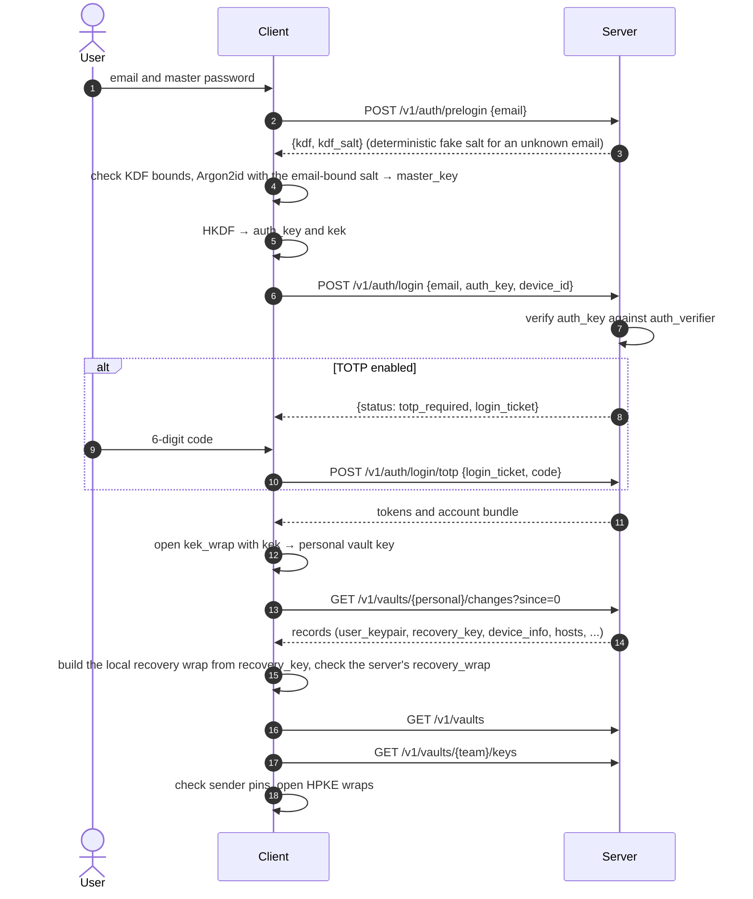
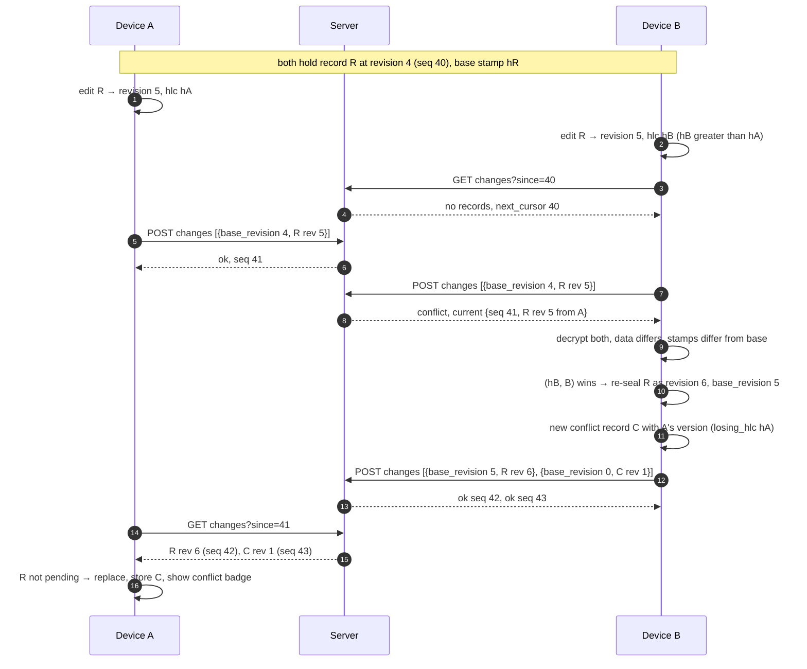
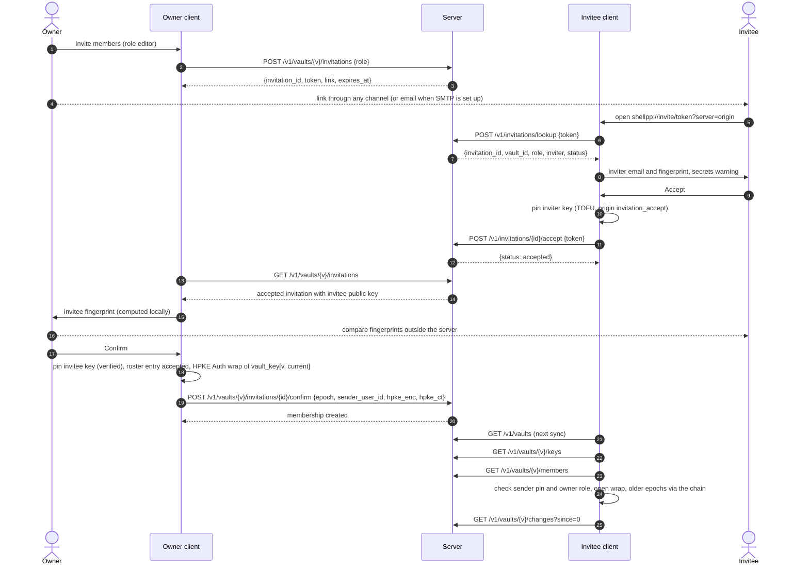
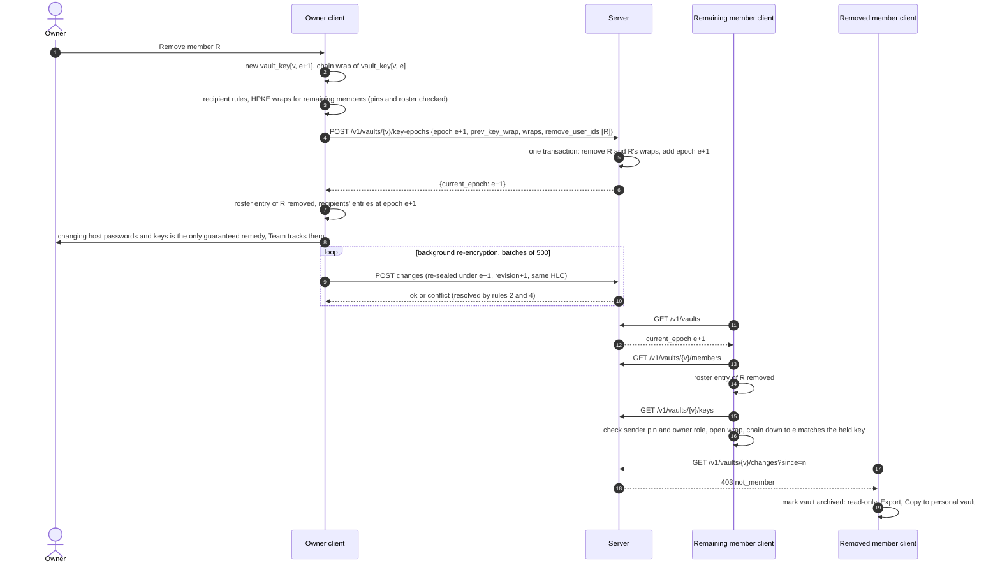

# Sync protocol

This document specifies how Shell++ clients and a self-hosted sync server exchange data: transport, authentication, account operations, record sync and conflict resolution, team vaults and key epochs, errors, limits and the server schema. It is normative for the wire types in `crates/sync-api` (`shellpp-sync-api`), the sync client in `crates/core` (`shellpp-core`) and the server in `server/` (`shellpp-server`).

- Status: stage 0 design, 2026-10-18.
- `D<n>` refers to accepted decision n in [decisions.md](decisions.md).
- "(stage 0 decision)" marks a choice made in stage 0 that is not in `SPEC.md`, the UI specification or an accepted decision. When a heading or a table is marked, the mark covers everything under it except values that cite a decision.
- "[decision] (D93)" marks what was added from the owner's answers to the sync design draft (D93, 2026-10-22). The answers are the owner's; the details that carry them out are ours and can be changed, as D93 lists. A heading marked this way covers its whole section.
- Wire examples use placeholders such as `"<b64u 73 bytes>"` for binary values and `…` inside strings for shortened tokens.

Related documents:

| Document | Relevant content |
|---|---|
| [architecture.md](architecture.md) | components, crates and their licenses, identifiers, server deployment and env configuration |
| [data-model.md](data-model.md) | record classes and types, payload fields, conflict copies as data, sync toggles, `member_pin`, `roster_entry` and `device_info` records |
| [storage-format.md](storage-format.md) | encodings, record envelope, AAD, padding, wrap blob, local SQLite schema |
| [security.md](security.md) | threat model, key hierarchy, Argon2id, HKDF labels, HPKE, fingerprints, server-visible metadata, accepted risks |
| [ui-behavior-spec.md](ui-behavior-spec.md) | Account & Sync (12.2), SSH ID and Team (12.3), Lock and account (13), sync conflicts (13.6) |

## 1. Overview

### 1.1 Components

| Component | Crate and license | Role |
|---|---|---|
| Sync client | `shellpp-core` (`crates/core`), Apache-2.0 | derives keys, seals and opens envelopes, runs the sync cycle, resolves conflicts |
| Wire types | `shellpp-sync-api` (`crates/sync-api`), Apache-2.0 | request and response types, item statuses, error codes |
| Server | `shellpp-server` (`server/`), AGPL-3.0-only | stores accounts, envelopes, key wraps and memberships; enforces roles, limits and retention |

The server may depend on `shellpp-sync-api`. Client code never depends on anything in `server/`.

### 1.2 Properties

- Local-first: the app works without a server. A server outage only delays sync (principle 1).
- Zero-knowledge: the server stores record envelopes (ciphertext with a small clear header), opaque key wraps and Argon2id verifiers of high-entropy auth keys. Passwords, keys and record plaintext never reach the server (principle 5, D10, D11).
- Revocation stops only future sync: removal from a vault, log out, account deletion or a dead server never wipes or locks data already on the device (principle 3).
- No telemetry: requests carry only what the operation needs (principle 2).
- Integrity against the server: the server cannot read or forge records, and swapped or reordered envelopes fail the AEAD check. Rollback and withholding by the server are not detected (D14, see [security.md](security.md)).

### 1.3 Terms

Record terms (vault, record, class, type, envelope, wrap, tombstone, conflict copy, pin) are defined in [data-model.md](data-model.md) and [storage-format.md](storage-format.md). Sync terms (revision, `synced_revision`, base stamp, `seq`, cursor, HLC) are defined in sections 6.1 and 6.2, key epochs in section 7.7. In short: a vault is the unit of encryption and sharing (D13); each record is one envelope; the server orders the writes of a vault by `seq`; clients order the versions of a record by HLC.

## 2. Transport

| Item | Rule |
|---|---|
| Scheme | HTTPS only. The client accepts `http://` only for `localhost`, `127.0.0.1` and `[::1]` (development and tests); any other `http://` origin is refused before a request is sent. [decision] (D93) |
| TLS | Terminated in front of the server: by a reverse proxy (Caddy example, SPEC), by Cloudflare's edge with Cloudflare Tunnel, or by a proxy on a VPN address (section 2.2). The server listens on plain HTTP at `SHELLPP_BIND`, default `127.0.0.1:8080`. The client uses `reqwest` with rustls (`ring` provider) and the system root store, plus, for one origin only, a certificate the user pinned or a CA the user added (section 2.1). [decision] (D93) |
| Server URL | The user enters an `https` origin. The client normalizes it to scheme, host and port (no path) and stores it as `server_account.server_url`: scheme and host in lowercase ASCII (an internationalized host in its punycode form), the port only when it is not the scheme's default, no trailing slash. The server must be served at the root of its origin. The normalized origin is also an input of `auth_key` and `recovery_auth_key` (section 4.1), so an account signs in only under the origin it was registered with. (stage 0 decision) |
| Base path | `/v1` for the API. `/healthz` and `/readyz` are not versioned. |
| Bodies | JSON, `Content-Type: application/json; charset=utf-8`. A response without a body uses `204 No Content`. |
| Encoding | `snake_case` names; binary as base64url without padding (`b64u`); UUIDs as lowercase hyphenated text; timestamps as RFC 3339 UTC with milliseconds; emails normalized (trim, NFC, lowercase) by both sides. Details: [storage-format.md](storage-format.md). |
| Unknown fields | Both sides ignore unknown JSON fields (section 13). (stage 0 decision) |
| Authorization | `Authorization: Bearer shellpp_at_…` on every `access` endpoint. |
| User-Agent | `shellpp/<semver>`. No other identifying headers. |
| Secrets | Auth keys, tokens, tickets, invitation tokens, codes and emails travel only in request bodies or headers, never in paths or query strings. The server logs user ids only, never emails, keys, tokens or envelopes. |
| Compression | None in v1; envelopes are incompressible. (stage 0 decision) |
| CORS | Not supported: requests come from the Rust core, not from the webview. (stage 0 decision) |
| Client timeouts | Connect 10 s, whole request 60 s (stage 0 decision); a token refresh 20 s (section 4.6; [decision] (D93)). |
| IP addresses | Used in memory for rate limiting only and never stored (section 10). |

### 2.1 Certificate trust

[decision] (D93)

The client never accepts an invalid certificate silently. For each server origin it trusts a certificate in one of three ways:

| Trust | When | What is checked on every connection |
|---|---|---|
| System | the certificate chain validates against the system root store | rustls' normal checks: chain, host name, validity dates |
| Pinned | the user chose "Trust this certificate" for this origin | the server's end-entity certificate equals the pinned one (SHA-256 of its DER bytes); its host name and validity dates are still checked |
| CA added | the user added a CA certificate for this origin | the chain validates against the system roots plus that CA, with the normal name and date checks; the CA counts only for this origin, never for another server or for anything else the app connects to |

- The trust choice is offered only when the handshake fails because the issuer is unknown (a self-signed certificate or a private CA). A certificate that is expired, not yet valid or not issued for the origin's host name is refused with that reason, pinned or not, and so is any other TLS failure: the operator fixes the certificate.
- The choice dialog (UI 13.5, step 1, and the unlock screen's recovery, UI 13.2) shows the origin, the certificate's subject, issuer and validity dates, the reason the system gives, and the SHA-256 fingerprint of the certificate as 32 uppercase hex byte pairs separated by colons, the form `openssl x509 -noout -fingerprint -sha256` prints, so the operator can compare it on the server. "Add a CA certificate…" takes a PEM or DER file and shows the CA's subject and fingerprint for confirmation; the server's certificate must then validate against it.
- A pin is like a TOFU host key (UI 10.2): once an origin has a pin, any other certificate stops sync with that server, also one the system trusts, until the user confirms it in the dialog of a changed certificate (UI 12.2): it shows the pinned and the new fingerprint and whether the system trusts the new one, and offers "Trust the new certificate" (a new pin), "Use the system's trust" (only when the system trusts the new one; removes the pin) or Cancel (sync stays stopped). Until then no request is sent to that origin: sync, recovery and invitation lookups wait; nothing is deleted.
- With an added CA, a new certificate from that CA is accepted without a question (that is how short-lived certificates of an internal CA renew). A certificate that no longer validates offers the choice dialog again.
- The trust choices are kept per normalized origin in the local table `server_tls` ([storage-format.md](storage-format.md), section 4.2), in plaintext, because the recovery from the unlock screen calls the server while the app is locked; they hold only public certificates and hashes. They stay after log out and go with "Delete local copy".
- The client keeps rustls; a certificate verifier of its own adds the pin or the CA of the one origin on top of the system roots.

### 2.2 Deployment and access

[decision] (D93)

The server is meant to run on a machine of the user's own, such as a homelab. Its documentation (`server/README.md`, written with the server in stage 7) covers three ways to reach it, each with an example configuration that the server's tests run:

| Access | How | Certificate the client sees |
|---|---|---|
| Own domain | a public DNS name; Caddy as the reverse proxy with automatic Let's Encrypt certificates (ports 80 and 443 open); Caddy forwards to `SHELLPP_BIND` | publicly trusted: no question in the client |
| Cloudflare Tunnel | `cloudflared` in the compose file connects out to Cloudflare; no inbound port is opened; Cloudflare's edge terminates TLS | Cloudflare's, publicly trusted: no question |
| VPN only (Tailscale or WireGuard) | the proxy listens only on the VPN address; the name resolves only inside the VPN (Tailscale MagicDNS or an internal DNS); the certificate comes from an internal CA, such as Caddy's `tls internal` | from the internal CA: the user adds that CA once per device (section 2.1), or pins a long-lived certificate. A pin of a short-lived certificate would stop sync at every renewal. Tailscale's `tailscale cert` gives a publicly trusted certificate for the `ts.net` name instead, with no question |

- In every case `SHELLPP_PUBLIC_URL` is the exact origin the clients use. Account credentials are bound to it (section 4.1), so moving from one way of access to another keeps the accounts only when scheme, host and port stay the same.
- `SHELLPP_TRUSTED_PROXIES` names the proxy that talks to the server (Caddy, or the `cloudflared` container), so per-IP rate limits see the client's address from `X-Forwarded-For` ([security.md](security.md), section 14.4).
- With Cloudflare Tunnel, Cloudflare sees every request in the clear: auth keys, tokens, emails, envelopes, wraps and metadata, as an active server would for the transport. Record contents stay end-to-end encrypted ([security.md](security.md), RR23). A Cloudflare Access policy that asks for a browser login cannot be passed by the client and must not cover the API.
- Plain HTTP stays for `localhost` only (section 2).

## 3. Endpoint reference

Auth column: `none`; `access` (bearer access token); `refresh` and `ticket` (the refresh token or ticket is sent in the body).

### 3.1 Service and authentication

| Method | Path | Auth | Purpose | Section |
|---|---|---|---|---|
| GET | `/healthz` | none | liveness: `200 {"status":"ok"}` | 3.4 |
| GET | `/readyz` | none | readiness: `200` when the database answers, else `503` | 3.4 |
| GET | `/v1/server` | none | server version, `api_versions`, registration mode, `smtp` flag, limits, `server_generation` | 3.4 |
| POST | `/v1/auth/prelogin` | none | KDF parameters and salt for an email | 4.2 |
| POST | `/v1/auth/register` | none | create an account and bind the local personal vault | 4.3 |
| POST | `/v1/auth/login` | none | sign in, or get a login ticket for the TOTP step | 4.4 |
| POST | `/v1/auth/login/totp` | ticket | finish sign-in with a TOTP code | 4.4 |
| POST | `/v1/auth/token/refresh` | refresh | rotate the refresh token, get a new access token | 4.6 |
| POST | `/v1/auth/token/revoke` | refresh | log out this device | 5.7 |
| POST | `/v1/auth/recover/begin` | none | prove the recovery key, get a recovery ticket, the account email and the recovery wrap | 5.2 |
| POST | `/v1/auth/recover/complete` | ticket | set a new password with the recovery ticket | 5.2 |

### 3.2 Account, devices and users

| Method | Path | Auth | Purpose | Section |
|---|---|---|---|---|
| GET | `/v1/account` | access | account bundle | 4.4 |
| POST | `/v1/account/password` | access | password change | 5.1 |
| POST | `/v1/account/recovery-key` | access | recovery key reissue | 5.3 |
| POST | `/v1/account/email` | access | change the email or resend the verification code | 5.4 |
| POST | `/v1/account/email/verify` | access | verify the email with a code | 5.4 |
| POST | `/v1/account/totp/setup` | access | create a pending TOTP secret | 5.5 |
| POST | `/v1/account/totp/enable` | access | enable TOTP with a code | 5.5 |
| POST | `/v1/account/totp/disable` | access | disable TOTP | 5.5 |
| PUT | `/v1/account/ssh-id` | access | publish a new SSH ID public key | 5.6 |
| POST | `/v1/account/delete` | access | delete the account on the server | 5.8 |
| GET | `/v1/devices` | access | list the user's devices | 4.7 |
| DELETE | `/v1/devices/{device_id}` | access | revoke a device's tokens | 4.7 |
| GET | `/v1/users/{user_id}/keys` | access | public keys of a co-member or invitation counterpart | 7.1 |

### 3.3 Vaults, records, members and invitations

| Method | Path | Auth | Purpose | Section |
|---|---|---|---|---|
| GET | `/v1/vaults` | access | the caller's vaults with role, epoch and `last_seq` | 7.2 |
| POST | `/v1/vaults` | access | create a team vault | 7.2 |
| GET | `/v1/vaults/{vault_id}` | access | vault details and members | 7.2 |
| DELETE | `/v1/vaults/{vault_id}` | access | delete a team vault's server copy (owner) | 7.11 |
| GET | `/v1/vaults/{vault_id}/keys` | access | epoch chain and the caller's wrap | 7.7 |
| POST | `/v1/vaults/{vault_id}/key-epochs` | access | rotate the vault key, optionally removing members (owner) | 7.7, 7.8 |
| GET | `/v1/vaults/{vault_id}/changes` | access | pull | 6.3 |
| POST | `/v1/vaults/{vault_id}/changes` | access | push | 6.5 |
| GET | `/v1/vaults/{vault_id}/members` | access | members with roles and public keys | 7.6 |
| PATCH | `/v1/vaults/{vault_id}/members/{user_id}` | access | change a member's role (owner) | 7.6 |
| POST | `/v1/vaults/{vault_id}/leave` | access | leave the vault | 7.6 |
| POST | `/v1/vaults/{vault_id}/invitations` | access | create an invitation (owner) | 7.3 |
| GET | `/v1/vaults/{vault_id}/invitations` | access | the vault's invitations (owner) | 7.3 |
| POST | `/v1/vaults/{vault_id}/invitations/{invitation_id}/confirm` | access | confirm an accepted invitation and post the key wrap (owner) | 7.3 |
| DELETE | `/v1/vaults/{vault_id}/invitations/{invitation_id}` | access | revoke an invitation (owner) | 7.3 |
| POST | `/v1/invitations/lookup` | access | invitee: details of an invitation by token | 7.3 |
| POST | `/v1/invitations/{invitation_id}/accept` | access | invitee: accept | 7.3 |
| POST | `/v1/invitations/{invitation_id}/decline` | access | invitee: decline | 7.3 |

Vault-scoped endpoints answer `403 not_member` both for unknown vaults and for vaults where the caller is not a member, so the existence of a vault is not revealed. (stage 0 decision)

### 3.4 Service endpoints

`GET /v1/server` needs no authentication. The connect wizard (UI 13.5, step 1) calls it to check that the URL points to a compatible server.

```json
{
  "version": "0.7.0",
  "api_versions": ["v1"],
  "registration": "invite",
  "smtp": false,
  "limits": {
    "max_envelope_bytes": 262232,
    "max_push_items": 500,
    "max_push_body_bytes": 16777216,
    "default_pull_limit": 500,
    "max_pull_limit": 1000,
    "tombstone_retention_days": 90
  },
  "server_generation": "<b64u 16 bytes>"
}
```

- `registration`: `open` or `invite` (`SHELLPP_REGISTRATION`). Invite-only is the default; open registration is the operator's choice in the server's configuration. [decision] (D93)
- `smtp`: `true` when SMTP is configured. Without it, email invitations and email verification are unavailable and the client hides the "verified" mark (D14).
- `limits`: the effective values of section 10. The names of the `limits` fields are a stage 0 decision.
- `server_generation`: 16 random bytes created by the first `migrate` and replaced by `shellpp-server admin restored` at the end of every restore from a backup (`server_state`, section 14). A client that sees another value than the one it stored runs the server restore procedure of section 6.9 for every vault (section 6.11). A server without the field (an older one) is not checked. The client stores the value in `server_account.server_generation` when it binds (registration, sign-in, rebind), from the `GET /v1/server` of the connect wizard's first step (UI 13.5). [decision] (D93)

`GET /healthz` always answers `200 {"status":"ok"}` while the process runs. `GET /readyz` answers `200 {"status":"ok"}` when the database answers a trivial query and `503 {"status":"unavailable"}` otherwise.

## 4. Authentication and devices

### 4.1 Key material

The client derives everything from the master password. Only the auth keys reach the server, and the server stores only verifiers of them. Derivations, labels and sizes are owned by [security.md](security.md).

| Value | Sent to the server | Server stores |
|---|---|---|
| master password, `master_key`, `kek` | never | nothing |
| `auth_key` = HKDF(`master_key`, `"shellpp/v1/auth"` ‖ origin) | on register, login, password change, recovery, email change and sensitive operations | Argon2id PHC verifier (`users.auth_verifier`) |
| `recovery_key`, `recovery_kek` | never | nothing |
| `recovery_auth_key` = HKDF(`recovery_key`, `"shellpp/v1/recovery-auth"` ‖ origin) | on register, recovery and reissue | Argon2id PHC verifier (`users.recovery_verifier`) |
| `kdf`, `kdf_salt` | on register, password change, recovery and email change | as sent; returned by pre-login |
| `kek_wrap`, `recovery_wrap` (wrap blobs of the personal vault key) | on register, password change, recovery, reissue; `kek_wrap` also on email change | opaque bytes |
| X25519 public key, SSH ID public key | on register (SSH ID also on regeneration) | as sent |

`master_key` is Argon2id over the password with a salt that binds the stored `kdf_salt` to the normalized account email ([security.md](security.md), section 5.4). The server never sees that salt, only `kdf_salt`; an email change therefore changes `auth_key` and `kek_wrap` (section 5.4).

"origin" in the two auth keys is `be16(len(o))` ‖ `o`, where `o` is the ASCII of the normalized server origin (section 2) the client sends the request to ([security.md](security.md), section 5.5). A server that answers pre-login with the salt and parameters another server uses for the same email, or that receives a registration from a device bound to another server before, therefore never obtains an auth key or a recovery auth key the other server accepts. (stage 0 decision)

Server-side verifiers are Argon2id PHC strings with `m = 19456 KiB, t = 2, p = 1` and a random 16-byte salt, computed over the 32-byte keys. The low cost is enough because the inputs are high-entropy keys, not passwords.

### 4.2 Pre-login

Request and response:

```json
{"email": "alice@example.com"}
```

```json
{
  "kdf": {"alg": "argon2id", "v": 1, "m_kib": 65536, "t": 3, "p": 4},
  "kdf_salt": "<b64u 16 bytes>"
}
```

- Known email: the stored `kdf` and `kdf_salt`.
- Unknown email: `kdf` is the desktop preset and `kdf_salt` is `HMAC-SHA256(prelogin_salt_key, normalized_email)[0..16]` (D11, [security.md](security.md)). The answer is stable across calls, so it does not reveal whether the account exists.
- The client refuses parameters below the floor (`alg = argon2id`, `v = 1`, `m_kib ≥ 32768`, `t ≥ 3`, `m_kib × t ≥ 131072`, `1 ≤ p ≤ 16`) or above the ceiling of its platform (desktop `m_kib ≤ 1048576`, mobile `m_kib ≤ 262144`, both `t ≤ 16`), or a salt that is not 16 bytes ([security.md](security.md), section 5.4). It then stops with "the server sent unsafe key derivation parameters" and sends no auth key. This stops a malicious server from forcing a cheap KDF or a derivation the device cannot finish.
- The client never uses `kdf_salt` alone as the Argon2id salt: it binds it to the email the user typed, so a server that returns the same salt to many users still gets auth keys computed under different salts.
- On a device bound to an account (signing in again after being signed out), an answer whose `kdf` or `kdf_salt` differs from `local_auth` means the password or the email changed on another device. The client says so and asks for the current account password before deriving anything. (stage 0 decision)
- Rate limit: per IP (section 10).

### 4.3 Registration

Registration binds the existing local data to a new account. It reuses the device's master password, KDF parameters, `kdf_salt`, personal vault key and recovery key (except after the move below); nothing is regenerated except the X25519 keypair and the SSH ID, which are created as records in the personal vault just before the request (D13).

A personal vault that was bound to an account before (the device logged out and kept its local copy) is first moved to a new personal vault, with a new `vault_id`, vault key and record ids, as the merge at sign-in does; that new vault is the one registered. The earlier account's `user_keypair`, `ssh_id`, `member_pin`, `roster_entry` and `credential_binding` records are not carried over and stay in a read-only archive of that account ([data-model.md](data-model.md), section 18.5). In this move case registration also generates a new `kdf_salt` and a new `recovery_key`: the new vault gets a new `recovery_key` record, its key is shown in step 4 of the wizard with the required "I saved it" (UI 13.5), and `recovery_auth_key` and `recovery_wrap` are made from it. The earlier server, which knows the old salt and verifies the old recovery key, therefore never sees material the new server receives, and the reverse. (stage 0 decision)

The master password is entered again for registration, and the client re-derives `master_key`, `kek` and `auth_key` with the account email in the Argon2id salt ([security.md](security.md), section 5.4), over the new `kdf_salt` in the move case. It wraps the personal vault key under the new `kek` → `kek_wrap`. This is a password change that keeps the password; the local copy keeps opening with the same password. (stage 0 decision)

Request:

```json
{
  "email": "alice@example.com",
  "registration_code": "7Q2M9X4K1D8F3H6J0N5P2R7T9V",
  "kdf": {"alg": "argon2id", "v": 1, "m_kib": 65536, "t": 3, "p": 4},
  "kdf_salt": "<b64u 16 bytes>",
  "auth_key": "<b64u 32 bytes>",
  "recovery_auth_key": "<b64u 32 bytes>",
  "personal_vault": {
    "vault_id": "0199f6a0-1c2d-7e3f-8a4b-5c6d7e8f9012",
    "epoch": 1,
    "kek_wrap": "<b64u 73 bytes>",
    "recovery_wrap": "<b64u 73 bytes>",
    "epoch_chain": []
  },
  "x25519_public_key": "<b64u 32 bytes>",
  "ssh_id_public_key": "ssh-ed25519 AAAAC3Nz… shellpp:alice@example.com",
  "device_id": "0199f6a1-b2c3-7d4e-8f00-112233445566"
}
```

- `registration_code` is omitted on open servers.
- `epoch_chain` lists `{"epoch": e, "prev_key_wrap": "<b64u 73 bytes>"}` for every `e` from 2 to `epoch`, and is empty when `epoch = 1`. (field name: stage 0 decision)

Response `201`:

```json
{
  "user_id": "0199f6a0-0a1b-7c2d-8e3f-405162738495",
  "tokens": {
    "access_token": "shellpp_at_…",
    "access_expires_at": "2026-10-18T22:46:05.123Z",
    "refresh_token": "shellpp_rt_…",
    "refresh_expires_at": "2026-11-17T22:31:05.123Z"
  }
}
```

The `tokens` object has the same shape in every response that issues tokens. (stage 0 decision)

Server checks, in this order, in one transaction (order: stage 0 decision):

1. Invite-only server: the code exists (by SHA-256), is not expired and has `uses_left > 0`, else `403 registration_closed`. The code is checked before the email, so a caller without a code learns nothing about registered emails.
2. `kdf` within the floor and the mobile ceiling of section 4.2 (clients never write parameters above it), else `400 weak_kdf_params`. Binary field sizes, else `400 bad_request`.
3. Normalized email not taken, else `409 email_taken`.
4. `vault_id` unused, `epoch ≥ 1`, `epoch_chain` complete, `device_id` not bound to another user, else `422 validation_failed`.
5. Create the user (`user_id` UUIDv7), both verifiers, the personal vault (`current_epoch = epoch`) with one `vault_members` row (role `owner`), the epoch rows, the device row and a new refresh family; decrement `uses_left`.
6. With SMTP: send a 6-digit verification code to the email (section 5.4).

After `201`, the client, in one local transaction, stores the account (refresh token wrapped, [storage-format.md](storage-format.md)), replaces the local `kek` wrap with the one it sent, sets `local_auth.kdf_email` to the account email (and, in the move case, `local_auth.kdf_salt` to the new salt, with the `recovery` row built from the new `recovery_key` record) and marks the personal vault as bound. It then pushes all records of enabled classes. The wizard then offers TOTP (UI 13.5).

### 4.4 Login and the TOTP step

Request:

```json
{
  "email": "alice@example.com",
  "auth_key": "<b64u 32 bytes>",
  "device_id": "0199f6a1-b2c3-7d4e-8f00-112233445566"
}
```

Response without TOTP:

```json
{
  "status": "ok",
  "tokens": {"access_token": "shellpp_at_…", "access_expires_at": "2026-10-18T22:46:05.123Z", "refresh_token": "shellpp_rt_…", "refresh_expires_at": "2026-11-17T22:31:05.123Z"},
  "account": {"user_id": "0199f6a0-0a1b-7c2d-8e3f-405162738495", "email": "alice@example.com"}
}
```

The `account` value is the full account bundle (below), shortened here. Response with TOTP enabled:

```json
{"status": "totp_required", "login_ticket": "shellpp_lt_…"}
```

Second step, `POST /v1/auth/login/totp`:

```json
{"login_ticket": "shellpp_lt_…", "code": "492817"}
```

It answers like a login without TOTP, without the `status` field.

Server rules:

- Unknown email: run a dummy Argon2id verification against a fixed PHC string computed at startup, then answer `401 invalid_credentials`. Wrong `auth_key`: the same code. Both count as failed sign-ins for that email (section 10).
- `403 account_disabled` is returned only after a correct `auth_key`.
- `device_id` bound to another user: `422 validation_failed` (section 4.7).
- TOTP enabled: create an `auth_tickets` row (`kind = login`, 5 minutes, 5 attempts) and return the ticket. No tokens yet.
- TOTP check: RFC 6238, HMAC-SHA1, 6 digits, 30 s step, ±1 step. A step at or below `totp_last_step` is rejected. A wrong code answers `401 invalid_totp` and increments `attempts`; at 5 attempts the ticket is deleted and later calls answer `401 ticket_expired`. On success `totp_last_step` is updated and the ticket is deleted.
- Success: upsert the device row (section 4.7), start a new refresh family, issue tokens, return the account bundle.

Account bundle (`GET /v1/account` and the `account` field):

```json
{
  "user_id": "0199f6a0-0a1b-7c2d-8e3f-405162738495",
  "email": "alice@example.com",
  "email_verified": true,
  "totp_enabled": true,
  "kdf": {"alg": "argon2id", "v": 1, "m_kib": 65536, "t": 3, "p": 4},
  "kdf_salt": "<b64u 16 bytes>",
  "personal_vault": {
    "vault_id": "0199f6a0-1c2d-7e3f-8a4b-5c6d7e8f9012",
    "epoch": 1,
    "kek_wrap": "<b64u 73 bytes>",
    "recovery_wrap": "<b64u 73 bytes>"
  },
  "x25519_public_key": "<b64u 32 bytes>",
  "ssh_id_public_key": "ssh-ed25519 AAAAC3Nz… shellpp:alice@example.com",
  "created_at": "2026-10-18T22:31:05.123Z",
  "quota": {"max_records": 20000, "max_bytes": 268435456, "records": 1532, "bytes": 1048576}
}
```

`quota` is present only when a limit applies to the account (section 10.2): the limits (`null` for one that is not set) and the account's usage. [decision] (D93)

After sign-in on an empty device the client opens `kek_wrap` with its `kek`, writes the local `kek` wrap and `local_auth` (`kdf`, `kdf_salt`, and as `kdf_email` the normalized email the user typed), pulls the personal vault (which holds `user_keypair` and `recovery_key`), then lists and pulls team vaults and writes its `device_info` record. A failed unwrap means the server sent a wrong wrap; the client stops and reports an integrity error. Signing in on a device with local data merges that data into the account's personal vault (D15, [data-model.md](data-model.md), section 18.5). When the account bundle's `personal_vault.vault_id` equals the local personal vault's id (the account this device was last bound to), sign-in is a rebind, not a merge: the client keeps the rows and record ids, binds the vault again and runs the full resync of section 6.9; an account bundle that reports a personal epoch below the local one, or a `kek_wrap` that opens to another key than the one this device holds for that epoch, is a rollback and changes nothing (section 5.1, "Personal epoch rollback"). A personal vault that was bound to another account is merged without that account's `user_keypair`, `ssh_id`, `member_pin`, `roster_entry` and `credential_binding` records, which stay in a read-only archive. (stage 0 decision for the last two rules)

The local `recovery` wrap is never copied from the server (stage 0 decision):

- Every device builds its local `recovery` wrap itself while unlocked: `recovery_kek` = HKDF of the key in the synced `recovery_key` record, wrapping the current personal vault key ([storage-format.md](storage-format.md), section 6.2). It rebuilds the wrap whenever it applies a new revision of that record and whenever the personal vault gets a new epoch.
- After sign-in, the client opens the server's `recovery_wrap` with that `recovery_kek` and compares the result with the personal vault key (constant time). If the wrap does not open or holds another key, the server copy is wrong: recovery through the server would fail when the password is lost. The client shows an integrity warning and offers a recovery key reissue (section 5.3), which replaces the server's verifier and wrap.
- Until the record has been pulled, the device has no local `recovery` wrap.

### 4.5 Login sequence



### 4.6 Tokens

(stage 0 decision)

| Token | Form | Lifetime | Server stores |
|---|---|---|---|
| Access | `shellpp_at_` + b64u(32 random bytes) | 15 minutes | SHA-256 in `access_tokens` |
| Refresh | `shellpp_rt_` + b64u(32 random bytes) | 30 days, rotated on every use | SHA-256 in `refresh_tokens`, with `family_id` and `device_id` |
| Login ticket | `shellpp_lt_` + b64u(32 random bytes) | 5 minutes, 5 attempts | SHA-256 in `auth_tickets` |
| Recovery ticket | `shellpp_rc_` + b64u(32 random bytes) | 10 minutes, 5 attempts | SHA-256 in `auth_tickets` |

Refresh, `POST /v1/auth/token/refresh`:

```json
{"refresh_token": "shellpp_rt_…"}
```

```json
{"tokens": {"access_token": "shellpp_at_…", "access_expires_at": "2026-10-18T23:01:05.123Z", "refresh_token": "shellpp_rt_…", "refresh_expires_at": "2026-11-17T22:46:05.123Z"}}
```

Server rules:

- A refresh token whose row is unknown, expired or revoked answers `401 unauthenticated`, unless its hash is in `deleted_account_tokens`: then `401 account_deleted` (section 5.8).
- A refresh token that was already used (`used_at` set) is a reuse: the server revokes every refresh and access token of its family and answers `401 refresh_token_reused`. The device must sign in again. One exception, the retry of a lost response (below).
- Otherwise the server sets `used_at`, inserts the successor in the same family with a new 30-day expiry, stores the successor's hash in `successor_hash` of the used row and issues a new access token.
- Retry of a lost response [decision] (D93): a used token is accepted once more when it was used at most 60 seconds ago, its successor has not been used, and no retry was granted for it before (`retried_at` is null). In one transaction the server marks the unused successor as used, so that presenting it later counts as a reuse and revokes the family, sets `retried_at`, inserts a new successor in the same family and issues a new access token. Anything else (a later retry, a second one, a successor already used) is a reuse as above. The access token issued with the lost response simply expires.
- An access token is valid while its row exists, `expires_at` is in the future, the device is not revoked and the user is not disabled. Earlier access tokens of a family stay valid until they expire; revocation deletes them all.
- The device's `last_seen_at` is updated at most once per day, with day precision.

Client rules:

- The refresh token is stored only as a wrap blob under `local_secrets_key` (`server_account.refresh_token`, [storage-format.md](storage-format.md)), so it is usable only while the app is unlocked.
- The access token lives in memory only and is discarded on lock (stage 0 decision). Sync is paused while locked; after unlock the client refreshes.
- One refresh at a time (single flight). An `access` call that answers `401 unauthenticated` triggers one refresh and one retry. If the refresh fails with any `401`, the account enters the "signed out" state: sync stops, local data stays, and Account & Sync asks to sign in again.
- The stored refresh token is replaced only in the transaction that stores a refresh response. A refresh request has a whole-request timeout of 20 s. A refresh that ends without a response (a network error or that timeout) is retried once at once with the same token, without the backoff of section 6.11, so that it arrives within the 60 seconds in which the server accepts it once (above); after that, with that backoff. A `401 refresh_token_reused` after that signs the device out as before. [decision] (D93; replaces the stage 0 rule that a lost refresh response signs the device out)
- `401 account_deleted`: the account was deleted from another device. The client does what the deleting device did (section 5.8) and says so (UI 12.2). [decision] (D93)

### 4.7 Devices

A device is one installation with its own `device_id` (UUIDv7 generated locally). There is no separate registration call: register, login, login/totp and recover/complete create or refresh the `devices` row for the `device_id` in the request.

- A `device_id` belongs to the first account that uses it. When a client binds to a different account (another server or another `user_id`) than the one it was last bound to, it first generates a new `device_id`. The server answers `422 validation_failed` with `details.field = "device_id"` if the id belongs to another user. (stage 0 decision)
- Signing in again with a revoked `device_id` clears `revoked_at`, since the sign-in proves the password (and TOTP) again. (stage 0 decision)
- Device names are not sent to the server; they live in `device_info` records in the personal vault ([data-model.md](data-model.md)).

`GET /v1/devices`:

```json
{
  "devices": [
    {"device_id": "0199f6a1-b2c3-7d4e-8f00-112233445566", "created_at": "2026-10-18T22:31:05.123Z", "last_seen_at": "2026-10-18T00:00:00.000Z", "revoked": false, "current": true},
    {"device_id": "0199e2c4-5a6b-7c8d-9e0f-a1b2c3d4e5f6", "created_at": "2026-10-02T08:12:44.501Z", "last_seen_at": "2026-10-11T00:00:00.000Z", "revoked": false, "current": false}
  ]
}
```

`DELETE /v1/devices/{device_id}` answers `204`. It sets `revoked_at` and deletes all refresh and access tokens of that device. It never wipes data on the device (principle 3); the revoked device gets `401` and enters the "signed out" state. Revoking the current device equals log out.

A lost or stolen device (client flow; [decision] (D93)): Revoke for another device (UI 12.2, Devices) asks whether the device was lost or stolen. "Revoke only" sends the `DELETE` alone. "Lost or stolen" sends it and continues:

1. A password change with "my old password may be compromised" turned on and fixed (section 5.1): the personal vault rotates, so the stolen device's keys open nothing written later, and the new password stops the thief from signing in again, which would clear the revocation (above).
2. A list of the team vaults where the user is an owner, all ticked, each rotated with an explicit rotation and no removal (section 7.7, interactive recipient rules).
3. For the team vaults the user does not own, the dialog names their owners (from the member lists) and says to ask one of them to rotate the vault's key.

The stolen device also holds the user's X25519 private key, which cannot be rotated in the MVP ([security.md](security.md), RR17): a team vault rotation protects that vault only while the server refuses the stolen device, which the revocation and the new password make sure of. Nothing is wiped on the stolen device (principle 3).

### 4.8 Sensitive operations

These requests repeat the proof of password as `current_auth_key` in the body. A wrong value answers `401 invalid_credentials` and counts as a failed sign-in (section 10).

| Endpoint | Also requires |
|---|---|
| `POST /v1/account/password` | none |
| `POST /v1/account/recovery-key` | none |
| `POST /v1/account/email` | none |
| `POST /v1/account/email/verify` | only when it completes an email change (section 5.4) |
| `POST /v1/account/totp/setup` | none |
| `POST /v1/account/totp/disable` | `code` (current TOTP) |
| `POST /v1/account/delete` | `totp_code` when TOTP is enabled |
| `POST /v1/vaults/{personal}/key-epochs` | none (stage 0 decision: a stolen access token alone cannot replace `kek_wrap`) |

## 5. Account operations

### 5.1 Password change

The change rewraps the personal vault key and atomically replaces the auth key, salt and KDF parameters; records are not re-encrypted (D11). With the option "my old password may be compromised" (off by default) the change also rotates the personal vault key, so the old `kek_wrap` that the server and its backups keep stops opening current and future data ([security.md](security.md), RR6). (stage 0 decision for the option)

Client steps:

1. Ask for the current and the new password and the option (minimum length and the rest of the UI: UI 13.4, [security.md](security.md)).
2. Derive `current_auth_key` from the current password with the stored parameters.
3. Generate a new 16-byte `kdf_salt`; use the platform preset as the new `kdf` ([security.md](security.md)).
4. Derive the new `master_key`, `kek` and `auth_key` (the Argon2id salt binds the new `kdf_salt` to `local_auth.kdf_email`); wrap `vault_key[personal, current]` under the new `kek` → `kek_wrap`.
5. With the option: generate `vault_key[personal, e + 1]`, wrap `vault_key[personal, e]` under `chain_key[personal, e + 1]` → `prev_key_wrap`, and wrap the new key under the new `kek` → `kek_wrap` and under `recovery_kek` from the `recovery_key` record → `recovery_wrap`.
6. `POST /v1/account/password`.
7. On success, in one local transaction: replace the local `kek` wrap and `local_auth` (`kdf`, `kdf_salt`), and store the new refresh token. With a rotation, also write the new epoch: `vaults.current_epoch`, the `chain` row and the `kek`, `recovery` and (when "remember on this device" is on) `device` rows of the new epoch, the refresh token wrapped under the new `local_secrets_key`; background re-encryption then starts (section 7.9). The new epoch is always above the local current epoch: a rotation never writes an epoch this device already holds (below).

Request:

```json
{
  "current_auth_key": "<b64u 32 bytes>",
  "kdf": {"alg": "argon2id", "v": 1, "m_kib": 65536, "t": 3, "p": 4},
  "kdf_salt": "<b64u 16 bytes>",
  "auth_key": "<b64u 32 bytes>",
  "kek_wrap": "<b64u 73 bytes>",
  "rotation": {"epoch": 2, "prev_key_wrap": "<b64u 73 bytes>", "recovery_wrap": "<b64u 73 bytes>"}
}
```

Response `200`: `{"tokens": {…}}` for the calling device.

`rotation` (stage 0 decision) is optional here and required in a recovery (section 5.2) and a recovery key reissue (section 5.3). When it is present, `kek_wrap` and `rotation.recovery_wrap` wrap `vault_key[personal, epoch]`, and the server, in the same transaction as the rest of the request, checks `epoch = current_epoch + 1` (`409 epoch_conflict`) and the wrap sizes, inserts the epoch row with `prev_key_wrap`, replaces `recovery_wrap` and sets `current_epoch = epoch`, as step 5 of section 7.7 does for the personal vault.

Server, in one transaction: verify `current_auth_key`; check KDF bounds (`400 weak_kdf_params`); replace `auth_verifier`, `kdf`, `kdf_salt` and `kek_wrap`; apply `rotation` when present; set `credentials_changed_at`; revoke every refresh family and delete every access token and ticket of the user, including the caller's; issue a new family for the caller.

Effects:

- Other devices get `401` on their next request and must sign in with the new password. Until then their old password still unlocks their local copy (accepted risk, [security.md](security.md)). After that sign-in they rewrap their local `kek` wrap; after a rotation they also learn the new epoch from `kek_wrap` and the epoch chain, rebuild their local `recovery` wrap and receive the re-encrypted records by normal pulls.
- Without a rotation, the recovery wrap and any device wrap do not change.
- If the client crashes after the server accepted the change but before step 7, the local copy still opens with the old password; the next sync fails with `401`, and signing in with the new password repairs the local wraps. An interrupted re-encryption is resumed by whichever device of the user syncs next (section 7.9).
- In local mode the change is local only ([security.md](security.md)), with the same optional rotation.

Personal epoch rollback (stage 0 decision): the client never lowers `vaults.current_epoch` of the personal vault and never replaces a `key_wraps` row of an epoch at or below the local current epoch with one whose wrapped key differs; a rewrap of the same key under another wrapping key stays allowed ([storage-format.md](storage-format.md), section 6.2). A server restored from a backup (section 6.9), or one that replays an older genuine `recovery_wrap` or `kek_wrap`, would otherwise make a device reuse an epoch number it already holds, overwrite that epoch's key rows and lose every record sealed under the newer local keys.

- When `recover/begin`, the account bundle, `GET /v1/vaults`, `GET /v1/vaults/{personal}/keys` or `details.current_epoch` of a `409 epoch_conflict` reports a personal epoch below the local current epoch, or a `kek_wrap` or `recovery_wrap` for an epoch this device holds opens to another key than the one it holds for that epoch (constant-time comparison), the client changes nothing, does not retry the request with the server's epoch, stops syncing the personal vault and shows "server state rolled back".
- A recovery on that device then opens its local `recovery` row and only rewraps locally, without a rotation (section 5.2, "Offline recovery of the local copy").
- Bringing such a server back to the local epochs: the re-post below. It is never automatic, because a hostile server can report a lower epoch on purpose.

Re-post of the personal vault's epochs ([decision] (D93); D11 amended): "server state rolled back" offers "Bring the server up to date…". Each time, after the user confirms it and re-enters the account password:

1. The password is the one the server holds now. After a restore it may be the one from before a password change made after the backup: the sign-in and the re-post then use it, and the user can change the password again afterwards.
2. For each epoch `k` from the server's current epoch + 1 up to the local current epoch, in order, the client calls `POST /v1/vaults/{personal}/key-epochs` (section 7.7) with `current_auth_key`, `epoch = k`, `prev_key_wrap` = the bytes of its local `chain` row of epoch `k`, and `account_wraps`: `vault_key[personal, k]` wrapped under the `kek` of that password and under `recovery_kek` of the local `recovery_key` record. Every step is `current + 1`, so the server's existing checks apply; the keys are the ones the device holds, so no epoch number gets a second key and no local key row changes.
3. The server restore procedure of section 6.9 then pushes back every record the server lacks or holds older.
4. When the server's `recovery_key` record is older than the local one (a reissue after the backup), the server's recovery verifier belongs to the older key; the client then offers a recovery key reissue (section 5.3).

A `409 epoch_conflict` in step 2 (another device re-posted in between) refreshes the epochs and goes on from the server's new current epoch.

### 5.2 Recovery with the recovery key

Used from the unlock screen ("Use recovery key", UI 13.2) when the master password is lost.

The recovery dialog of a bound device pre-fills `server_account.email` and lets the user edit it, because an email change made on another device signs this device out without updating that column. When the entered key opens the local `recovery` row but `begin` answers `401 invalid_credentials`, the dialog says that the email or the recovery key may have changed on another device, not only that the key is wrong. (stage 0 decision)

`POST /v1/auth/recover/begin`:

```json
{
  "email": "alice@example.com",
  "recovery_auth_key": "<b64u 32 bytes>",
  "device_id": "0199f6a1-b2c3-7d4e-8f00-112233445566"
}
```

```json
{
  "recovery_ticket": "shellpp_rc_…",
  "email": "alice@example.com",
  "recovery_wrap": "<b64u 73 bytes>",
  "personal_vault_id": "0199f6a0-1c2d-7e3f-8a4b-5c6d7e8f9012",
  "epoch": 1,
  "totp_required": true
}
```

`device_id` is needed because the ticket row records the device. `email` is the normalized account email that `begin` accepted; the client checks that it equals its own normalization of the email it sent, and stops otherwise. (stage 0 decision)

On a device that holds the personal vault, an `epoch` below the local current epoch, or a `recovery_wrap` that opens to another key than the one this device holds for that epoch (the local `recovery` row and the chain give it), is a rollback: the client stops before `complete` and offers the offline recovery below (section 5.1, "Personal epoch rollback"). (stage 0 decision)

The client opens `recovery_wrap` with `recovery_kek`, asks for a new password, derives new `kdf_salt`, `kek`, `auth_key` and `kek_wrap` as in section 5.1, except that the Argon2id salt binds the new `kdf_salt` to the email accepted by `begin`, not to `local_auth.kdf_email`, which may be stale after an email change on another device. It always rotates the personal vault key (step 5 of section 5.1, with `recovery_wrap` made with the same recovery key), so a lost or leaked old password and its `kek_wrap` on the server stop opening current and future data (stage 0 decision). It then calls `POST /v1/auth/recover/complete`:

```json
{
  "recovery_ticket": "shellpp_rc_…",
  "totp_code": "492817",
  "email": "alice@example.com",
  "kdf": {"alg": "argon2id", "v": 1, "m_kib": 65536, "t": 3, "p": 4},
  "kdf_salt": "<b64u 16 bytes>",
  "auth_key": "<b64u 32 bytes>",
  "kek_wrap": "<b64u 73 bytes>",
  "rotation": {"epoch": 2, "prev_key_wrap": "<b64u 73 bytes>", "recovery_wrap": "<b64u 73 bytes>"},
  "device_id": "0199f6a1-b2c3-7d4e-8f00-112233445566"
}
```

Response `200`: `{"tokens": {…}}`.

- `begin` with an unknown email or a wrong key: dummy verification, `401 invalid_credentials`, counted as a failed attempt.
- `complete` checks the ticket (`kind = recovery`, same `device_id`, not expired), the TOTP code when TOTP is enabled (`401 invalid_totp`, 5 attempts per ticket, then `401 ticket_expired`), that `email` (the normalized email the new material was derived for, the one `begin` returned) equals `users.email` (`422 validation_failed` with `details.field = "email"`; stage 0 decision), the KDF bounds and `rotation` (required; `409 epoch_conflict`). TOTP can be reset only with the admin CLI (D11).
- On success the server replaces the auth material and applies the rotation as in a password change, and revokes every other device.
- The client then stores the new epoch as in step 7 of section 5.1, pulls the personal vault and starts background re-encryption (section 7.9). The step 7 transaction also sets `local_auth.kdf_email` and `server_account.email` to the email accepted by `begin`.
- `422` with `details.field = "email"` means the email changed on another device after `begin`; the client tells the user and restarts the recovery with the current email. An email change also deletes every ticket of the user (section 5.4), so a later `complete` with the old ticket answers `401 ticket_expired`.
- The recovery key itself stays valid; the user can reissue it (section 5.3).
- Local mode: the client opens the local `recovery` wrap, sets a new password locally and rotates the personal vault the same way.

Offline recovery of the local copy (stage 0 decision): on a bound device, when the server cannot be reached, refuses the recovery (any answer other than a retryable `429` or `5xx`) or reports a rolled-back epoch (section 5.1), the client may recover the local copy from its local `recovery` row instead, as principle 3 requires:

- the entered key must open the local `recovery` row; the user sets a new local password;
- the client rewraps the current personal vault key under the new `kek` as a local password change does (new `kdf_salt`, the current preset, `local_auth.kdf_email` unchanged), without a rotation, so no epoch the server does not know is created;
- in the same local transaction it sets `server_account.refresh_token` to `NULL` ([storage-format.md](storage-format.md), section 6.4), so the account is in the "signed out" state of section 4.6 on this device; the rest of the `server_account` row and the vault bindings stay;
- the next sign-in needs the account password or a recovery through the server. It is a rebind (section 4.4) that writes `local_auth` and the `kek` row from the account, after which the local copy opens with the account password again.

### 5.3 Recovery key reissue

A reissue rotates the personal vault key, because the old key and the old `recovery_wrap` kept by the server and its backups would otherwise keep opening current data, and commits the new `recovery_key` record in the same server transaction, so two devices that reissue at the same time cannot leave the verifier and the record on different keys. (stage 0 decision)

1. The user re-enters the master password (UI 13.4); the client derives `current_auth_key` and `kek`.
2. The client generates a new `recovery_key` and derives `recovery_kek` and `recovery_auth_key`. It generates `vault_key[personal, e + 1]`, wraps `vault_key[personal, e]` under `chain_key[personal, e + 1]` → `prev_key_wrap`, and wraps the new key under `kek` → `kek_wrap` and under the new `recovery_kek` → `recovery_wrap`.
3. It seals the new revision of the `recovery_key` record under the new epoch, with `base_revision` = its `synced_revision`.
4. The client shows the new key and requires "I saved it" before anything is sent. (stage 0 decision)
5. `POST /v1/account/recovery-key`:

```json
{
  "current_auth_key": "<b64u 32 bytes>",
  "recovery_auth_key": "<b64u 32 bytes>",
  "kek_wrap": "<b64u 73 bytes>",
  "rotation": {"epoch": 3, "prev_key_wrap": "<b64u 73 bytes>", "recovery_wrap": "<b64u 73 bytes>"},
  "record": {"base_revision": 2, "envelope": "<b64u 344 bytes>"}
}
```

Response `200`: `{"tokens": {…}, "seq": 1533}`.

Server, in one transaction: verify `current_auth_key`; apply `rotation` as in section 5.1; check `record` with the push rules of section 6.6, where its header must name the personal vault, class `0x01` and the new epoch (`400 invalid_envelope` otherwise), and its `base_revision` must equal the stored revision (`409 revision_conflict` otherwise, with `details.current` = the stored `{seq, envelope}`); write the record with the next `seq`; replace `recovery_verifier`, `kek_wrap` and `recovery_wrap`; set `credentials_changed_at`; revoke every refresh family, including the caller's, and issue a new family for the caller. Any failure rolls back the whole request: the old key keeps working.

6. On success, the client stores the record as synced and the new epoch as in step 7 of section 5.1, and starts background re-encryption (section 7.9). The old key stops working.
7. If another device reissued the key first, this request fails as a whole: with `401`, because that reissue revoked this device's tokens, or with `409 revision_conflict`. The client discards its new key and tells the user that the key shown on this device is not valid; after signing in again it applies the winning record and offers to show the valid key.

Other devices are signed out. Until they sign in again, their local copy still opens with the old recovery key ([security.md](security.md), RR6); after signing in they rebuild their local `recovery` wrap from the new record (section 4.4).

### 5.4 Email change and verification

The normalized email is part of the Argon2id salt ([security.md](security.md), section 5.4), so the request that makes a new email effective also carries new key material: the client asks for the current password and derives a new `kdf_salt`, `auth_key` and `kek_wrap` for the new email exactly as a password change does (section 5.1, steps 2–4, with the current password as the new one). Personal vault and records are unchanged. (stage 0 decision)

- `POST /v1/account/email` with `{"current_auth_key": "<b64u 32 bytes>", "new_email": "alice@example.org"}`:
  - without SMTP: the request also carries `kdf`, `kdf_salt`, `auth_key` and `kek_wrap` for the new email, and the change takes effect at once with `email_verified = false`; response `200 {"email": "alice@example.org", "email_verified": false, "tokens": {…}}`;
  - with SMTP: a 6-digit code (15 minutes, 5 attempts) is sent to the new address and the email changes only after verification; response `202 {"verification": "sent"}`;
  - `409 email_taken` if the address belongs to another account.
- `new_email` equal to the current email resends the verification code for it (stage 0 decision).
- `POST /v1/account/email/verify`:
  - completing a change: `{"code": "381904", "current_auth_key": "<b64u 32 bytes>", "email": "alice@example.org", "kdf": {…}, "kdf_salt": "<b64u 16 bytes>", "auth_key": "<b64u 32 bytes>", "kek_wrap": "<b64u 73 bytes>"}`, with the material for the new email (the client asks for the password at this step) and, as `email`, the normalized email the material was derived for → `200 {"email": "alice@example.org", "email_verified": true, "tokens": {…}}`. Without the material: `422 validation_failed`;
  - verifying the current email: `{"code": "381904"}` → `200 {"email": "alice@example.com", "email_verified": true}`;
  - a wrong code answers `422 validation_failed`; after 5 attempts the code is deleted.
- `email_codes` holds one pending change per user, so a second `POST /v1/account/email` (from another device, or with a corrected address) replaces the first. In the transaction that completes a change, the server answers `422 validation_failed` with `details.field = "email"` unless `email` equals `email_codes.new_email`, so a code for one address can never install material derived for another. The client then tells the user that a newer change replaced this one. (stage 0 decision)
- A change takes effect in one server transaction, as in a password change: verify `current_auth_key`, check KDF bounds, replace `email`, `auth_verifier`, `kdf`, `kdf_salt` and `kek_wrap`, set `credentials_changed_at`, revoke every refresh family and delete every access token and ticket of the user, including the caller's, and issue a new family for the caller. Deleting the tickets ends a recovery begun before the change, whose new material would be bound to the old email (section 5.2). (stage 0 decision for the tickets)
- The client then, in one local transaction, replaces the local `kek` wrap, `local_auth` (`kdf`, `kdf_salt`, `kdf_email`) and `server_account.email`, and stores the new refresh token. Other devices are signed out and sign in with the new email and the same password.

### 5.5 TOTP management

- `POST /v1/account/totp/setup` with `{"current_auth_key": "<b64u 32 bytes>"}` → `200 {"secret": "JBSWY3DPEHPK3PXPJBSWY3DPEHPK3PXP", "otpauth_uri": "otpauth://totp/Shell%2B%2B:alice%40example.com?secret=JBSWY3DPEHPK3PXPJBSWY3DPEHPK3PXP&issuer=Shell%2B%2B"}`. The secret is 160 bits, shown as RFC 4648 base32 (the form authenticator apps expect; stage 0 decision). The client shows the URI only as a QR code and never opens it. The server stores the secret encrypted under `totp_at_rest_key` with `totp_enabled = false`. Calling setup again replaces a pending secret; when TOTP is already enabled it answers `422 validation_failed`.
- `POST /v1/account/totp/enable` with `{"code": "492817"}` → `204`; sets `totp_enabled = true` and `totp_last_step`.
- `POST /v1/account/totp/disable` with `{"current_auth_key": "<b64u 32 bytes>", "code": "492817"}` → `204`; clears the secret.
- Enabling or disabling TOTP does not revoke tokens. A lost authenticator is reset only with `shellpp-server admin user reset-totp`.

### 5.6 SSH ID public key

After the SSH ID is regenerated (the private key is the `ssh_id` record in the personal vault), the client publishes the new public line: `PUT /v1/account/ssh-id` with `{"ssh_id_public_key": "ssh-ed25519 AAAAC3Nz… shellpp:alice@example.com"}` → `204`.

Two devices that regenerate at the same time can leave the server with the key published last, while the other version of the record wins the conflict (section 6.7). So the device that wrote the effective `ssh_id` version (its payload `device_id` is this device) compares the record's `public_key` with `ssh_id_public_key` of `GET /v1/account` after a pull applies a new revision of the record, after it resolves a conflict on it, and after each sign-in, and publishes the record's key when they differ. Other devices only read it. [decision] (D93)

### 5.7 Log out

`POST /v1/auth/token/revoke` with `{"refresh_token": "shellpp_rt_…"}` → `204`. The server revokes the token's family and deletes its access tokens; the device row stays. The client then asks whether to keep the local copy (default) or delete it (UI 12.2). If it is kept, the vaults become unbound: the personal vault is local-only and team vaults become read-only archives (section 7.11). Signing in to the same account later is a rebind (section 4.4). Log out works offline too: the client unbinds locally and the server tokens expire on their own.

### 5.8 Account deletion

`POST /v1/account/delete` with `{"current_auth_key": "<b64u 32 bytes>", "totp_code": "492817"}` → `204`.

- Blocked with `409 sole_owner` while the user is the only owner of a team vault that has other members; `details.vault_ids` lists those vaults (D14). The user transfers ownership first (section 7.6).
- Otherwise, in one transaction, the server deletes the user, the personal vault with its records, epochs and invitations, the devices and all tokens and tickets. Team vaults where the user is the only member are deleted. In other team vaults the membership and the user's wraps are removed and `rotation_pending` is set, so a remaining owner rotates the key (section 7.7).
- The records the user wrote in team vaults that keep other members stay there, its published connection log entries included; their `created_by` names a user that no longer exists. [decision] (D93)
- In the same transaction the server copies the hash of every refresh token of the user that is not expired or revoked into `deleted_account_tokens` with the time of the deletion, and keeps nothing else in the database: no email, no user id (the server log keeps the event "account deleted" with its `user_id`, section 10.3). For 30 days a refresh with one of them answers `401 account_deleted` with `details.deleted_at` (a date without time), so the account's other devices learn why they are signed out; the purge job then deletes the rows. [decision] (D93)
- The deletion is immediate, with no grace period on the server ([decision] (D93)). Before it, the client's dialog offers Export and says what changes: the account cannot be restored, this device keeps its data, the members of team vaults lose the user's access while the user's records and published log entries stay with them, and the account's other devices are told at their next sync (UI 12.2). Server backups follow [security.md](security.md), section 14.4.
- The local copy stays (UI 12.2): the personal vault becomes local-only and team vaults become archives. A device that gets `401 account_deleted` does the same in one local transaction (`server_account` row removed, `vaults.bound = 0`, team vaults `archived`, the `meta` keys of the last account kept) and says that the account was deleted from another device and that the data here is kept. [decision] (D93)

## 6. Record sync

### 6.1 Model

| Item | Where | Meaning |
|---|---|---|
| Envelope | local `records.envelope`, server `records.envelope` | the encrypted record, byte-identical on both sides (D10). Layout, AAD and padding: [storage-format.md](storage-format.md). |
| `revision` | envelope header | per record, u64, starts at 1, +1 on every local write (edit, deletion, re-encryption) |
| `synced_revision` | client only | revision last acknowledged by or received from the server; `0` means the server never had the record. A record is pending when `revision ≠ synced_revision`. |
| Base stamp | client only | `(hlc, device_id)` of the synced version a pending record was derived from; empty when `synced_revision = 0`, except for a record a full resync pushes back (section 6.9), which keeps the stamp of its own synced version. Set at the first local write after a sync, cleared when the record becomes synced. Used only by conflict resolution (section 6.7). (stage 0 decision; kept as the encrypted copy `records.base_envelope`, [storage-format.md](storage-format.md), section 4.6, so HLC values stay out of the clear) |
| `seq` | server | per-vault sequence number of the last accepted write of a record; an update moves the record to a new `seq` |
| Cursor | client `sync_state.cursor` | one per vault (D12): the highest `seq` up to which the client has applied every write |
| `last_seq`, `min_valid_seq` | server `vaults` | the newest `seq`; the highest `seq` of a purged tombstone |
| HLC, `device_id` | inside the payload | clock and author of the last semantic change; the server never sees them |

The server keeps only the newest version of each record. Live records and tombstones are both records.

### 6.2 Hybrid logical clock

(D12; format: stage 0 decision)

- Value: u64 = `(unix_ms << 16) | counter`, 48 bits of milliseconds and a 16-bit counter. Text form in payloads: 16 lowercase hex digits, for example `0199f6a1b2c30001`, so string order equals numeric order.
- Local event (any semantic edit or deletion): `ms' = max(ms, now_ms)`. If `ms'` equals the previous `ms`, `counter + 1`, else `counter = 0`. On counter overflow, `ms' + 1` and `counter = 0`.
- Receive (every opened record): let `r' = min(r, (now_ms + 3 600 000) << 16)`. Merge with the standard HLC rule: `ms' = max(l.ms, r'.ms, now_ms)`; the counter is `max(l.c, r'.c) + 1` if `ms'` equals both, `l.c + 1` if it equals only `l.ms`, `r'.c + 1` if it equals only `r'.ms`, else `0`.
- Drift guard: the local clock never advances more than 1 hour past `now` because of a received value. A record further ahead is still compared by its real value, and sync status shows a clock-skew warning.
- Start value: on unlock, the clock starts at the maximum HLC of the records decrypted into the index, or `now`, whichever is greater. Nothing extra is stored. (stage 0 decision)
- Ordering for last-writer-wins: compare `(hlc, device_id)` lexicographically, `device_id` as its 16 raw bytes; the greater value wins.
- Re-encryption (rotation or re-sealing) keeps `hlc` and `device_id`. A move to another vault creates a new record with a fresh HLC (D13). A move between groups or a reorder is an ordinary semantic edit.

### 6.3 Pull

`GET /v1/vaults/{vault_id}/changes?since=<seq>&limit=<n>&classes=<c,c>`

- `since`: the cursor; `0` requests a full snapshot.
- `limit`: default 500, maximum 1000.
- `classes`: comma-separated decimal class codes, for example `classes=1,2,3,4,5`. Omitted means all classes. Class 1 (`vault`) is always included.

Response:

```json
{
  "records": [
    {"seq": 41, "envelope": "<b64u 600 bytes>"},
    {"seq": 42, "envelope": "<b64u 344 bytes>"}
  ],
  "next_cursor": 42,
  "has_more": false,
  "current_epoch": 3,
  "min_valid_seq": 17
}
```

Server algorithm, in one read snapshot (PostgreSQL `REPEATABLE READ`; SQLite read transaction):

1. Membership check (`403 not_member`).
2. If `since > 0` and `since < min_valid_seq`: `410 cursor_expired` with `details.reason = "purged"` (tombstones the client never saw are gone).
3. If `since > last_seq`: `410 cursor_expired` with `details.reason = "ahead"` (the server database was restored from an older backup; section 6.9). (stage 0 decision)
4. Select records with `seq > since` and a class in the filter, ordered by `seq`, up to `limit`, stopping after 8 MiB of envelopes but always returning at least one record.
5. If the selection stopped early: `has_more = true`, `next_cursor` = `seq` of the last returned record. Otherwise `has_more = false` and `next_cursor = last_seq` from the same snapshot, so the cursor also advances over filtered-out records.

`since = 0` is always accepted, even when `min_valid_seq > 0`: a full snapshot needs no tombstones, because the client never learns a deletion from an absent record; records it holds but does not receive are handled by section 6.9. (stage 0 decision)

### 6.4 Applying pulled records

For each record in `seq` order:

1. Check that the header `vault_id` equals the vault being pulled, and that no local record with the same `record_id` belongs to another vault. A record id is unique on a device ([data-model.md](data-model.md), section 3.1), so a pulled record that reuses the id of a record in another vault is an attack or a fault, never a move. (stage 0 decision for the second check)
2. If `key_epoch` is newer than the local current epoch, fetch `GET /v1/vaults/{vault_id}/keys` first and accept the epoch as in section 7.7. Older epochs come from the epoch chain.
3. Open the envelope (AAD binds version, class, flags, vault, record, revision and epoch), unpad, parse the payload. The payload type's class must equal the envelope class, and `deleted` must match the tombstone flag.
4. Failure in steps 1–3: the record is not applied, the local version stays, the cursor still advances, and sync status shows an integrity warning (a server or storage fault). (stage 0 decision)
5. Merge the payload HLC into the local clock.
6. Apply, where "local record" is the record with the same (`vault_id`, `record_id`):

| Local state | Action |
|---|---|
| no local record | insert; `synced_revision = revision` |
| received `revision ≤ synced_revision` | ignore: own write echoed back, duplicate, or a server rollback of this record |
| local record not pending | replace with the received version; `synced_revision = revision` |
| local record pending | resolve the conflict with the received version as the server version (section 6.7) |

7. After each page, store the applied records and `cursor = next_cursor` in one local transaction. (stage 0 decision)

Records of an unknown class or type (from a newer client) are stored as received, kept out of the UI and never modified or deleted by this client (section 13).

Key epoch check ([decision] (D93)): a received version with `revision > synced_revision` whose `key_epoch` is below the `key_epoch` of the version this device last synced for that record (the local envelope when the record is synced, its `base_envelope` when it is pending) is refused like a failure of steps 1–3: it is not applied, the cursor advances, and sync status shows the integrity warning. An honest server never sends such a version: it accepts writes only under the current epoch (section 6.6, check 5), and epochs only rise. A removed member with an active server can still write under the epochs it held ([security.md](security.md), RR4); the check stops it from changing or deleting records that were already re-encrypted, not from adding new records under old epochs. The same check applies to `current` of a push conflict (section 6.5). A vault whose server epoch is below the device's is handled by section 5.1 or 7.7 first.

Also, in the transaction of step 7 ([decision] (D93)):

- applying a tombstone to a live local record keeps the record's last live envelope in Recently deleted on this device ([data-model.md](data-model.md), section 16.6);
- inserting a record whose natural key equals that of another live record of the same type in the same vault raises a duplicate pair for the user to merge or keep ([data-model.md](data-model.md), section 18.3).

### 6.5 Push

`POST /v1/vaults/{vault_id}/changes`

```json
{
  "items": [
    {"base_revision": 4, "envelope": "<b64u 600 bytes>"},
    {"base_revision": 0, "envelope": "<b64u 856 bytes>"}
  ]
}
```

Response `200` (each item is judged on its own and in order; all accepted items commit in one transaction):

```json
{
  "results": [
    {"record_id": "0199f6a2-0d1e-7f20-8a31-b2c3d4e5f607", "status": "ok", "seq": 43},
    {"record_id": "0199f6a2-41f0-7a12-9b23-c4d5e6f70819", "status": "conflict", "current": {"seq": 40, "envelope": "<b64u 600 bytes>"}},
    {"record_id": "0199f6a2-7a3b-7c4d-8e5f-60718293a4b5", "status": "conflict", "current": null},
    {"record_id": "0199f6a2-9c0d-7e1f-8a2b-3c4d5e6f7a8b", "status": "stale_key_epoch"}
  ]
}
```

Client rules for building a push:

- Items: pending records of the vault, `base_revision = synced_revision`. In the personal vault only enabled classes are pushed (section 6.10).
- A pending record sealed under an older epoch is re-sealed first: `revision + 1`, current epoch, same payload and HLC.
- A tombstone with `synced_revision = 0` (created and deleted before it was ever pushed) is not pushed; it is marked synced locally. (stage 0 decision)
- Batches: at most 500 items and 16 MiB of request body.
- A push never advances the cursor; only pulls do.

Client handling of item results:

| Status | Client action |
|---|---|
| `ok` | `synced_revision` = pushed revision, `server_seq = seq`, clear the base stamp. If the record changed locally meanwhile, it stays pending and its base stamp becomes that of the pushed version. |
| `conflict` | resolve with `current` as the server version (section 6.7). A `current` that fails the key epoch check of section 6.4 is not adopted and cannot win: the local version stays, is marked "not synced" with the integrity warning and is not retried automatically. [decision] (D93) |
| `stale_key_epoch` | fetch keys, re-seal, push again in the same cycle |
| `quota_exceeded` | the account's storage limit on the server is reached (section 6.6, check 8). Keep the local version and mark it "not synced: the server's storage limit is reached"; sync status shows the usage from the account bundle (section 4.4). Retried at "Sync now" and after this device pushed a deletion, not in every cycle. Local data is never touched (principles 2 and 3). [decision] (D93) |
| `insufficient_role` | the local role is stale. Refresh `GET /v1/vaults`; the rejected local version stays visible as "not synced: no write access" with "Copy to personal vault" and "Discard". (stage 0 decision) |
| `invalid_envelope`, `class_not_allowed`, `payload_too_large` | a client bug or an oversized record: keep the local version, mark it "not synced" with the code, show it in sync errors, do not retry automatically |
| unknown status | keep the record pending and retry in the next cycle |

A retry after a lost response is safe: the server already holds the pushed revision, the retry gets `conflict` with the client's own version as `current`, and rule 2 of section 6.7 adopts it.

### 6.6 Server acceptance rules

The push request is processed in one transaction that starts by locking the vault row (`SELECT … FOR UPDATE` in PostgreSQL, `BEGIN IMMEDIATE` in SQLite), so pushes to a vault are serialized and `seq` values become visible in order.

Whole-request checks: authentication, membership (`403 not_member`), body at most 16 MiB and 500 items (`413 payload_too_large`), JSON shape (`400 bad_request`).

Per item, in this order (order: stage 0 decision):

1. Envelope longer than 262 232 bytes → `payload_too_large`.
2. Header check → `invalid_envelope`: `version = 1`; known class; flag bits 1–7 and the reserved byte are zero; `vault_id` equals the path vault; `record_id` is a UUIDv7; `revision ≥ 1`; `key_epoch ≥ 1`; `(len − 88) mod 256 = 0`.
3. Class not allowed in this vault kind → `class_not_allowed` (section 7.5).
4. Role does not allow this write → `insufficient_role` (section 7.5; needs the stored row for `connection_log`).
5. `key_epoch ≠ current_epoch` → `stale_key_epoch`.
6. A stored record with a different class, or a record with the same `record_id` stored in another vault → `invalid_envelope`. The class of a record never changes; otherwise an editor could overwrite an owner-only record by relabeling it. A record id belongs to one vault, so a member cannot push into a team vault a record that reuses the id of another user's personal record. (stage 0 decision)
7. Let `stored` be the stored revision (`0` when absent). Accept if and only if `stored = base_revision` and envelope `revision > base_revision`. Otherwise → `conflict` with `current` = the stored `{seq, envelope}`, or `current: null` when the record is absent.
8. Quota ([decision] (D93); only while a limit applies to the pushing account, section 10.2) → `quota_exceeded` when the item would raise the pushing account's usage above one of its limits. The usage of an account is the number of live records (not tombstones) whose `created_by` is the account, in every vault, and the sum of their envelope lengths. A new record, or a tombstone made live again, adds one record and its length to its creator; an update of a live record adds the growth of its length to the record's creator. The item is refused only when that creator is the pushing account: a member is never stopped by another account's quota, whose growth the record size limit bounds. Tombstones and writes that do not grow (re-encryption among them) are never refused.
9. Accept: `seq = ++vaults.last_seq`; write the row with `class`, `revision`, `key_epoch`, `tombstone`, `envelope`, `updated_by`, `updated_by_device` (from the access token), `received_at = now`; set `created_by` on insert; set `tombstoned_at = now` for a tombstone, `NULL` otherwise. Status `ok` with `seq`.

A later item in the same request sees the effect of earlier ones.

### 6.7 Conflict resolution

Conflicts are resolved only by clients (D12). A conflict arises when a pull brings a new version of a pending record, or when a push item gets `conflict`.

Inputs: the local pending version L (revision `rL`, stamp `(hL, dL)`), the server version S (revision `rS`, stamp `(hS, dS)`) or `null`, and L's base stamp B. Both versions are decrypted. L and S always have the same `vault_id` and `record_id`: S comes from a pull or a push of that vault, L is looked up by both ids, and the client never compares or re-seals versions across vaults (stage 0 decision).

| # | Condition | Result | Conflict copy |
|---|---|---|---|
| 0 | S is stale: `rS` is below the revision this device synced, or below the revision of L's base envelope (a record pushed back by a resync or a restore) | L wins: re-sealed above `rS`, pushed again | no ([decision] (D102)) |
| 1 | S is `null` (record absent on the server, for example a purged tombstone) | live L: push again with `base_revision = 0`. Tombstone L: mark synced, nothing to push. | no |
| 2 | `deleted` and `data` of L and S are equal (deep JSON equality) | adopt S | no |
| 3 | `(hS, dS) = B` (S only re-encrypted the base) | L wins | no (stage 0 decision) |
| 4 | `(hL, dL) = B` (L only re-encrypted the base) | S wins | no (stage 0 decision) |
| 5 | otherwise | the greater of `(hL, dL)` and `(hS, dS)` wins | yes, for the loser |

- Adopt S: local envelope = S, `revision = synced_revision = rS`, `server_seq = S.seq`, base stamp cleared.
- L wins: re-seal L with `revision = max(rL, rS) + 1` under the current epoch, same payload and HLC; set `synced_revision = rS` and base stamp `= (hS, dS)`; L stays pending and is pushed in this cycle.
- Delete versus edit follows the same rules; a losing deletion becomes a conflict copy with `losing_deleted: true`.
- Type rule for `roster_entry` (stage 0 decision): under rule 5, a version whose status is `removed` wins over one whose status is not, whatever the stamps; between two versions that both say `removed`, or that both do not, the stamps decide. Rules 1–4 are unchanged, so an explicit accept written on top of a synced `removed` version still wins over a re-encryption of that version (rule 3). This stops a version written on a device that the server keeps on a forked view from overwriting a removal through a push conflict ([security.md](security.md), section 5.7).
- Type rules of D93 ([decision]; Choice 7 (c): a winner rule only where the type needs one; every type still keeps its conflict copy). Under rule 5, as for `roster_entry`:
  - `known_host`: a version whose `marker` is `revoked` wins over one that is not revoked, whatever the stamps, so a concurrent edit never brings a revoked host key back;
  - `member_pin`: when both versions hold the same `x25519_public_key`, the one with `verified = true` wins, so a fingerprint comparison is never lost to a concurrent write; with different keys the stamps decide, and the pin shows the key change of section 7.1.
  Both rules get a security review before stage 7 ships ([security.md](security.md), section 18).
- If the record is itself a conflict copy, the loser is dropped and no copy of a copy is created. (stage 0 decision)
- Only the client that detects the conflict creates the copy; the other side already has its version on the server.
- Rules 3 and 4 keep background re-encryption (section 7.9) from producing spurious conflict copies.

### 6.8 Conflict records

(D12; payload fields: [data-model.md](data-model.md))

- A conflict copy is a new record in the same vault and class: type `conflict` (type code `class << 8 | 0xFF`), a new UUIDv7 `record_id`, `revision = 1`, a fresh HLC and this device's `device_id`. Its `data` holds `original_record_id`, `original_type`, `original_revision`, `losing_hlc`, `losing_device_id`, `losing_deleted` and `losing_data`.
- It is pushed with `base_revision = 0`, normally in the same request as the winner, so every device sees it.
- UI: a badge on the object, "Conflicts: N" in Account & Sync and the comparison dialog (UI 13.6). N counts live conflict records. Every type keeps conflict copies (D12); a type without a card or panel of its own (for example `vault_meta`, `snippet_package`, `workspace`, `terminal_theme`, `highlight_rule`, `history_entry`, `connection_log_entry`, `credential_binding`, `device_info`) is compared in a generic view of its fields with secrets masked (UI 13.6). [decision] (D93)
- "Keep this" tombstones the conflict record. "Keep other" writes `losing_data` (or a deletion when `losing_deleted`) as a new revision of the original with a fresh HLC, then tombstones the conflict record. If the original is absent on the server, rule 1 applies.
- Role rules apply: a viewer writes only its own connection log copies (section 7.5), so a viewer creates conflict copies only in class `connection_log`, where any member may create records.

### 6.9 Tombstones, retention and full resync

- Deletion writes a new revision with the tombstone flag and a payload of `deleted: true` without `data` ([storage-format.md](storage-format.md)).
- The server keeps a tombstone for 90 days after `tombstoned_at` (D12, `SHELLPP_TOMBSTONE_RETENTION_DAYS`). The purge job deletes older tombstones and raises `min_valid_seq` to the highest purged `seq` in the same transaction.
- Clients purge their synced tombstones older than 90 days (local `tombstoned_at`). Pending tombstones are kept until pushed.
- Background re-encryption skips tombstones. (stage 0 decision)

Only a received, authenticated tombstone (or the user's own action on this device) deletes a record. The absence of a record from a snapshot never does: the server decides when a cursor expires and which records a snapshot holds, so deleting by absence would let it strip member pins, roster entries, known hosts (revoked markers included), account keys, credential bindings and log entries from a device. For the types `member_pin`, `roster_entry`, `known_host`, `user_keypair`, `ssh_id`, `recovery_key` and `credential_binding` this is a hard rule that no later optimization may relax. (stage 0 decision)

Full resync of a vault (on `410 cursor_expired` with `reason = "purged"`, and for a vault seen for the first time):

1. Pull from `since = 0` with the normal class filter until `has_more = false`, applying records as in section 6.4 and collecting the received record ids.
2. Synced live local records of the covered classes that were not received are kept and set to `synced_revision = 0`, as in the server restore below: they become pending and are pushed again with `base_revision = 0`. Their `base_envelope` is set to the local synced envelope, so if the server does hold a version after all (the push gets `conflict`), rule 4 of section 6.7 lets the server version win without a conflict copy. Synced local tombstones that were not received stay as they are and are purged after 90 days as usual.
3. Keep pending local records; if absent on the server, their push gets `current: null` and they are pushed again with `base_revision = 0`. A local record the server returned at a revision below the one this device synced (a server rolled back while the device could not notice, such as a restore while it was signed out) is marked as in step 2 of the server restore below and pushed again, an edit or a deletion alike; a synced revision is only ever lowered, never raised to a version the pull received without applying it (a type that is off, a refused key epoch). [decision] (D103)
4. Set the cursor to the last `next_cursor`. If another `410` arrives during the resync (a purge ran in between), restart once from `0`.
5. Every record pushed back in step 2 goes into the "Brought back" list of this device for review ([data-model.md](data-model.md), section 16.7; UI 12.2), with "Delete again" (an ordinary deletion, for a user who may write the vault) and "Keep". Records of types the user cannot delete in the interface (`vault_meta`, `user_keypair`, `ssh_id`, `recovery_key`, `member_pin`, `roster_entry`, `device_info`, `history_hint_state`) are pushed back and only counted. [decision] (D93; Choice 2 (c); the stage 0 rule only counted them)

A deletion whose tombstone was purged before this device saw it (the device was away for more than 90 days) is therefore undone: the record returns to the server and to the other devices, and the "Brought back" list lets the user delete it again in one place. In a team vault, a viewer's push of such a record gets `insufficient_role` and the record stays local, as "not synced: no write access" (section 6.5). This is the price of principle 3 against a server that can force resyncs (D12 sets the 90-day retention; [security.md](security.md), RR1).

Server restore (`410 cursor_expired` with `reason = "ahead"`, or a new `server_generation` (section 3.4) for every bound vault; best effort; stage 0 decision, the second trigger [decision] (D93)): the server database was restored from a backup and lost writes the client had already seen.

1. Pull a full snapshot from `since = 0`. Records with a revision higher than the local one are applied as usual.
2. For every local record of the vault whose synced revision is above the revision the server returned, set `synced_revision` to that revision, or to `0` when the server has no such record; a synced revision is never raised here (a version above it that step 1 did not apply stays for its own rules). Every record newer than the server copy becomes pending, and the normal push restores it. Synced records missing from the snapshot are kept and pushed, as in a full resync.
3. A conflict that still arises is decided by rule 5 of section 6.7 without a conflict copy only when the server copy's revision is below the synced revision this device held before step 2, because the server copy is then the stale one. Otherwise the normal rules of section 6.7 apply.
4. Sync status shows the "Server restored" row (UI 12.2) until the procedure has finished for every vault; "server state rolled back" (UI 12.2, 12.3) is shown only when step 5 applies. Records pushed back here are not added to the "Brought back" list: after a restore they are the writes the backup lost. [decision] (D93)
5. When the server's epoch of the vault is below the device's, the push of step 2 waits: the device stops writing to the vault and, after the user's confirmation, first re-posts the newer epochs: section 5.1 for the personal vault, section 7.7 for a team vault, whose re-post also removes again the members the owner's roster marks `removed`. This replaces the stage 0 advice that owners repeat member removals made after the backup, which would have made a new key under an epoch number the members already hold with another key, and so a fork. [decision] (D93)

The cursor check only fires while `last_seq` is below the client's cursor, and a restored server that has since received more writes than it lost is not detected by it (D14). `server_generation` catches every restore that ends with `shellpp-server admin restored`, as the operator documentation requires; a hostile server can skip it, so D14 still holds. What a restore brings back on the server (deleted accounts, revoked devices, deleted vaults) is undone by the operator's documented manual steps ([security.md](security.md), section 14.4; D93). [decision] (D93)

### 6.10 Selective sync

(D15; toggles and their defaults: [data-model.md](data-model.md), UI 12.2)

- Toggles are per device, stored in `local_settings`, and apply to both push and pull of the personal vault. Team vaults always sync every allowed class.
- Pull passes the enabled classes in `classes`; class 1 is always included. The cursor advances over filtered records.
- Records of a disabled class are not pushed; their local changes stay pending. Turning a toggle off never deletes data on the server or on the device.
- Turning a toggle on adds the class to `sync_state.resync_classes`. The next cycle runs a class-limited full resync (section 6.9 with `classes` = the new classes and `since = 0`, then steps 2 and 5 for those classes only, so records it pushes back are listed in "Brought back" too [decision] (D93)) and removes the classes from the list. An interrupted class-limited resync restarts from `0`. Records it also delivers through the main cursor are ignored as duplicates.
- Conflict copies have the class of their original and follow the same toggle.
- Two toggles share the class `appearance` (custom terminal themes and keyword highlighting rules, UI 12.2). The class is pulled while either toggle is on, and the per-type rule for pushing and applying records is in [data-model.md](data-model.md), section 17.

### 6.11 Sync cycle

Triggers: unlock, app start (after unlock), 2 s after the last local change, every 60 s while unlocked, and "Sync now". Sync is paused while locked. There is no WebSocket or server push in the MVP.

One cycle:

1. Ensure a valid access token (section 4.6). At unlock, and then at most every 10 minutes, also `GET /v1/server`: a `server_generation` other than the stored `server_account.server_generation` starts the server restore procedure of section 6.9 for every bound vault in this cycle, and the new value is stored only once that procedure has finished for all of them, so an interrupted one runs again. A stored `NULL` (a device bound before the field existed) is filled in without the procedure. [decision] (D93)
2. `GET /v1/vaults`; reconcile with local vaults. The team vault items that need keys, pins or the roster (a new vault, a newer epoch, `rotation_pending`) run after the personal vault pull of step 3, because the personal vault holds `user_keypair`, the member pins and the roster entries ([architecture.md](architecture.md), section 4.5):
   - a new vault: fetch keys, open the wrap (section 7.1), full resync;
   - a bound vault missing from the list: confirm with a pull; `403 not_member` archives it (section 7.11);
   - `current_epoch` newer than the local one: fetch the member list and the keys, accept or refuse the epoch (section 7.7);
   - `current_epoch` below the local one: change no key row, stop writing to the vault and show "server state rolled back"; an owner device may re-post its epochs after the user's confirmation (section 7.7, "A server epoch below the device's") [decision] (D93);
   - `rotation_pending = true` and the caller is an owner: rotate automatically if the roster allows it, otherwise notify the owner and wait for an interactive confirmation (section 7.7, "Rotation recipients").
3. For each active bound vault with `last_seq ≠ cursor` or non-empty `resync_classes`, the personal vault first: pull until `has_more = false`.
4. Push pending records per vault and handle results. If resolution produced new pending writes, repeat steps 3–4, at most 3 rounds per cycle. (stage 0 decision)
5. Owners continue background re-encryption (section 7.9) in batches after the cycle.
6. Update `sync_state.last_sync_at`, or `last_error` with the error code only.

Errors (stage 0 decision): network failures and `5xx` back off exponentially from 5 s up to 5 minutes and reset after a successful cycle. `429` waits for `Retry-After`. "Sync now" skips the backoff but not `Retry-After`.

### 6.12 Push and pull with a conflict



## 7. Team vaults

### 7.1 Member keys, pinning and fingerprints

- Every account has an X25519 keypair created at registration. The private key is the `user_keypair` record in the personal vault, so all of the user's devices share it; the public key is stored on the server (D13). Rotation of this keypair is not in the MVP.
- A team vault key is wrapped for each member with HPKE (RFC 9180) in Auth mode, sender authenticated by its static X25519 key; `info` binds vault, epoch, recipient and sender. Parameters: [security.md](security.md).
- Public keys come from the server: `GET /v1/users/{user_id}/keys`, the member list, invitation lookup and the owner's invitation list. `GET /v1/users/{user_id}/keys` answers only for users who share a vault with the caller or are the other side of an open invitation; anyone else gets `404 not_found`. (stage 0 decision)

```json
{"email": "bob@example.com", "x25519_public_key": "<b64u 32 bytes>", "ssh_id_public_key": "ssh-ed25519 AAAAC3Nz… shellpp:bob@example.com"}
```

Pinning (TOFU, D14):

- A pin is a `member_pin` record in the personal vault, one per (`server_url`, `user_id`), so a pin made on one device applies to all of the user's devices ([data-model.md](data-model.md)).
- The first time a client sees a user's public key, it creates the pin with `verified = false` and `origin = seen`, wherever the key came from (a member list of any vault, `GET /v1/users/{user_id}/keys`, the owner's invitation list) and on whichever device of the account. The one exception is the invitee's pin of the inviter, created with `origin = invitation_accept` when the user accepts an invitation whose dialog showed the inviter's fingerprint (section 7.3). An owner who confirms an invitation after comparing fingerprints creates or updates the pin with `verified = true`. Either side can mark a pin verified after an out-of-band comparison. (`origin`: stage 0 decision)
- Before wrapping a key to a user, and before opening a wrap from a sender, the client compares the key from the server with the pin. A mismatch blocks the operation and shows a warning like a changed host key (UI 10.2); the user can accept the new key only explicitly, after checking the fingerprint.
- Opening a wrap uses the pinned sender key in HPKE Auth mode, so a wrap made with a substituted sender key fails to open.
- The fingerprint shown in Team (UI 12.3) and in the invitation dialogs is computed locally from the public key ([security.md](security.md)); fingerprints sent by the server are never trusted.

Rosters (stage 0 decision; rationale in [security.md](security.md), section 5.7):

- For every team vault the client keeps a roster in the personal vault: one `roster_entry` record per (`server_url`, `vault_id`, `user_id`) of another user of that vault, with a `status`, the last seen `role` and, for `accepted`, the `epoch` this account last wrapped to the user ([data-model.md](data-model.md), section 6.8). The roster holds no keys; the key of a user is its pin. The account itself has no entry.
- `seen`: the user appeared in a member list. Entries are created as `seen`, and their `role` is updated from later lists while they are not `removed`.
- `accepted`: set only by an invitation confirmation made on one of this account's devices (section 7.3) or by an explicit accept after a fingerprint comparison in the recipient dialog (section 7.7). Both also set the user's pin to `verified = true` in the same local transaction. Its `epoch` is the epoch of that confirmation, and is updated for every recipient of a rotation this account makes; with it the entry stores `epoch_commit`, a 16-byte commitment to the key of that epoch ([data-model.md](data-model.md), section 6.8). An entry counts as accepted for the current epoch only when its `epoch` equals the vault's current epoch, its `epoch_commit` matches the key this device holds for that epoch and the user's pin has `verified = true`; only such users can be recipients of an automatic rotation. The commitment matters because an active server can show two devices of the account different forks, on which the same epoch number holds different keys; an entry written on another fork does not match. (stage 0 decision for the commitment and the pin)
- `removed`: set when this account removes the user (section 7.8), and when a fetched member list no longer names a user whose entry is `seen` or `accepted`. A `removed` entry changes only by an explicit accept, even when the server lists the user again: to `accepted` in the recipient dialog, or to `seen` when the user accepts it as a sender in an epoch warning (section 7.7). Until then the user's wraps are refused for that vault. When two versions of one entry meet in a sync conflict, the one that says `removed` wins (section 6.7, type rule).
- The client fetches `GET /v1/vaults/{vault_id}/members` and updates the roster when Team opens, before it accepts a new epoch, and before it rotates.

### 7.2 Vault creation and listing

Create, `POST /v1/vaults`:

```json
{
  "vault_id": "0199f6b0-2a3b-7c4d-8e5f-6a7b8c9d0e1f",
  "epoch": 1,
  "wrap": {"hpke_enc": "<b64u 32 bytes>", "hpke_ct": "<b64u 48 bytes>"}
}
```

Response `201`: `{"vault_id": "0199f6b0-2a3b-7c4d-8e5f-6a7b8c9d0e1f", "kind": "team", "role": "owner", "current_epoch": 1, "last_seq": 0}`.

- The client generates `vault_id` and `vault_key[v, 1]` and wraps it to itself (sender = recipient = the creator). The server stores the creator as `owner`, epoch 1 without `prev_key_wrap`, and the wrap. A taken `vault_id` answers `422 validation_failed`.
- The client then pushes the `vault_meta` record (name, color).
- The personal vault is created by registration, never by this endpoint.

`GET /v1/vaults`:

```json
{
  "vaults": [
    {"vault_id": "0199f6a0-1c2d-7e3f-8a4b-5c6d7e8f9012", "kind": "personal", "role": "owner", "current_epoch": 1, "last_seq": 1532, "rotation_pending": false},
    {"vault_id": "0199f6b0-2a3b-7c4d-8e5f-6a7b8c9d0e1f", "kind": "team", "role": "editor", "current_epoch": 3, "last_seq": 220, "rotation_pending": false}
  ]
}
```

`GET /v1/vaults/{vault_id}`:

```json
{
  "vault_id": "0199f6b0-2a3b-7c4d-8e5f-6a7b8c9d0e1f",
  "kind": "team",
  "current_epoch": 3,
  "last_seq": 220,
  "min_valid_seq": 0,
  "rotation_pending": false,
  "created_by": "0199f6a0-0a1b-7c2d-8e3f-405162738495",
  "created_at": "2026-10-18T22:40:00.000Z",
  "members": [
    {"user_id": "0199f6a0-0a1b-7c2d-8e3f-405162738495", "email": "alice@example.com", "role": "owner", "added_by": "0199f6a0-0a1b-7c2d-8e3f-405162738495", "added_at": "2026-10-18T22:40:00.000Z"}
  ]
}
```

Vault names and colors are not on the server; they are in the encrypted `vault_meta` record.

### 7.3 Invitations

(D14; two steps, no key material in links)

States:

| State | Entered by | Next states |
|---|---|---|
| `pending` | owner creates | `accepted`, `declined`, `revoked`, `expired` |
| `accepted` | invitee accepts (binds account and X25519 key) | `confirmed`, `declined`, `revoked`, `expired` |
| `confirmed` | owner confirms and posts the wrap; membership created | final |
| `declined`, `revoked`, `expired` | invitee, owner, time (`expires_at`, 7 days) | final |

Rows in a final state are purged after 30 days.

Create (owner), `POST /v1/vaults/{vault_id}/invitations`:

```json
{"role": "editor", "email": "bob@example.com"}
```

```json
{
  "invitation_id": "0199f6c1-3b4c-7d5e-8f60-718293a4b5c6",
  "token": "00000000000000000000000000",
  "link": "shellpp://invite/00000000000000000000000000?server=https%3A%2F%2Fsync.example.com",
  "expires_at": "2026-10-25T22:45:00.000Z"
}
```

- `role`: `owner`, `editor` or `viewer`. `email` is optional and allowed only when the server has SMTP (`422 validation_failed` otherwise); the server then emails the link.
- The token is 16 random bytes in Crockford base32 (26 characters, [security.md](security.md)). The server stores only its SHA-256 and returns the token once.
- The link uses the app's URL scheme and carries only the one-time token and the server origin. The token grants nothing by itself: acceptance needs a signed-in account, and access needs the owner's fingerprint confirmation. The client sends the token only in request bodies and never logs it.
- Invitations to the personal vault answer `422 validation_failed`.

Owner list, `GET /v1/vaults/{vault_id}/invitations`:

```json
{
  "invitations": [
    {
      "invitation_id": "0199f6c1-3b4c-7d5e-8f60-718293a4b5c6",
      "role": "editor",
      "email": "bob@example.com",
      "status": "accepted",
      "created_by": "0199f6a0-0a1b-7c2d-8e3f-405162738495",
      "created_at": "2026-10-18T22:45:00.000Z",
      "expires_at": "2026-10-25T22:45:00.000Z",
      "accepted_at": "2026-10-18T23:02:10.400Z",
      "invitee": {"user_id": "0199f6a9-5c6d-7e8f-9a0b-1c2d3e4f5a6b", "email": "bob@example.com", "x25519_public_key": "<b64u 32 bytes>"}
    }
  ]
}
```

`invitee` is `null` until the invitation is accepted.

Lookup (invitee), `POST /v1/invitations/lookup`:

```json
{"token": "00000000000000000000000000"}
```

```json
{
  "invitation_id": "0199f6c1-3b4c-7d5e-8f60-718293a4b5c6",
  "vault_id": "0199f6b0-2a3b-7c4d-8e5f-6a7b8c9d0e1f",
  "role": "editor",
  "inviter": {"user_id": "0199f6a0-0a1b-7c2d-8e3f-405162738495", "email": "alice@example.com", "x25519_public_key": "<b64u 32 bytes>"},
  "status": "pending",
  "expires_at": "2026-10-25T22:45:00.000Z"
}
```

- Unknown token: `404 not_found`. Past `expires_at`: `410 invitation_expired`.
- The invitee's client shows the inviter's email and fingerprint and the warning that every member, viewers included, receives all secrets of the vault (D13, UI 12.3). It pins the inviter's key (TOFU) with `origin = invitation_accept` when the user accepts, or sets that origin on an existing pin with the same key; an existing pin with another key is a key change (section 7.1).

Accept, `POST /v1/invitations/{invitation_id}/accept` with `{"token": "00000000000000000000000000"}` → `200 {"status": "accepted"}`. The server checks that the token matches the invitation, the status is `pending` (or already `accepted` by the same user, which is idempotent), the invitation is not expired, and the caller is not yet a member (`409 invitation_state` otherwise). For an invitation with an email, the caller's account email must equal it and be verified (`403 forbidden` otherwise; stage 0 decision). The server binds `invitee_user_id` and the caller's current `x25519_public_key`.

Decline, `POST /v1/invitations/{invitation_id}/decline` with `{"token": "…"}` → `204`.

Confirm (owner), `POST /v1/vaults/{vault_id}/invitations/{invitation_id}/confirm`, after the out-of-band fingerprint comparison:

```json
{
  "epoch": 3,
  "sender_user_id": "0199f6a0-0a1b-7c2d-8e3f-405162738495",
  "hpke_enc": "<b64u 32 bytes>",
  "hpke_ct": "<b64u 48 bytes>"
}
```

Response `200`: `{"user_id": "0199f6a9-5c6d-7e8f-9a0b-1c2d3e4f5a6b", "role": "editor"}`.

- Checks: the caller is an owner; status `accepted` (`409 invitation_state`); not expired (`410 invitation_expired`); `epoch = current_epoch` (`409 stale_key_epoch`; the client fetches keys and wraps again); `sender_user_id` is the caller (`422 validation_failed`).
- Effect, in one transaction: a `vault_members` row with the invitation's role, the wrap row, status `confirmed`.
- Any owner can confirm, not only the inviter.
- The confirming client creates or updates the invitee's pin with `verified = true` and sets the invitee's roster entry to `accepted` with the invitation's role, `epoch` = the wrapped epoch and the `epoch_commit` of that epoch's key (section 7.1). This is the normal way a user enters a roster as `accepted`.

Revoke (owner), `DELETE /v1/vaults/{vault_id}/invitations/{invitation_id}` → `204` for `pending` or `accepted`, `409 invitation_state` otherwise.

After confirmation the invitee's client finds the vault in `GET /v1/vaults`, fetches the member list (creating `seen` roster entries) and the keys, checks the pin for the wrap's sender, checks that the sender is listed as an owner, opens the wrap, derives older epochs through the chain and runs a full resync. The sender's pin must have `verified = true` or `origin = invitation_accept`, as the inviter's pin made at accept has; any other pin, wherever and on whichever device it was made, does not count, and the client shows the epoch warning instead (section 7.7, the paragraph after the epoch acceptance steps).

### 7.4 Invitation sequence



### 7.5 Roles and server enforcement

The server enforces roles per class on every push (D13). It cannot see record types; rules per type inside a class are enforced by clients ([data-model.md](data-model.md)).

| Class | Personal vault | Team vault |
|---|---|---|
| `vault` (`0x01`) | the user | owners only |
| `hosts`, `keys`, `snippets`, `forwarding` (`0x02`–`0x05`) | the user | owners and editors |
| `connection_log` (`0x07`) | the user | any member may create (`base_revision = 0`); updates and tombstones only by the record's creator (`created_by`) or an owner |
| `history`, `known_hosts`, `appearance`, `workspaces` (`0x06`, `0x08`–`0x0A`) | the user | rejected with `class_not_allowed` |

- Viewers can decrypt everything in the vault; the server only stops their writes, except connection log copies (D13, D15). Records are not signed in the MVP, so any member with write access can write any content within their role.
- Membership management (invite, confirm, change role, rotate, remove, delete the vault) is for owners only (`403 insufficient_role`).
- The connection log is written to a team vault only by members who turned on "Publish my connection log" for it (UI 12.3, [data-model.md](data-model.md)).

### 7.6 Owners, role changes and leaving

- A vault can have several owners, with equal rights; any owner can change the role of or remove any other member, including another owner (D14; equal rights: stage 0 decision).
- `GET /v1/vaults/{vault_id}/members` → `{"members": [{"user_id": "…", "email": "…", "role": "owner", "x25519_public_key": "<b64u 32 bytes>", "ssh_id_public_key": "ssh-ed25519 …", "added_by": "…", "added_at": "…"}]}`.
- `PATCH /v1/vaults/{vault_id}/members/{user_id}` with `{"role": "owner"}` → `200 {"user_id": "…", "role": "owner"}`. Demoting the last owner answers `409 sole_owner`. A role change does not rotate the key, since the member keeps access. The changing client updates the member's roster entry with the new role.
- Ownership transfer is a promotion of another member to `owner`, followed if wanted by the old owner's demotion or leave.
- `POST /v1/vaults/{vault_id}/leave` → `204`: removes the caller's membership and wraps and sets `rotation_pending`. The last owner of a vault with other members gets `409 sole_owner`; a sole member deletes the vault instead (`409 sole_owner` on leave). The leaving client archives the vault (section 7.11).
- Personal vaults reject leave, role changes and invitations with `422 validation_failed`.

### 7.7 Key epochs and rotation

(D14; mechanics: stage 0 decision)

- Each vault has epochs 1, 2, …; `vault_key[v, e]` is 32 random bytes. For `e ≥ 2` the server stores `prev_key_wrap[v, e]`, the wrap blob of `vault_key[v, e − 1]` under `chain_key[v, e]`. The newest key opens every older one, so a new member can read records not yet re-encrypted, and a removed member only ever held older keys. Derivations: [security.md](security.md); blob layout: [storage-format.md](storage-format.md).
- Each member has one wrap, for the current epoch. Older wraps are deleted when a new epoch is created.
- New writes must use the current epoch (`stale_key_epoch`).

`GET /v1/vaults/{vault_id}/keys`:

```json
{
  "current_epoch": 3,
  "epoch_chain": [
    {"epoch": 1, "prev_key_wrap": null, "created_by": "0199f6a0-0a1b-7c2d-8e3f-405162738495", "created_at": "2026-10-18T22:40:00.000Z"},
    {"epoch": 2, "prev_key_wrap": "<b64u 73 bytes>", "created_by": "0199f6a0-0a1b-7c2d-8e3f-405162738495", "created_at": "2026-10-19T09:10:00.000Z"},
    {"epoch": 3, "prev_key_wrap": "<b64u 73 bytes>", "created_by": "0199f6a0-0a1b-7c2d-8e3f-405162738495", "created_at": "2026-10-20T15:00:00.000Z"}
  ],
  "wraps": [
    {"epoch": 3, "sender_user_id": "0199f6a0-0a1b-7c2d-8e3f-405162738495", "hpke_enc": "<b64u 32 bytes>", "hpke_ct": "<b64u 48 bytes>"}
  ]
}
```

For the personal vault `wraps` is empty; the client opens the account's `kek_wrap` instead.

Rotate, `POST /v1/vaults/{vault_id}/key-epochs` (team vault):

```json
{
  "epoch": 4,
  "prev_key_wrap": "<b64u 73 bytes>",
  "wraps": [
    {"user_id": "0199f6a0-0a1b-7c2d-8e3f-405162738495", "sender_user_id": "0199f6a0-0a1b-7c2d-8e3f-405162738495", "hpke_enc": "<b64u 32 bytes>", "hpke_ct": "<b64u 48 bytes>"},
    {"user_id": "0199f6a9-5c6d-7e8f-9a0b-1c2d3e4f5a6b", "sender_user_id": "0199f6a0-0a1b-7c2d-8e3f-405162738495", "hpke_enc": "<b64u 32 bytes>", "hpke_ct": "<b64u 48 bytes>"}
  ],
  "remove_user_ids": ["0199f6b7-8d9e-7f0a-8b1c-2d3e4f5a6b7c"]
}
```

Personal vault (no UI of its own; password change with rotation, recovery and recovery key reissue carry the same fields as `rotation` inside their own requests, section 5, so credentials and the epoch change in one transaction):

```json
{
  "current_auth_key": "<b64u 32 bytes>",
  "epoch": 2,
  "prev_key_wrap": "<b64u 73 bytes>",
  "account_wraps": {"kek_wrap": "<b64u 73 bytes>", "recovery_wrap": "<b64u 73 bytes>"}
}
```

Response `200`: `{"current_epoch": 4}`.

Server checks and effect, in one transaction with the vault row locked:

1. The caller is an owner (`403 insufficient_role`).
2. `epoch = current_epoch + 1`, else `409 epoch_conflict` with `details.current_epoch`.
3. `remove_user_ids` are members other than the caller, else `422 validation_failed`.
4. `wraps` hold exactly one entry for each remaining member (members minus removed), every `sender_user_id` is the caller, and sizes are right (`hpke_enc` 32 bytes, `hpke_ct` 48 bytes, `prev_key_wrap` 73 bytes). Otherwise `409 epoch_conflict` with `details.member_user_ids`; the client refreshes the member list and retries under rule 4 of the recipient rules below. This also catches a member confirmed in between.
5. Delete the removed members and all their wraps; insert the epoch row and the new wraps; delete older wraps of the remaining members; set `current_epoch = epoch` and `rotation_pending = false`. For the personal vault, replace `kek_wrap` and `recovery_wrap` instead of HPKE wraps.

Rotation is triggered by member removal (section 7.8), by `rotation_pending` after a member left or deleted the account (an owner client rotates with an empty `remove_user_ids`), or by an explicit owner action. Invitations that are still open stay valid; their confirmation wraps the new epoch.

The server controls `rotation_pending`, the member list and `details.member_user_ids`, so none of them can add a recipient by themselves. Client rules ([security.md](security.md), section 5.7; stage 0 decision):

Rotation recipients:

1. The recipients are the remaining members. Each needs a pin that matches the key in the member list and has `verified = true`, and wraps use the pinned key. A rotation never pins a recipient on the spot: an unverified pin, made on first sight of a member list on any device, does not make its user a recipient, even when the user's roster entry is `accepted`; only rules 2 and 3 do. Both ways to `accepted` set the pin verified in the same local transaction, so a pin the server withheld from this device and replaced with its own key stops the rotation instead of receiving the wrap.
2. Automatic rotation (`rotation_pending`, or resuming an interrupted rotation) runs only when every remaining member in the server's list is accepted for the current epoch (section 7.1): `accepted` in the roster with `epoch` = `current_epoch`, an `epoch_commit` that matches the key this device holds for that epoch, and a pin with `verified = true`. It then wraps to exactly those members, so it can only keep or shrink the recipient set. Otherwise it stops, Team shows "rotation waiting for confirmation" and the owner gets a notification. A withheld or rolled-back roster entry, a withheld pin, or an entry written on a device the server keeps on another fork therefore only stops automatic rotation.
3. Interactive rotation (removal, explicit rotation, or a waiting automatic one): the confirmation lists every recipient with email, locally computed fingerprint and pin state. A recipient that is not `accepted` (new, `seen` or `removed`), or is `accepted` with an unverified pin, needs its own confirmation after an out-of-band fingerprint comparison, which marks its pin verified and its roster entry `accepted`; or the owner removes it in the same request. An `accepted` recipient with a verified pin whose `epoch` is older than the current epoch, or whose `epoch_commit` does not match the key this device holds, is marked "not confirmed for the current epoch".
4. After `409 epoch_conflict`, a retry whose recipient set grew is checked again: an automatic rotation under rule 2, which stops unless every recipient is accepted for the current epoch, and an interactive one under rule 3, which repeats the confirmation. A retry that only drops recipients proceeds.
5. In the local transaction that stores the new epoch, users in `remove_user_ids` become `removed` in the roster and the entry of every recipient gets `epoch` = the new epoch and the `epoch_commit` of the new key.

Epoch acceptance (every member, before using epoch `e + k` of a vault whose epoch `e` it holds):

1. Fetch the member list and update the roster (section 7.1).
2. Open the caller's wrap with the pinned key of `sender_user_id`. The sender must be this account, or a user whose roster entry has the role `owner` and is not `removed`.
3. Walk the chain from `e + k` down to `e` with `prev_key_wrap` and compare the result with the held `vault_key[v, e]` in constant time.
4. Any failure refuses the epoch: the client keeps reading with the keys it holds, stops writing to the vault and shows a warning in Team naming the sender. For a `removed` sender the warning asks whether the user was added back to the vault on purpose, not for a fingerprint comparison; an explicit accept sets its roster entry to `seen`, not `accepted`, and retries.

A client that holds no earlier key of the vault (a new member, or a new device of a member) checks only steps 1 and 2. It opens its first wrap only when the sender is this account, or a user whose pin has `verified = true` or `origin = invitation_accept` ([data-model.md](data-model.md), section 6.3). Any other pin does not count, wherever it was made: from this vault's member list, from another vault's member list or `GET /v1/users/{user_id}/keys`, on this or another device of the account. Pins are synced and created on first sight of any key, so an account the server controls can already have one. Otherwise the client shows the epoch warning of step 4 with a fingerprint comparison and opens the wrap only after an explicit accept that follows the comparison, which also marks the sender's pin verified. (stage 0 decision for the pin conditions) Team shows the current epoch, the sender of the wrap this client opened (email and local fingerprint) and the epoch's `created_at`, so members can compare them out of band after a removal.

A server epoch below the device's ([decision] (D93); Choice 3 (b)): after a restore, or a rollback by a hostile server, `GET /v1/vaults` can report a team vault epoch below the one the device holds. The device never lowers it ([storage-format.md](storage-format.md), section 6.2): it changes no key row, keeps reading, stops writing to the vault (local changes stay pending) and shows "server state rolled back" in Team and in sync status. On a member that is not an owner the message says to ask an owner. An owner's device offers "Bring the server up to date…", every time only after the user's explicit confirmation, never automatically, because a hostile server can report a lower epoch on purpose:

1. Fetch the member list and update the roster (section 7.1).
2. For each epoch `k` from the server's current epoch + 1 up to the local current epoch, in order, `POST /v1/vaults/{vault_id}/key-epochs` with `epoch = k`, `prev_key_wrap` = the bytes of the local `chain` row of epoch `k`, and an HPKE wrap of `vault_key[v, k]` for every remaining member under the interactive recipient rules (rule 3 above: one confirmation dialog for the whole re-post). The first step also carries `remove_user_ids`: the members this device's roster marks `removed`. Each step is `current + 1`, so the server's checks apply unchanged, and every epoch number keeps the key the members already hold: their chain check (step 3 of the epoch acceptance) matches, and no fork arises.
3. The server restore procedure of section 6.9 then pushes back the records the server lacks or holds older, re-sealed under the current epoch where needed.

Members who joined after the backup are not members on the restored server; the owner invites them again. A `409 epoch_conflict` (another owner re-posted in between) refreshes the keys and goes on from the server's new current epoch.

### 7.8 Member removal

1. The owner chooses Remove for a member (UI 12.3).
2. The owner's client fetches the member list, applies the recipient rules of section 7.7 (interactive), generates `vault_key[v, e + 1]`, wraps `vault_key[v, e]` under `chain_key[v, e + 1]` and makes an HPKE wrap for every remaining member with its pinned key.
3. `POST /v1/vaults/{vault_id}/key-epochs` with `remove_user_ids`. Removal and rotation are one transaction; a member cannot be removed without a new epoch (D14). On success the removed users become `removed` in the roster and the recipients' entries get the new epoch and its `epoch_commit` (rule 5 of the recipient rules in section 7.7).
4. The client starts background re-encryption (section 7.9). The dialog says that changing the passwords and keys of the vault's hosts is the only guaranteed remedy, because the removed member has seen them and an active server could keep serving it ([security.md](security.md), RR21), and Team then tracks the secrets still to change ([security.md](security.md), section 15).
5. Other members' clients see the new epoch in `GET /v1/vaults`, fetch the member list (which marks the removed users `removed` in their rosters) and the keys, accept the epoch (section 7.7) and continue.
6. The removed member's client gets `403 not_member` and archives the vault (section 7.11).

### 7.9 Background re-encryption

(D14; details: stage 0 decision)

- After a rotation, the rotating owner's client re-seals every live record of the vault whose `key_epoch` is older than the current epoch: `revision + 1`, current epoch, same payload, same HLC and `device_id`. Each re-sealed record becomes an ordinary pending record with its base stamp set, and is pushed in batches of up to 500 items through the normal push path.
- Any owner client that finds live records with an older `key_epoch` in a vault it owns resumes the work after a pull, so an interrupted re-encryption finishes on whichever owner device syncs next.
- Concurrent edits win by the normal rules: a re-sealed version has the base stamp, so rule 4 of section 6.7 gives the edit priority without a conflict copy; two owners re-sealing the same record meet rule 2.
- Progress is the count of live records with an older `key_epoch`; it is shown in sync status.
- Re-encryption does not hide what the removed member already saw; only changing host secrets does. It ensures the server copy stops depending on keys the removed member holds.
- The personal vault follows the same rules after a password change with rotation, a recovery or a recovery key reissue (section 5): any device of the user resumes the work.

### 7.10 Member removal sequence



### 7.11 Archives and vault deletion

- When a team vault becomes inaccessible (removal, leave, vault deletion, account deletion, `401 account_deleted` [decision] (D93), log out with the local copy kept), the client sets `vaults.status = 'archived'` and keeps every record and key it has. The row keeps the `account_user_id` and `server_url` of the account it was bound to, which its HPKE wrap needs to open later ([storage-format.md](storage-format.md), section 4.2; [decision] (D93)). Nothing is wiped (principle 3). The personal vault is never archived: it becomes local-only (`bound = 0`) and stays writable (sections 5.7, 5.8). The one exception is the old personal vault of an earlier account, which becomes an archive when the device binds to another account (section 4.3, [data-model.md](data-model.md), section 18.5).
- An archived vault is read-only and offers Export and "Copy to personal vault" (D14). Pending local changes in it are kept and can be copied the same way. The client stops syncing it and keeps its old keys to read it.
- `DELETE /v1/vaults/{vault_id}` (owner, team vault only) → `204`: the server deletes the vault's records, epochs, wraps, members and invitations. Every member, the deleting owner included, keeps a local archive. The personal vault is deleted only with the account (`422 validation_failed`).

## 8. Error codes

Error body:

```json
{"error": {"code": "cursor_expired", "message": "Cursor is older than the oldest retained change.", "details": {"reason": "purged", "min_valid_seq": 17, "last_seq": 300}}}
```

`message` is for logs and never contains secrets; the client shows its own i18n text by `code`. (stage 0 decision for the list and client actions)

| HTTP | Code | Meaning | Client action |
|---|---|---|---|
| 400 | `bad_request` | malformed JSON or parameters | report as a bug, no retry |
| 400 | `invalid_envelope` | envelope header or size check failed | mark the record "not synced" |
| 400 | `weak_kdf_params` | KDF parameters outside the bounds | report as a bug |
| 401 | `unauthenticated` | missing, invalid, expired or revoked token | refresh once and retry, else "signed out" |
| 401 | `invalid_credentials` | wrong email, auth key or recovery key (one generic code) | ask for the password or recovery key again; in a recovery, also say that the email may have changed on another device and offer the offline recovery (section 5.2) |
| 401 | `invalid_totp` | wrong or reused TOTP code | ask for the code again |
| 401 | `ticket_expired` | login or recovery ticket expired or out of attempts | restart sign-in or recovery |
| 401 | `refresh_token_reused` | a rotated refresh token was reused (other than the one retry of section 4.6); the family is revoked | "signed out", sign in again |
| 401 | `account_deleted` | the account was deleted, at most 30 days ago; `details.deleted_at` is the date (D93) | keep the local copy as the deleting device does and say so (section 5.8). [decision] (D93) |
| 403 | `forbidden` | generic denial | show the error |
| 403 | `not_member` | the caller is not (or no longer) a member of the vault | archive the vault |
| 403 | `insufficient_role` | the role does not allow the operation | refresh vaults, show the error |
| 403 | `class_not_allowed` | the class is not allowed in this vault kind | mark the record "not synced" |
| 403 | `registration_closed` | invite-only server, missing or invalid registration code | ask for an invite code |
| 403 | `account_disabled` | disabled with the admin CLI | "signed out", show the error |
| 404 | `not_found` | unknown resource | show the error |
| 409 | `revision_conflict` | whole-request form of a push conflict, used by the recovery key reissue (section 5.3); `details.current` holds the stored `{seq, envelope}` | discard the local change and pull |
| 409 | `stale_key_epoch` | key epoch is not the vault's current epoch | fetch keys, re-seal or re-wrap, retry |
| 409 | `epoch_conflict` | rotation epoch is not `current + 1`, or wraps do not cover the remaining members | refresh keys and members, retry under rule 4 of the recipient rules (section 7.7); for the personal vault, a `details.current_epoch` below the local epoch is a rollback and is not retried (section 5.1) |
| 409 | `email_taken` | email already registered | show the error |
| 409 | `sole_owner` | the operation would leave a vault without an owner | show the vaults from `details.vault_ids` |
| 409 | `invitation_state` | invitation is not in the required state | refresh the invitation |
| 410 | `cursor_expired` | `since` is older than `min_valid_seq` or newer than `last_seq` | full resync (section 6.9) |
| 410 | `invitation_expired` | invitation past `expires_at` | show the error |
| 413 | `payload_too_large` | envelope or request over the limits | split the push or mark the record |
| 422 | `validation_failed` | semantically invalid field; `details.field` names it | report as a bug or show the error |
| 429 | `rate_limited` | too many requests; `Retry-After` header in seconds | wait for `Retry-After` |
| 500 | `internal` | server error | back off and retry |
| 503 | `unavailable` | database unavailable or maintenance | back off and retry |

Push item statuses (section 6.5) reuse the codes `conflict`, `stale_key_epoch`, `invalid_envelope`, `insufficient_role`, `class_not_allowed` and `payload_too_large`, plus `ok` and `quota_exceeded` (D93: the pushing account's storage limit, section 6.6, check 8). `account_deleted` and `quota_exceeded` are compatible additions to v1 (section 13). [decision] (D93)

## 9. Server-visible metadata and padding

The complete list of what the server sees is owned by [security.md](security.md) (D10). In protocol terms:

- Per record: `vault_id`, `record_id` (UUIDv7, so its creation time), class (the sync category), revision, key epoch, tombstone flag and its time, padded size, `seq`, receive time, and the user and device of the creating and the latest write. Exact types, names, addresses, secrets, HLC values and `device_id` inside payloads are encrypted.
- Padding: each payload is padded to a multiple of 256 bytes before encryption, so the server learns the size only in 256-byte steps ([storage-format.md](storage-format.md)). Key wraps have fixed sizes (73 bytes for wrap blobs, 32 + 48 bytes for HPKE).
- Per account and vault: email, verifiers, KDF parameters, opaque wraps, public keys, TOTP state, devices with day-precision last-seen, members, roles, epochs and invitations; the account's storage limits and usage. [decision] (D93)
- After an account deletion, for 30 days: the hashes of the account's refresh tokens and the deletion time, nothing else (section 5.8). [decision] (D93)
- Derived: record counts per class and vault, activity timing, which devices sync when. Request sizes reveal batch sizes.
- IP addresses and request timing are seen during requests and used in memory for rate limiting only.

## 10. Limits, rate limiting and retention

### 10.1 Rate limits

In-memory token buckets (crate `governor`), keyed by client IP (from the socket, or from `X-Forwarded-For` only when the peer is in `SHELLPP_TRUSTED_PROXIES`; an element may carry a port, `ip:port` or `[ipv6]:port`, and an IPv4-mapped IPv6 address counts as the IPv4 address [decision] (D103)), by account or by device. Defaults are overridable with `SHELLPP_RATE_LIMIT_*` ([architecture.md](architecture.md)). Exceeding a limit answers `429 rate_limited` with `Retry-After`. (stage 0 decision)

| Scope | Key | Default limit |
|---|---|---|
| prelogin, register, login, login/totp, recover/*, token/refresh, invitations/lookup | IP | 20 per minute, burst 10; checked before the request body is read [decision] (D103) |
| bearer tokens that do not authenticate | IP | 60 per 15 minutes, then `429` before the database is asked, until the window ends [decision] (D103) |
| failed sign-ins, failed `current_auth_key` checks and recovery attempts | normalized email, known or not | 10 per 15 minutes, then `429` until the window ends |
| TOTP attempts | ticket and account | 5 per ticket; 10 failures per 15 minutes per account |
| authenticated API | device | 300 per minute, burst 60 |
| push | device | 60 requests per minute |
| invitation creation | user | 20 per hour |
| email code sending | user | 5 per hour |

The failed sign-in limit is keyed by the normalized email whether or not the account exists, so the limit does not reveal account existence. (stage 0 decision)

### 10.2 Size limits

| Item | Value |
|---|---|
| Padded plaintext per record | 256 KiB |
| Envelope | 262 232 bytes |
| Push request | 500 items and 16 MiB body |
| Request to the unauthenticated auth endpoints (`/v1/auth/*`) [decision] (D103) | 1 MiB body; a larger one is `413` |
| Pull `limit` | default 500, maximum 1000; the response stops after 8 MiB of envelopes, always with at least one record |
| Storage per account [decision] (D93) | off by default. `SHELLPP_QUOTA_MAX_RECORDS` and `SHELLPP_QUOTA_MAX_BYTES` set a default for every account (unset: no limit); `shellpp-server admin user quota <user_id>` sets or clears the limits of one account (`users.quota_max_records`, `users.quota_max_bytes`). A limit only stops pushes (`quota_exceeded`, section 6.6, check 8); nothing stored is deleted and no local data is touched (principles 2 and 3) |

### 10.3 Retention and timers

| Item | Value | Source |
|---|---|---|
| Tombstones | 90 days on the server, then purged and `min_valid_seq` raised; clients purge synced tombstones older than 90 days | D12 |
| Access token | 15 minutes | stage 0 decision |
| Refresh token | 30 days, rotated on use; a used token is accepted once more within 60 s while its successor is unused (section 4.6) | stage 0 decision; the retry [decision] (D93) |
| Refresh token hashes of a deleted account | 30 days, then purged (section 5.8) | [decision] (D93) |
| Recently deleted (client, never synced) | 90 days on each device, then purged ([data-model.md](data-model.md), section 16.6) | [decision] (D93) |
| Login ticket | 5 minutes, 5 attempts | stage 0 decision |
| Recovery ticket | 10 minutes, 5 attempts | stage 0 decision |
| Vault invitation | 7 days, single use; final-state rows purged after 30 days | stage 0 decision |
| Registration code | 7 days, single use by default (CLI flags change both) | stage 0 decision |
| Email code | 6 digits, 15 minutes, 5 attempts | stage 0 decision |
| TOTP | RFC 6238, HMAC-SHA1, 6 digits, 30 s step, ±1 step, 160-bit secret, a used step is rejected (crate `totp-rs`) | stage 0 decision |
| Device last seen | day precision | stage 0 decision |
| Sync | push 2 s after the last change; poll every 60 s while unlocked | stage 0 decision |

The purge job (`shellpp-server admin purge`, also run daily by `serve`) deletes expired tombstones (raising `min_valid_seq`), expired or revoked tokens and tickets, expired email and registration codes, invitations in a final state for more than 30 days, and rows of `deleted_account_tokens` older than 30 days ([decision] (D93)); it marks invitations past `expires_at` as `expired`. A used refresh token row stays until its family is revoked or it expires, so the retry rule of section 4.6 can find it.

Irreversible events are logged with ids only, at `info`: account deleted (`user_id`), device revoked (`device_id`, `user_id`), vault deleted (`vault_id`), members removed (`vault_id`, `user_id`s). After a restore from a backup, the operator's manual steps ([security.md](security.md), section 14.4) use them to delete again the accounts deleted after the backup (`admin user delete`), revoke again the devices (`admin device revoke`) and delete again the vaults (`admin vault delete`); owners' clients repeat the removals through the re-post of section 7.7. [decision] (D93)

## 11. Client and server responsibilities

| Concern | Client | Server |
|---|---|---|
| Encryption, padding, key derivation | all | none |
| KDF parameter bounds | refuses parameters below the floor or above its platform's ceiling; binds the salt to the email | rejects parameters outside the floor and the mobile ceiling on register, password change, recovery and email change |
| Envelope integrity | AEAD with AAD; rejects mismatched class, flags or vault | header and size checks only |
| Ordering | HLC per record | `seq` per vault |
| Conflicts | detects, resolves, writes conflict copies | detects revision mismatch only |
| Roles | hides actions the role does not allow | enforces per class on push and per endpoint |
| Key pinning | TOFU pins, rosters, epoch acceptance and fingerprint display | none (cannot verify keys) |
| Record identity | (`vault_id`, `record_id`), with `record_id` unique on the device | (`vault_id`, `record_id`), with `record_id` unique on the server |
| Deletions | only received tombstones delete; absent records are pushed back and listed in "Brought back"; every deleted record is kept 90 days in Recently deleted on each device. [decision] (D93) | purges tombstones after 90 days |
| TLS trust | system roots, or a pin or an added CA for one origin; a changed pinned certificate stops sync until confirmed (section 2.1). [decision] (D93) | none: TLS ends at the proxy, Cloudflare or the VPN proxy (section 2.2). [decision] (D93) |
| Restores | runs the restore procedure on a new `server_generation`; re-posts newer epochs after the user's confirmation. [decision] (D93) | `admin restored` replaces `server_generation`; the operator follows the manual steps. [decision] (D93) |
| Storage limits | shows `quota_exceeded`, keeps the local version. [decision] (D93) | counts and enforces per-account limits when set. [decision] (D93) |
| Retention | purges own synced tombstones after 90 days | purges tombstones, tokens, tickets, invitations |

## 12. Testing requirements

(stage 0 decision; the sync E2E test with two clients and a server is required by SPEC "Quality")

- Unit tests in `crates/core`: HLC local and receive rules with drift; every row of the conflict table in section 6.7; pull application table in section 6.4, including a pulled record that reuses the id of a record in another vault; full resync keeps and pushes back every record missing from the snapshot, for every type of section 6.9; selective sync with a class enabled later; roster transitions and the recipient rules of section 7.7 (an automatic rotation stops for a server-added member, for an `accepted` member whose pin is unverified and for an entry whose `epoch_commit` names another key of the current epoch number; an interactive retry after `epoch_conflict` asks again when the set grew); the `roster_entry` type rule of section 6.7; epoch acceptance refuses a removed sender, a non-owner sender and a broken chain over several epochs; a first wrap from a sender whose pin is neither verified nor from an invitation accept shows the epoch warning; a personal epoch below the local one changes no key row; KDF floor, ceilings, the email-bound salt and the origin in both auth keys.
- Server integration tests on PostgreSQL and SQLite: acceptance rules and check order of section 6.6, including a `record_id` already stored in another vault; `seq` monotonic under concurrent pushes; `next_cursor` with class filters; `410` for purged and ahead cursors; role matrix of section 7.5; rotation checks, including `rotation` inside password change, recovery and reissue; two concurrent recovery key reissues, of which exactly one commits; an `email/verify` or `recover/complete` whose `email` differs from the pending or current email answers `422`, and an email change deletes open recovery tickets; invitation state machine; refresh reuse revokes the family.
- Added by D93 ([decision]): client: a pulled or `current` version whose key epoch is below the local synced one is refused; a full resync lists what it pushed back and "Delete again" deletes it; a tombstone applied to a live record keeps its last live envelope in Recently deleted, and Restore brings it back under its id; a duplicate pair is raised on a pulled insert with an equal natural key, and Merge rewrites every reference; the `known_host` and `member_pin` type rules of section 6.7; certificate trust (system, pinned, CA added; a changed pinned certificate stops sync, also one the system trusts; expired and wrong-name certificates are refused even when pinned; `http://` refused for any host but `localhost`, `127.0.0.1` and `[::1]`). Server: `quota_exceeded` with the check of section 6.6 (another account's quota never stops a member; tombstones and re-encryption pass); the refresh retry within 60 s once, and a reuse after it; `account_deleted` for 30 days and nothing kept but hashes; `server_generation` replaced by `admin restored`. E2E: a restore from a backup with newer epochs on a device (personal and team vault) re-posted with the same keys and no fork; the encrypted backup recipe and a restore from it.
- Added by the review of D93 ([decision]). Client:
  - the SSH ID public key is re-published by the device whose `ssh_id` version won, when the server's differs (section 5.6);
  - "Lost or stolen?" on Revoke continues with a password change that rotates the personal vault and offers rotations of the owned team vaults (section 4.7);
  - `401 account_deleted` applies the local changes of section 5.8 in one transaction (account row removed, `vaults.bound = 0`, team vaults archived with `account_user_id` and `server_url`) and shows the message;
  - after binding to another account, an earlier account's archived team vault still opens through its `account_user_id` and `server_url` (section 7.11; [storage-format.md](storage-format.md), section 14.5);
  - a team vault whose server epoch is below the device's changes no key row and stops writes; a non-owner is told to ask an owner; the re-post never starts without the confirmation;
  - the re-post sends `remove_user_ids` in its first step, asks once for the whole re-post, continues from the new epoch after `409 epoch_conflict` and, when the server's `recovery_key` record is older than the local one, offers a recovery key reissue (section 5.3);
  - a new `server_generation` starts the restore procedure for every bound vault, the value is stored only after all of them finished, and a stored `NULL` is filled in without the procedure;
  - a restore's push-back is not added to "Brought back"; a class-limited resync lists what it pushed back; types the user cannot delete are only counted; a viewer gets no "Delete again";
  - Recently deleted: an entry for a local deletion, also in local mode; nothing for history entries, retention tombstones this device wrote, the sources of a move, conflict copies and bookkeeping types; entries older than 90 days purged; Restore into the personal vault where the user cannot write the record; entries re-encrypted at sign-in with local data;
  - duplicates: "Keep both" is not raised again on this device; no hint for history or log entries, for viewers or in archives;
  - quota: the local version stays "not synced" after `quota_exceeded` and is retried only at "Sync now" or after a pushed deletion;
  - a token refresh: the stored token is replaced only with a stored response; a refresh without a response is retried at once with the same token within 20 s;
  - certificate trust: an added CA counts only for its origin; while a changed pin is unconfirmed no request goes to that origin (sync, recovery, invitation lookups); "Use the system's trust" removes the pin; trust choices are read while locked by the recovery, stay after log out and go with "Delete local copy".
- Server, added by the review of D93 ([decision]): `quota` appears in the account bundle only when a limit applies; `SHELLPP_QUOTA_MAX_*` unset means no limit; `admin user quota` sets and clears a limit; irreversible events are logged with ids only; `admin device revoke` and `admin vault delete`; the example configuration of each of the three ways of access (section 2.2) runs in the server's tests; the backup service deletes files older than its retention.
- Sync E2E (two clients and a server): concurrent edit and delete versus edit produce one conflict copy on both devices; member removal leaves the removed client with a readable archive; re-encryption finishes and produces no conflict copies; password change signs the other device out; after a recovery key reissue the other device signs in again and rebuilds its local `recovery` wrap from the new record.

## 13. Versioning and compatibility

(stage 0 decision)

- The API major version is the path prefix `/v1`. A breaking change gets a new prefix; a server may serve several, listed in `api_versions` of `GET /v1/server`. A client that finds no version it supports shows "incompatible server" and does not sync.
- Compatible changes within `v1`: new endpoints, new optional request fields, new response fields, new error codes and new item statuses. Both sides ignore unknown JSON fields. D93 adds such changes only: `server_generation` in `GET /v1/server`, `quota` in the account bundle, the code `account_deleted` and the item status `quota_exceeded`. [decision] (D93) A client maps an unknown error code by its HTTP status and treats an unknown item status as "keep pending, retry later".
- Formats carry their own versions and evolve independently: envelope and wrap blob `version` bytes ([storage-format.md](storage-format.md)), payload `v` ([data-model.md](data-model.md)) and KDF `v` ([security.md](security.md)). The v1 server accepts only envelope version 1.
- A new record class needs server support, because the server validates classes. A client pushes a class introduced after v1 only to a server that advertises it; the advertisement field is added together with the first such class.
- A new record type inside a known class needs no server change. Older clients store such records as received, keep them out of the UI and never modify or delete them, so data written by newer clients survives older ones.
- The User-Agent `shellpp/<semver>` is informational; the server never blocks a client by version.

## 14. Server schema

PostgreSQL types are shown; the SQLite backend uses equivalent types (D101: `rusqlite` and the `postgres` client behind one SQL layer, not `sqlx`). Opaque secrets (tokens, tickets, invitation tokens, registration codes, email codes) are stored only as SHA-256 hashes. The server never stores IP addresses. (stage 0 decision)

```sql
CREATE TABLE users (
  user_id                UUID PRIMARY KEY,         -- UUIDv7, server-generated
  email                  TEXT NOT NULL UNIQUE,     -- normalized
  email_verified         BOOLEAN NOT NULL DEFAULT FALSE,
  auth_verifier          TEXT NOT NULL,            -- Argon2id PHC over auth_key
  recovery_verifier      TEXT NOT NULL,            -- Argon2id PHC over recovery_auth_key
  kdf                    JSONB NOT NULL,
  kdf_salt               BYTEA NOT NULL,
  personal_vault_id      UUID NOT NULL,
  kek_wrap               BYTEA NOT NULL,           -- personal vault key, current epoch
  recovery_wrap          BYTEA NOT NULL,
  x25519_public_key      BYTEA NOT NULL,
  ssh_id_public_key      TEXT NOT NULL,
  totp_secret_enc        BYTEA,                    -- wrap blob under totp_at_rest_key
  totp_enabled           BOOLEAN NOT NULL DEFAULT FALSE,
  totp_last_step         BIGINT,                   -- replay protection
  disabled               BOOLEAN NOT NULL DEFAULT FALSE,
  quota_max_records      BIGINT,                   -- NULL: the server default (D93)
  quota_max_bytes        BIGINT,                   -- NULL: the server default (D93)
  created_at             TIMESTAMPTZ NOT NULL,
  credentials_changed_at TIMESTAMPTZ NOT NULL
);

CREATE TABLE devices (
  device_id    UUID PRIMARY KEY,
  user_id      UUID NOT NULL REFERENCES users,
  created_at   TIMESTAMPTZ NOT NULL,
  last_seen_at TIMESTAMPTZ NOT NULL,              -- day precision
  revoked_at   TIMESTAMPTZ
);

CREATE TABLE refresh_tokens (
  token_hash BYTEA PRIMARY KEY,                   -- SHA-256 of the token
  family_id  UUID NOT NULL,
  device_id  UUID NOT NULL REFERENCES devices,
  user_id    UUID NOT NULL REFERENCES users,
  created_at TIMESTAMPTZ NOT NULL,
  expires_at TIMESTAMPTZ NOT NULL,
  used_at    TIMESTAMPTZ,
  revoked_at TIMESTAMPTZ,
  successor_hash BYTEA,                           -- SHA-256 of the token issued when this one was used (D93)
  retried_at     TIMESTAMPTZ                      -- the one retry of a lost response was granted (D93)
);

CREATE TABLE deleted_account_tokens (             -- D93: 30 days after an account deletion
  token_hash BYTEA PRIMARY KEY,                   -- SHA-256 of a refresh token of the deleted account
  deleted_at TIMESTAMPTZ NOT NULL
);

CREATE TABLE server_state (                       -- D93: one row
  id                INTEGER PRIMARY KEY CHECK (id = 1),
  server_generation BYTEA NOT NULL,               -- 16 random bytes, replaced by `admin restored`
  changed_at        TIMESTAMPTZ NOT NULL
);

CREATE TABLE access_tokens (
  token_hash BYTEA PRIMARY KEY,                   -- SHA-256 of the token
  family_id  UUID NOT NULL,                       -- refresh family that issued it
  device_id  UUID NOT NULL REFERENCES devices,
  user_id    UUID NOT NULL REFERENCES users,
  expires_at TIMESTAMPTZ NOT NULL
);

CREATE TABLE vaults (
  vault_id         UUID PRIMARY KEY,              -- client-generated
  kind             TEXT NOT NULL,                 -- 'personal' | 'team'
  current_epoch    INTEGER NOT NULL,
  last_seq         BIGINT NOT NULL DEFAULT 0,
  min_valid_seq    BIGINT NOT NULL DEFAULT 0,     -- highest seq of a purged tombstone
  rotation_pending BOOLEAN NOT NULL DEFAULT FALSE,
  created_by       UUID NOT NULL,
  created_at       TIMESTAMPTZ NOT NULL
);

CREATE TABLE vault_members (
  vault_id UUID NOT NULL REFERENCES vaults,
  user_id  UUID NOT NULL REFERENCES users,
  role     TEXT NOT NULL,                         -- 'owner' | 'editor' | 'viewer'
  added_by UUID NOT NULL,
  added_at TIMESTAMPTZ NOT NULL,
  PRIMARY KEY (vault_id, user_id)
);

CREATE TABLE vault_key_epochs (
  vault_id      UUID NOT NULL REFERENCES vaults,
  epoch         INTEGER NOT NULL,
  prev_key_wrap BYTEA,                            -- NULL for epoch 1
  created_by    UUID NOT NULL,
  created_at    TIMESTAMPTZ NOT NULL,
  PRIMARY KEY (vault_id, epoch)
);

CREATE TABLE vault_key_wraps (
  vault_id       UUID NOT NULL REFERENCES vaults,
  epoch          INTEGER NOT NULL,
  user_id        UUID NOT NULL REFERENCES users,  -- recipient
  sender_user_id UUID NOT NULL,
  hpke_enc       BYTEA NOT NULL,
  hpke_ct        BYTEA NOT NULL,
  created_at     TIMESTAMPTZ NOT NULL,
  PRIMARY KEY (vault_id, epoch, user_id)
);

CREATE TABLE records (
  vault_id          UUID NOT NULL REFERENCES vaults,
  record_id         UUID NOT NULL,
  seq               BIGINT NOT NULL,
  class             SMALLINT NOT NULL,
  revision          BIGINT NOT NULL,
  key_epoch         INTEGER NOT NULL,
  tombstone         BOOLEAN NOT NULL,
  envelope          BYTEA NOT NULL,
  created_by        UUID NOT NULL,
  updated_by        UUID NOT NULL,
  updated_by_device UUID NOT NULL,
  received_at       TIMESTAMPTZ NOT NULL,
  tombstoned_at     TIMESTAMPTZ,
  PRIMARY KEY (vault_id, record_id),
  UNIQUE (vault_id, seq)
);

CREATE TABLE invitations (
  invitation_id     UUID PRIMARY KEY,             -- non-secret, used by owners
  token_hash        BYTEA NOT NULL UNIQUE,        -- SHA-256 of the link token
  vault_id          UUID NOT NULL REFERENCES vaults,
  created_by        UUID NOT NULL,
  role              TEXT NOT NULL,
  email             TEXT,                         -- only when sent by email (SMTP)
  status            TEXT NOT NULL,                -- pending | accepted | confirmed | declined | revoked | expired
  invitee_user_id   UUID,
  invitee_x25519_pk BYTEA,
  created_at        TIMESTAMPTZ NOT NULL,
  expires_at        TIMESTAMPTZ NOT NULL,
  accepted_at       TIMESTAMPTZ,
  confirmed_at      TIMESTAMPTZ
);

CREATE TABLE registration_codes (                 -- invite-only registration, admin CLI
  code_hash  BYTEA PRIMARY KEY,
  note       TEXT,
  uses_left  INTEGER NOT NULL,
  created_at TIMESTAMPTZ NOT NULL,
  expires_at TIMESTAMPTZ NOT NULL
);

CREATE TABLE auth_tickets (                       -- TOTP step and recovery
  ticket_hash BYTEA PRIMARY KEY,
  kind        TEXT NOT NULL,                      -- 'login' | 'recovery'
  user_id     UUID NOT NULL REFERENCES users,
  device_id   UUID NOT NULL,
  attempts    INTEGER NOT NULL DEFAULT 0,
  expires_at  TIMESTAMPTZ NOT NULL
);

CREATE TABLE email_codes (
  user_id    UUID PRIMARY KEY REFERENCES users,
  new_email  TEXT,                                -- NULL = verify the current email
  code_hash  BYTEA NOT NULL,
  attempts   INTEGER NOT NULL DEFAULT 0,
  expires_at TIMESTAMPTZ NOT NULL
);

CREATE UNIQUE INDEX records_record_id ON records (record_id); -- a record id belongs to one vault
CREATE INDEX records_tombstoned ON records (tombstoned_at) WHERE tombstone;
CREATE INDEX refresh_tokens_family ON refresh_tokens (family_id);
CREATE INDEX refresh_tokens_device ON refresh_tokens (device_id);
CREATE INDEX access_tokens_family ON access_tokens (family_id);
CREATE INDEX access_tokens_device ON access_tokens (device_id);
CREATE INDEX vault_members_user ON vault_members (user_id);
CREATE INDEX invitations_vault ON invitations (vault_id);
```

Schema notes:

- `access_tokens` makes revocation immediate: deleting the rows of a family, device or user invalidates their access tokens at once. (stage 0 decision)
- The personal vault has one `vault_members` row with role `owner`, so authorization is uniform for both vault kinds. (stage 0 decision)
- Pull uses `UNIQUE (vault_id, seq)`; the partial index serves the tombstone purge.
- `records_record_id` backs check 6 of section 6.6: an id stored in one vault cannot be written into another. (stage 0 decision)
- The quota columns, `refresh_tokens.successor_hash` and `retried_at`, and the tables `deleted_account_tokens` and `server_state` come from D93 ([decision]). The usage of check 8 of section 6.6 is counted from `records` (live rows by `created_by`); a server may keep running totals per account, updated in the push transaction.
- Server migrations are written in stage 7 together with the server; this listing is the target schema.
